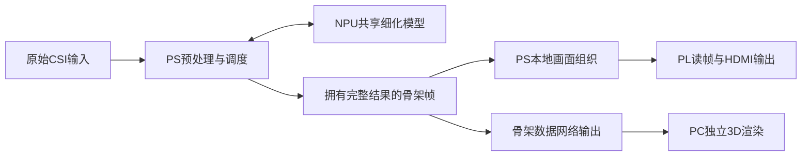

# ADR_49：PS／NPU感知、PL HDMI与PC独立3D展示

决定日期：2026-10-17；实施状态更新：2026-10-18。**架构已批准，HDMI三窗新推理有界闭环已通过；启动稳定性未解决，开发与上板当前整体暂停。**

后续执行已完成PS原骨架绘图→RGB565→PL读帧／扫描、动态图案、历史骨架回放和r13三窗新推理，用户确认切换正常。新HDMI应用未启动VPU／RTSP，旧演示保留。PC独立分支已完成历史真实结果的本机TCP／3D回放，板端实时发布与双路并发尚未联合验收。[HDMI实现](../FPGA/hdmi_candidate/INTEGRATION.md)、[PC实现](../software/pc_viewer/README.md)、[当前暂停汇报](../FPGA/hdmi_candidate/STARTUP-PAUSE-REPORT-20261018.md)。

本ADR保留原决定、取舍与讨论依据；第7节明确为最初归档时的历史事实，不能覆盖上述后续验证。原时序／数值门禁和未批准扩展保持。

## 1. 用户决定与适用范围

用户明确确认：

> 我同意你的方案：PS＋NPU负责感知，PL负责本地HDMI实时输出，PC负责高质量3D展示；正式主链停用VPU编码与RTSP。请你先将当前的讨论进行记录。

新目标保留两路输出，调整为：**板端HDMI本地输出＋骨架数据网络输出后由PC独立渲染**。本决策取代[ADR_00](ADR_00.md)中以VPU H.264／RTSP作为正式第二路输出的目标；旧演示、视频验证、源码和失败证据继续保留，不能把已批准目标写成已经完成的工程切换。

2026-10-17最初直接授权仅为讨论归档，随后用户明确要求HDMI接入和打通新推理全链路，已在该范围实际实施。当前则在r20后按用户要求整体暂停；本次仅做文档整理，不恢复工程负载。旧DATA调查独立保持暂停。

## 2. 背景与取舍

此前方案为VPU编码网络输出＋HDMI。用户观看VPU输出后认为现有画面粗糙、现场展示表现力不足，希望板端输出骨架数据，在PC实现接近[RuView](https://github.com/ruvnet/RuView)的展示效果。

现有显示程序在PS上绘制固定视角的720p线条、关节点和文字，随后编码。画面表现受到原始渲染方式限制；本轮没有原始帧与解码帧的画质对照，不能认定粗糙完全由VPU编码造成，也不能认定VPU本身无法输出高质量视频。

独立传输姿态坐标可让PC重新构建3D场景、材质和相机视角。14关节、每关节3个FP32坐标的本体为168字节／人／次，不含头部、分数和序列化开销；这是格式计算，不是实际网络性能测试。正式网络展示不再需要板端生成、编码并传送预绘制视频。

预期收益是提高展示可塑性、减少主链对VPU连续页分配及视频传输链的依赖；成本是新增骨架传输接口和PC展示程序，主展示依赖PC图形能力。去掉VPU不自动解决模型长尾或旧DATA异常，也没有新整机性能通过结论。

## 3. 已确认的硬件与软件分工

| 单元 | 确认的职责 | 边界 |
|---|---|---|
| PS | CSI接收、预处理、混合推理调度、必要Host算子、候选选择、结果发布及本地HDMI画面组织 | 保持资源拥有、线程归属与错误传播；本次不改变数学或CPU注册 |
| NPU | 共享细化图中分配给ZG的网络计算 | 固定共享模型已用于r13三窗新推理；不改变既有模型／RAW、NPU分配或数值门禁 |
| PL | 本地HDMI实时输出：独立时钟、AXI读帧、跨域FIFO、扫描、TMDS、换帧及安全停止 | 色条、DDR骨架、换帧／STOP及三窗联动已通过；跨启动稳定性与长期未验收 |
| PC | 接收板端骨架数据，独立完成高质量3D渲染、交互视角及展示面板 | 已有历史真实结果本机TCP／3D回放；板端实时接入未验，不用动画／参考值替换推理 |
| VPU／RTSP | 从未来正式主链停用 | 新HDMI应用未启动VPU／RTSP；旧演示保留，不表示已全仓库清理依赖或卸载驱动／SDK |

目标数据流如下；板端三窗HDMI和PC历史回放已分别验证，两个输出的实时联合路径尚未完成：

两路应可追溯至同一份实际推理结果和帧号。新HDMI编排位于`software/hdmi_demo`，复用`software/core`显示与推理能力，导出副本用显式同Device回调接入；不跨模块包含`.cpp`、访问私有状态或传递借用的SDK地址。旧`software/demo`的VPU启动依赖仍作为历史演示保留，新HDMI入口独立创建Engine并管理显示生命周期。

## 4. 对比赛异构要求的判断

本轮讨论核对了[复旦微选题指南](../CompetitionDescription/全国大学生嵌入式芯片与系统设计竞赛'2026FPGA赛道选题指南-复旦微.pdf)PDF第5—7页：要求明确CPU／NPU／FPGA分工、至少一种AI部署、至少一项FPGA开发及端到端闭环；视频接口、接口适配和实时控制属于允许内容，没有将VPU编码列为必选项。评分还关注资源、时序、集成、稳定性及软件／FPGA性能对比。

**架构判断：PS＋NPU感知、PL本地显示、PC独立展示符合上述异构协同方向，取消VPU不会因少用一种硬件而自动失去该方向的合理性。** 这是基于本地指南的分析，不是组委会认定或最终得分保证。现有证据不足以宣布全部要求已完整验收。

PL贡献应通过实际骨架显示闭环证明：真实DDR帧读取、来源／帧ID映射、换帧、带在途读STOP及安全释放，并量化像素吞吐、带宽、资源、时序和PS开销。1080p60扫描刷新率不能当作AI新姿态更新率。现有r13已提供三窗动态闭环证据；1080p60配置、资源或有限画面通过仍不代替跨启动稳定性、长期和性能对比验收。

## 5. PC展示方向、数据边界与待定接口

RuView的[Observatory](https://ruvnet.github.io/RuView/)及[源页面](https://github.com/ruvnet/RuView/blob/main/ui/observatory.html)将Three.js展示与数据源分开，支持演示生成器／WebSocket选择、骨架光晕、轨迹和场景参数。[官方说明](https://github.com/ruvnet/RuView/blob/main/docs/user-guide.md)及[演示库](https://ruvnet.github.io/RuView/three.js/)区分了不同数据和演示模式，部分展示涉及摄像头融合。这里借鉴展示组织方式，不继承其模型、采集配置或能力结论。

讨论中的展示建议是深色3D场景、立体骨架／关节、适度光晕与轨迹、地面网格、交互相机，以及PS／NPU／PL状态面板；这些细节尚未形成逐项实施规格或固定验收指标。当前仅确认高质量PC独立展示的方向。

- 保留本项目14关节语义，不直接套用17关节或其它拓扑。人物网格／补充关节若由渲染构造，应与实际模型输出区分。
- 当前坐标与真实房间坐标的标定仍需核实；房间、家具与无线波纹只能作为明确的示意背景，不能称为已重建的环境或实测传播场。
- 尚无心率数据或相关验收，心率／呼吸／健康面板不作为本次已实现能力。真实采集设备、时间戳和采样率问题继续保留。
- 原始骨架与展示用平滑／插值应分开，后者不能改变保存原值或数值门检；渲染FPS、新姿态率、端到端延迟和数据年龄分别统计。2Hz回放不会因60FPS渲染获得额外动作信息。
- 最初讨论时网络协议与schema未定。后续PC独立分支已实现14关节记录、TCP到Node／WebSocket及Three.js历史回放，具体格式与过期显示见[PC说明](../software/pc_viewer/README.md)；板端实时发布、时间对应及双路背压仍须独立接入和验证，不从本ADR宣告已完成。
- PC接收选中姿态不等于板端可以丢弃完整输出；保存优先及全部输入／分数／姿态证据规则保持。现行[ADR_48 v2](ADR_48.md)数值契约不变，score门检阈值不自动成为发布或人数判定策略。
- 若后续复用第三方代码或素材，须核对对应版本和具体许可、保留来源；本轮没有下载、集成或部署RuView。

## 6. 仅讨论、未批准实施的扩展

可以考虑PL骨架绘制／叠加：PS提交投影后的关节或绘图命令，PL生成线段和关节点并接入HDMI。它便于设计同等画面的PS／PL对照，但14关节负载小，收益必须实测，当前不承诺加速比，也没有批准新增RTL。

取消VPU后，RGB→NV12加速失去本方案主链用途，不作为当前必做任务。CSI预处理或TopK迁入PL仍是候选；心率功能仍缺真实数据依据。用户认可本ADR的主架构，不等于一并批准这些扩展。

## 7. 2026-10-17最初归档时的状态（历史）

| 项目 | 归档时的事实 |
|---|---|
| 原演示 | 旧图、VPU／RTSP的有界演示已完成；现行源代码仍是该路径，本轮没有停用或替换 |
| 共享模型 | 三冻结来源的独立30分钟／62,945次串行数值与内存观察通过；D41长尾未解，正式新链路未接入 |
| HDMI | 最后实际板测日期2026-10-16，静态八色条通过；DDR读帧、翻帧、STOP和推理并发未验 |
| 板端身份 | 上次封存确认启动文件原BOOT已恢复、运行PL仍为候选；本轮无新实板读取，不永久假设该状态 |
| 其它问题 | D25旧DATA继续暂停；D43 FAT来源未明、未修复；新方案不构成这些问题已解决的证明 |
| 本轮实际操作 | Windows本地文档编辑、链接／内容／SHA核对；没有EDA、板端连接、部署或后台任务 |

该表是原决定建立时的快照；后续结果见文首与当前进度，不将原“尚未接入”继续当作现状。当前恢复须用户明确唤醒，新增BOOT／重启与HDMI长期验证按具体范围确认；原BOOT／SDK／模型保护、帧资源生命周期和停止规则保持。

## 8. 证据与修订追溯

关联：[项目总览](../PROJECT-PROGRESS.md)、[核心接口](../software/core/INTERFACES.md)、[FPGA交接](../FPGA/FPGA-WORK-SUMMARY-20261016.md)、[10月15日讨论历史](../ARCHITECTURE-DISCUSSION-20261015.md)。

原架构证据入口`tools/pose-v1/evidence/architecture-output-20261017-r1`已不在当前树，本次不将它继续列为可读链接；原决定和讨论正文保留。2026-10-18仅将同一决定的后续实施状态同步到本ADR，修订前原文见[文档迁移记录](../tools/pose-v1/evidence/hdmi-documents-20261018-r1/revision.json)及before.tar；不新建无关ADR，不回写旧清单或借文档整理新增验收。
