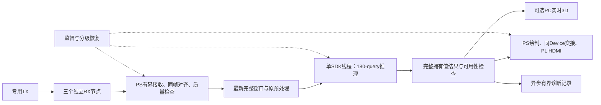

# ADR_50：端到端演示优先、有界缓存与分级自动恢复

**实施状态入口（2026-10-29）：** 本文保留方案／决策及各阶段原始结果；当前已实现内容、默认配置和实际交付见[项目进度](../PROJECT-PROGRESS.md)。历史计划、预算和“尚未”不代表后续成果未完成，独立暂停与安全条件保持。

日期：2026-10-25。状态：**已批准并实施；常驻核心、源端守护、有界日志及PC独立展示已投入实测。r5完成RX恢复与PC离线验证；r6完成持续TX续期和新版HDMI验证；r7完成更早窗口恢复实测并回退关闭，卡顿缩短但缺窗仍保留；现场黑屏／闪屏已按用户确认的显示规格限制移出故障清单。** 当前实现见[TechDetails](TechDetails.md)，最新软件、见证核查及恢复唯一见[r8／r9记录](../software/pose180_pipeline/resident/PHASE-TRACKING.md)（离线通过，r9仍在SDK前因见证差异及原生bit79拒绝，未验证实机改善）；r7实际结果见[r7记录](../software/pose180_pipeline/resident/WINDOW-RECOVERY.md)，r5／r4原值保留；问题1继续搁置。

本决策延续[ADR_49](ADR_49.md)的PS／NPU感知、PL HDMI和PC独立3D分工，调整运行调度、缓存、记录、容错及验收优先级。它取代旧计划中以零丢帧、PC逐帧归档确认、严格30Hz或全部问题关闭作为新演示推进前提的要求。历史验证结果与旧严格验证入口保留；实际状态见[项目总览](../PROJECT-PROGRESS.md)，执行顺序见[待办](../ToDoLists.md)。

## 1. 用户决定与最高目标

用户先明确：

> 一切目标以系统长时稳定运行为目标，可以容忍跳帧缺帧的小瑕疵，务必要实现端到端的演示系统。

随后批准本次方案并要求记录：

> 同意你的方案，请你先记录本次改动、项目架构调整，同时将实现完整的系统端到端演示作为最高优先级，其它的只要是不会触及到板子硬件损坏的问题通通忽略（记录进相关规范）

用户在记录过程中进一步明确：

> 无需严格30Hz，一切以完成搭建端到端的演示系统为最高优先级

据此，项目最高优先级为**可长时运行、可处理常见中断的完整端到端演示**。非硬件安全问题原则上忽略其阻断资格，记录后继续，优先采用跳帧、降级、局部隔离或有界恢复；不要求先修完所有历史问题。仍影响真实输入到实际新推理和显示的功能缺口，作为演示必需工作解决，不以进程存活或旧画面重复代替闭环。

缺帧、短时卡顿、有限数值偏差、严格实时指标未达、记录不完整及外观瑕疵不单独终止整套演示，也不重复请示。原值、精度与性能结论如实保留，不把忽略阻断写成已经通过；不伪造输入、结果或持续更新。已有重要资料和历史故障包不删除、覆盖。

## 2. 调整依据

- [现有主链](../software/pose180_pipeline/src/app/strict_main.cpp)等待PC归档ACK后才交接HDMI，记录或网络错误沿共享异常通道结束任务；[10月25日实测](../software/pose180_pipeline/RESULTS.md)已经出现归档回调1,019.7889ms触发全链保护。NVMe修正仍有验证价值，但不能代替解除运行依赖。
- 固定输入／结果池与HDMI双缓冲所有权已有实现，应复用；现有FIFO和过期即退出策略不适合以新鲜结果为主的演示。
- [直采候选](../tools/nexmon/board/README.md)只支持单次有界任务，满队列丢新窗、拒绝重连，并保留整批事件／网格／窗口；不能通过单纯放大次数和超时变成常驻系统。
- 180-query已有秒级正常返回长尾，D45共享HP2启动问题仍开放；超时、进程退出、检查器清零均不能证明设备事务已结束。

## 3. 目标架构与最小接口

正式采集／推理／本地显示不依赖PC在线、PC回执或PC磁盘。PC保留独立展示和开发诊断角色；其断开不影响板端主链。VPU／RTSP及原100-query验证代码保留为历史分支，不作为本次交付依赖。

复用180-query迁移最佳epoch99、原预处理、原厂SDK和AI四路连接；不因本次运行架构调整重训模型、改数学或迁移工具。接收／整理、CPU绘图、记录与网络模块只交换拥有值，不借用SDK地址。唯一SDK拥有线程串行执行模型、设备写帧与CSR操作；监督器不并发访问同一设备。

内部明确区分采集会话代次、源窗口编号、实际推理编号、结果产生时刻、显示采纳编号及有效状态；跳窗后不要求源窗口编号与推理次数相等。网络适配优先复用现有协议；若既有语义不能表达断线与代次，先明确最小版本化契约，不暗改旧解析器。源采样时刻、板端到达时刻、处理时刻分别保留，不用跨机未同步墙钟推算延迟。

## 4. 缓存、过载与记录

| 环节 | 已批准的设计方向 | 不可破坏的资源边界 |
|---|---|---|
| 三路采集与对齐 | 按时间、事件数和字节数设固定上限；淘汰已消费历史；缺失／超差窗口丢弃后继续 | 不混合不同代次，不用旧节点数据补齐，不以到达顺序冒充同一无线事件 |
| 推理入口 | 初始采用正在执行1窗＋最新待处理1窗；新完整窗可替换尚未执行的旧窗，过期窗丢弃 | SDK正在使用的输入不得覆盖；不通过增加并发Runtime追赶积压 |
| 推理结果 | 完整不可变拥有值；各消费者独立取得最新可用结果，限制其持有时间和容量 | 慢消费者不得占满推理池；被使用对象不得强制回收 |
| HDMI | 保留同Device双缓冲；只跳过尚未提交的显示帧 | 当前／待采纳帧不得覆盖；采纳、STOP排空及实际地址身份仍需证明 |
| PC输出 | 异步、可断开、可重连，慢客户端跳过旧结果 | 不反向阻塞采集／推理／本地显示；重新连接只发布明确代次的数据 |
| 诊断记录 | 固定容量近期完整输入／输出环、常规统计、分段轮转；故障冻结相关原值 | 日志写入不能卡住设备控制；故障资料独立保护，内存和磁盘预算明确 |

分离两种运行用途，使用共同的数学与设备核心：

- **演示模式：**新鲜结果优先，允许跳帧和常规记录缺口；保存失败、磁盘满或PC回执异常仅影响记录／客户端。诊断环容量固定，转储失败如实标记，不声称已持久化。
- **验证模式：**保留既有有界输入、完整首次原值、严格数值／逐帧性能比较及失败停止策略，按该次具体验证目标使用。验证门未达不自动成为演示模式退出条件。

以PIWFUL3每条74,544字节计算，30Hz完整记录约8.05GB／小时，尚不含原始CSI与其它日志；永久全量落盘不作为常驻必需能力。新记录策略只适用于新运行数据，不清理历史实验资料。

## 5. 自动恢复与硬件边界

状态至少区分初始化、运行、降级／等待输入、重新同步、恢复中及故障隔离。监督依据最后有效输入、推理实际完成、HDMI实际采纳、队列年龄和资源占用，不能只看进程心跳。

| 情形 | 默认处理 | 恢复依据 |
|---|---|---|
| 缺包、坏窗、输入过期、队列满 | 丢弃受影响整窗，计数后继续 | 新鲜完整窗口，不补造缺失采样 |
| RX断线／时钟连续性丢失 | 清除该失效代次的组窗状态，退避重连，重新建立三节点共同关联 | 身份、时钟连续性与同帧关联重新成立；处理TCP积压，不把旧流当新数据 |
| PC断线／慢客户端、常规记录停顿 | 局部断开、跳过旧结果或暂停记录 | 客户端／存储恢复后重新接入，板端主链保持运行 |
| 推理调用变慢但尚未失败 | 丢弃待处理旧输入，标记结果过期，监测原调用 | 原调用实际完成；不能仅因1秒无结果杀进程或另开SDK |
| 非有限输出、非法索引、身份不符 | 不发布该结果，保存相关原值并隔离影响范围 | 先辨识是可丢弃数据还是设备／资源状态失效；安全条件已知时有界恢复，不强求先完成全部根因研究 |
| SDK失败、设备通路异常、OOM | 保全现场、停止受影响负载，保留不受影响的状态展示／控制 | 仅在已证明停止、资源释放与独占重建契约后恢复；实际资源压力先解除 |
| HDMI故障 | 停止提交新帧，按原STOP流程处理 | 排空与帧归属证明成立后再恢复；共享HP2异常不能假定只影响显示 |

恢复采用退避、单实例和次数／时间预算；失败预算用尽进入明确故障隔离状态，不能无限重启、重复加载或累积资源。明确失败的SDK调用不盲目重试；纯网络、记录和未触及设备的组件可独立恢复。进程退出或超时不证明DMA／PL事务已完成，不能据此释放仍可能被硬件访问的内存。

硬件安全优先于演示：目标器件、电气连接、IO电压、供电／温度、设备地址与所有权、在途DMA及HDMI帧释放等必须受控；未证明无风险的硬件状态不能直接归入“可忽略”。优先复用r45合格位流与原工具路线，既有两项AI时序例外如实保留，不新增未经评估的频率、时序／DRC豁免或器件库变更，不为报表好看修改实际结论。

SDK阻塞时现有PL可以继续扫描旧画面，但PS不能保证及时刷新过期提示；独立PL超时指示仍是待评估的RTL候选，不在本轮宣称实现。缺少硬件安全恢复契约时先隔离相关功能，明确报告剩余阻塞，不能承诺任意故障都能自动恢复。

## 6. 优先级与验收

后续顺序为常驻运行核心与故障隔离→可控输入故障注入→实板持续HDMI→真实CSI直连→联合长时及恢复演示。回放只能证明中间集成，最终完整系统必须包含真实采集、实际新推理和本地显示，PC可独立加入／退出。

**严格30Hz不再是本次演示的目标、前置条件或验收门槛，也不列为必须补做的优化任务。** 帧率记录实际表现；旧30Hz测试原值保留，不能据旧失败阻断新系统。零丢帧、全部300Hz窗口通过、D48精度优化、逐帧全量归档、界面细节及独立扩展均降为观测或后续优化，不再作为主链推进前置。动作／求助、心率、训练旁支与旧问题全面根因研究不占关键路径；只处理会阻断本次真实演示的部分。

保留既有单窗质量与身份检查，允许丢弃不合格窗后继续；三节点幅度／相位适配和真实人体效果如实报告，不将格式符合写成精度验收。300Hz／20点非重叠组窗理论上限15新窗／秒，采样率、有效窗口率、实际新推理率和HDMI扫描刷新率分别报告。

完成证据关注：有效输入下持续的新结果、数据年龄和最长无更新时段；跳帧及恢复计数；持续实屏；PC断线／慢客户端／记录故障隔离；RX重连后的新代次恢复；内存、句柄、线程和磁盘占用有界。长期时长与恢复预算在具体运行前确定，软件模拟不代替设备验收，进程长期存活不代替有效输出。允许丢帧不等于允许无限停滞，剩余功能失效必须明确呈现。

## 7. 本次执行范围

本次批准已覆盖上述架构和策略方向，后续不为同一软件设计重复请求批准。用户最初要求“先记录”，随后明确要求实施，先后完成r3有界HDMI及[r4联合实测](../software/pose180_pipeline/resident/LONG-VALIDATION.md)。用户又批准局部重同步、协调退避、TX衔接和等待提示，继而要求接入PC渲染并开启长测，确认r5的1候选／最多1 SDK／30分钟／1原BOOT回退及现场配合范围。r5已执行、回退并关闭，实际结果及额度唯一见[r5记录](../software/pose180_pipeline/resident/STUTTER-VALIDATION.md)。问题1继续搁置，本轮结束不新增下一包额度。

用户随后批准TX“持续任务＋定期续期”的实现、离线验证和新包准备，又明确授权r6按1候选／最多1 SDK／10分钟／1原BOOT回退执行，并确认现场观察。该范围已完成并关闭，全部余额0；同一TX任务续期和新版HDMI确认，组窗缺失后的停顿仍需处理。接口、原始实测与恢复状态见[r6记录](../software/pose180_pipeline/resident/TX-LEASE.md)，不从本次完成推导新包启动额度。

用户同意继续优化r6暴露的共同窗口缺口和恢复等待；[r7](../software/pose180_pipeline/resident/WINDOW-RECOVERY.md)已完成有界窗口诊断、独立诊断日志及更早软恢复，离线回归、ARM64编译和新包准备通过。原完整窗口与数学契约保持；该阶段仅软件准备，随后的自主板测授权与实际执行见下段。

用户随后明确授权：只要验证需要，代理即可自主上板，无需再次询问。必要部署、BOOT、重启、SDK及回退由代理按最小必要范围安排，记录本批次数和恢复状态；旧包仍关闭，硬件安全及独立暂停边界保持。完整现行规则见[Agents.md](../Agents.md#自主权限与重大问题)，覆盖此前逐包询问上板的要求。r7依此完成600秒运行期并回退关闭，实际有效结果覆盖及显示器上电恢复的限制统一见[r7记录](../software/pose180_pipeline/resident/WINDOW-RECOVERY.md)。

旧包继续关闭，不复活历史次数；后续设备执行使用新的明确范围与恢复方案。本次记录不解除旧DATA及D45全面根因调查的独立暂停，也不安排后台续跑。必要的硬件安全处置和尚未包含在批准方案中的重大变化，先给出具体影响及恢复条件；普通可逆问题自主处理，不以文档、重复审查或历史完美指标阻断演示开发。
