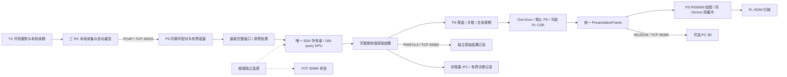

# Wi-Fi 人体三维姿态项目技术实现汇报

状态整理：2026-10-27。现行架构按[ADR_49](ADR_49.md)与[ADR_50](ADR_50.md)：**真实三 RX CSI 直达 Lite，PS 预处理、NPU 运行 180-query 模型，PS 后处理／绘图、PL 本地 HDMI；PC 独立消费派生结果。** 本文描述当前源码与接口，功能实现、候选验证和实际运行版本分别认定。最近实板使用 v3 后处理；当前 v4 源码已完成离线和 PS 回放，尚未用于新实时推理。版本与最后恢复状态见[RESUME](../FPGA/hdmi_candidate/RESUME.md)。

| 文档职责 | 维护位置 |
|---|---|
| 当前模块、接口、缓存与生命周期 | 本文现行实现部分；[常驻核心](../software/pose180_pipeline/resident/README.md) |
| 展示、v4 回放、PS／PL 测时与最新集成位流 | [PRESENTATION-20261026.md](../software/pose180_pipeline/resident/PRESENTATION-20261026.md) |
| CSI 恢复与历史实测 | [窗口恢复](../software/pose180_pipeline/resident/WINDOW-RECOVERY.md)、[相位跟踪](../software/pose180_pipeline/resident/PHASE-TRACKING.md)、[PC 独立显示](../software/pose180_pipeline/resident/STUTTER-VALIDATION.md) |
| 模型与数值误差 | [模型状态](../tools/pose180/STATUS.md)、[部署结果](../tools/pose180/deploy/RESULTS.md) |
| HDMI 所有权、启动消费与硬件保护边界 | [INTEGRATION.md](../FPGA/hdmi_candidate/INTEGRATION.md)、[保留消费候选](../FPGA/hdmi_candidate/probe_free_drain/README.md)、[独立守卫离线结果](../FPGA/hdmi_candidate/pose_stabilizer/README.md) |
| 执行规则、问题与后续顺序 | [Agents.md](../Agents.md)、[DIFFICULTIES.md](../DIFFICULTIES.md)、[ToDoLists.md](../ToDoLists.md) |

## 现行实现：设备分工与端到端数据流

TX 四个 LAN 口分别接开发板、RX1、RX2、RX3；PC 接 RX 空闲 LAN 作开发观察，不转发 CSI、不驱动采集心跳、不回传显示许可。RX1／TX／RX2／RX3 管理地址为 `.50.1/.50.2/.50.3/.50.4`；板端运行包配置 `.50.49/24`，管理保留 `.126.49`。已安装的[路由器开机服务](../software/pose180_pipeline/resident/autostart/README.md)与旧有限包无线 load／guard 互斥，不改变 LAN／DHCP，也不自动启动板端 SDK。

平台为悟净 Lite／JFMQL30TAI676H、ARM64 Linux、Icraft 3.39.0／ZG330。r45 完整诊断基线保留；其独立派生版本分别提供“去旁路诊断、保留主动消费”和“再加 4 路滤波”。后者已完成物理资格和有限板测，实际 GP 时钟为 **100 MHz**，没有新增时钟、DMA 主机或 HP 通路。独立精简守卫仍未取得部署资格，不能与已测消费候选混称。AI 四路、HP 分配及既有两项 AI 时序例外范围保持；VPU／RTSP／旧 100-query 为历史路径。

## 现行实现：模块和接口

| 模块 | 实现入口与职责 |
|---|---|
| 源端采集与开机服务 | [router_guard.c](../software/pose180_pipeline/resident/router_guard.c)、[router_ctl.sh](../software/pose180_pipeline/resident/router_ctl.sh)、[autostart](../software/pose180_pipeline/resident/autostart/README.md)：TX 本机续期、RX 捕获／有界发送／重连，不依赖 PC |
| CSI 与常驻编排 | [csi.cpp](../software/pose180_pipeline/resident/csi.cpp)、[ingress.cpp](../tools/nexmon/board/ingress.cpp)、[main.cpp](../software/pose180_pipeline/resident/main.cpp)、[core.hpp](../software/pose180_pipeline/resident/core.hpp)：解析、共同窗口、代次隔离、唯一 SDK 所有者和最新值调度 |
| 数学与推理 | [preprocess.cpp](../software/core/input/preprocess.cpp)、[runtime.cpp](../software/pose180_pipeline/board/runtime.cpp)：原预处理、180-query 图、公开 SDK 输出读回 |
| 人物后处理 | [postprocess.cpp](../software/core/pose/postprocess.cpp)、[postprocess.hpp](../software/core/pose/postprocess.hpp)：SDK 无关核心，实时与回放共用；筛选、去重／关联、异常门限、生命周期与滤波 |
| 可选 PL 滤波 | [pl_filter.hpp](../software/core/pose/pl_filter.hpp)、[RTL／集成入口](../FPGA/hdmi_candidate/pose_stabilizer/README.md)：匹配 profile 后显式启用，只处理已关联坐标，不承担人物选择 |
| 本地显示 | [hdmi_renderer.cpp](../software/core/display/hdmi_renderer.cpp)、[hdmi_output.cpp](../FPGA/hdmi_candidate/diagnostics/native_rgb565_r53/display/hdmi_output.cpp)：CPU RGB565、同 Device 帧分配、采纳和 STOP 证明 |
| PC 与网络 | [io.cpp](../software/pose180_pipeline/resident/io.cpp)、[resident.mjs](../software/pose180_pipeline/host/resident.mjs)、[presentation.mjs](../software/pose180_pipeline/host/presentation.mjs)：原始／派生订阅、最新值缓存与断线恢复，无 ACK |
| 记录与监督 | [journal.cpp](../software/pose180_pipeline/resident/journal.cpp)、[bounded_log.py](../software/pose180_pipeline/resident/bounded_log.py)、[service.py](../software/pose180_pipeline/resident/service.py)：异步有界记录、单实例、资源观察、安全退出 |
| 离线复现与计时 | [pose_replay.cpp](../software/pose180_pipeline/resident/pose_replay.cpp)、[filter_benchmark.cpp](../software/pose180_pipeline/resident/filter_benchmark.cpp)：同源历史回放与纯滤波／整体后处理分项 |

| 端口／窗口 | 契约 |
|---|---|
| TCP 39033 | 三 RX 的真实 PCAP 输入 |
| TCP 39382 | 旧 PIWCSI2 完整窗口适配；真实 CSI 模式关闭，两种输入不能同时驱动主链 |
| TCP 39383 | 原始 PIWFUL3/v3，74,544 字节／条，原字段与全部 180 候选保留 |
| TCP 39385 | 派生 PIWVIEW1/version=1 NDJSON，单条上限 16 KiB、最新值缓存、无 ACK |
| TCP 39384 | 一次 JSON 状态；读取不访问 NPU／HDMI 设备 |
| HTTP 127.0.0.1:39380 | 可选 PC 观察页面，默认消费派生通道；历史回放明确标识 |
| CSR 0x400b1000–0x400b1fff | 新匹配硬件的滤波 ABI，完整输入提交、序号、忙／完成／错误与输出；r45 不访问此窗口 |

PIWFUL3 包含 128 字节头、256 字节选中结果、43,200 字节 tokens、720 字节分数和 30,240 字节姿态。两类结果通道各自保持正在发送记录完整，随后只保留最新待发值；慢客户端局部断开，不反压主链。PresentationFrame 携带源会话／代次／序号／时间、稳定人物 ID、源候选、分数、坐标、暂失状态及末次有效观测时间，附原始 Top3 供诊断。主界面已取消并排对照和多余统计，原始数据与诊断入口仍保留。

## 现行实现：CSI、模型与后处理契约

三 RX 对齐同一无线事件，再按 3 RX×3 天线×30 载波×20 时间点组窗。300 Hz／20 点非重叠步进的理想输入为 15 窗／秒，不是实测吞吐承诺；缺失窗不补造。原复数 CSI 预处理输出 float32 `[1,180,60]`，幅度、相位、token 排列保持。采集时钟与板端单调时钟分开，未同步墙钟不用来计算端到端延迟。

模型为 180-query 迁移最佳 epoch99，输出 `[1,180]` 分数及 `[1,180,14,3]` 姿态，不含旧 100-query 图的 TopK／GatherElements／ScatterND Host 节点与内部读桥。Runtime 保留单 Session、固定输入、公开 SDK 等待与首次读回；正常帧按既有边界调用 `reset(1)`，这不是失败 SDK 的自动重建。设备、写帧及 CSR 仅由同一线程拥有，不能把 ADDR／BOTH 当普通 Linux 指针。

后处理保持 **Top3 → 严格 score > 0.2 → 人物级去重／关联与异常拒绝 → One Euro → 展示状态**；不从第四名补位，不改原始结果。v4 保留完整合格 Top3 供历史连续性选择，优先已确认人物；从滤波中心预测并低通中心速度，增加弱相似目标延期与有见证的新旧身份交接。至多 3 条确认及 3 条待确认，默认连续三次确认、250 ms 显示／身份上限；暂失不外推、不续写有效观测时间，跨会话／恢复代次或时间倒退清空。参数及启发式取舍见[最新候选记录](../software/pose180_pipeline/resident/PRESENTATION-20261026.md#2026-10-27v4-人物级时序去重及-ps-回放验证)，不能把启发式身份当作真实人物真值。

坐标 One Euro 默认 `min_cutoff=1 Hz, beta=0.5, d_cutoff=1 Hz`，首次确认初始化；不修骨长、不显示插帧。PS 默认浮点；可选 PL 为 Q16.16、同序运算与饱和，1／4 路共用 RTL，按坐标模 4 分银行，整帧完成才发布。人物关联、门控和生命周期始终在 PS。当前 CSR 总开销超过 CPU 滤波，不能据硬件纯计算周期宣称端到端加速。

## 现行实现：展示与所有权

HDMI 使用 1920×1080 RGB565，同 Device 两帧各 4,147,200 字节；写空闲帧，经地址／ID／pending 证明采纳才复用旧帧。保留 200 ms 采纳和 500 ms tagged STOP／排空契约，不覆盖或提前释放在途帧。固定透视与模型单位保持，不随人物自动缩放、不视作物理标定。

HDMI 保留标题、状态、帧号与骨架／地面；PC 另有透视／正面／侧面／俯视四按钮及拖动操作。所有骨架／关节统一蓝色 `#3b9dff`，包括暂失；正常鼠标指针保留，固定黑箭头不属于场景内容。PC 只显示最新完整派生结果，失联／到期清空相应姿态；历史回放有明确身份，不计作新推理。

250 ms 是算法的末次有效姿态上限。HDMI 到期重绘仍由 SDK 所有者执行，**SDK 阻塞时不能保证屏幕严格按时清除**；状态有效期和实际扫描画面分别认定。旧原始展示的 750 ms 等待／2 秒过期提示不作为派生姿态继续显示的许可。用户暂停的姿态偏置／标定仍独立保留，当前人物级重影／突跳属于后续明确授权的后处理工作。

## 现行实现：缓存、背压和日志上限

| 环节 | 固定资源与实际处理 |
|---|---|
| 每RX接收 | 守护最多64KiB待发送；500ms无发送进展丢弃该连接积压。板端PCAP解析缓存最多65,551字节 |
| CSI历史 | 每RX最多2,048事件、1,600格和4秒历史；整理器最多32个待取窗口，持续淘汰已消费历史 |
| 推理输入 | 正在执行1窗＋最新待处理1窗，完整拥有值；仅替换未执行窗口。默认500ms过期，跨输入代次也丢弃；已返回但过期的真实推理仍计数，不用于新鲜显示 |
| PC结果 | 当前发送1条＋最新待发1条；发送一条累计超过500ms仍未完成则断开慢客户端；不等PC归档或ACK |
| 主进程诊断 | 8条完整PIWFUL3近期环，约596KB；非阻塞SEQPACKET向独立记录进程提交，满则丢弃并计数 |
| CSI恢复诊断 | 最多16条、每条1024字节，满则淘汰旧事件并计入`diagnostic_dropped`；设备线程每秒取走交给异步记录子进程。保留原始故障字段；r7每5秒及清除代次前增加窗口拒绝原因、各RX缺点／越限点、残差、事件对应与节点快照，诊断不参与选点 |
| CSI诊断磁盘环 | r7独立`diagnostic-0/1.jsonl`各最多256KiB，共512KiB，按整行轮换；不再跟随每64条完整结果轮换。写入失败独立退避5秒，不阻断正常结果写入；共享非阻塞IPC拥塞仍可丢弃 |
| 正常结果磁盘环 | 四段，每段最多64条完整记录与约256KiB文本（文本可越限一条记录），下一次写入前轮换；正常约20MiB量级。故障冻结仅提交近期环，落盘失败不宣称证据完整 |
| SDK stdout／stderr | 独立记录进程接非阻塞管道，四段×512KiB，共2MiB；记录端阻塞不反压设备线程。管道未接收的丢字节数未知 |
| 资源／源端日志 | 板端资源日志两段×256KiB，共512KiB；路由器日志轮换约两段×64KiB，捕获与TX状态各最多保留四代；原生完整日志上限不包括固定数量的初始化／内存核验文件 |
| PC归档 | 独立Worker，执行中1条＋最新待写1条，四段×64条；PC停顿、磁盘错误或离线不占用板端推理资源 |

内存与记录上限不是零丢帧承诺。`record_dropped`包含诊断文本及完整结果IPC提交失败，`pc_dropped`包含被替换或断开的结果；二者不能直接解释为NPU推理失败。严格逐帧归档与ACK主链继续留在历史入口，现行演示不继承其1秒全链停止条件。

## 现行实现：持续采集、分级恢复与退出

路由器开机模式将资产保存于JFFS，运行目录与日志只写`/tmp`；原KoolShare开机脚本保留。每次开机自动尝试一次，等无线接口及本机身份就绪后启动；TX保留60秒固件租约／10秒本机续期，RX等待板端TCP39033并自动重连。专用`continuous`标记和时长0允许常驻守护；持续管道捕获同时移除时间与包数结束条件，文件采集及旧有限包保持原预算。持久服务与旧包无线`load/start`互斥。启停、实际重启结果及异常处理边界统一见[开机服务记录](../software/pose180_pipeline/resident/autostart/README.md)。

RX守护每次连接创建新的捕获代次，连接结束后按2／4／8／16／30秒退避；流式捕获不再每16秒主动结束。r5将网络重连退避集中到RX，板端即时接收合法连接。配对／时钟失锁或2秒静默只清空共同组窗代次，保留三个TCP及各自PCAP解析器；实际断开、500ms采集年龄漂移、格式错误或10秒无字节时，仅关闭受影响RX。r7将运行中已产出过窗口的代次无有效窗阈值从10秒缩短为2秒；首次／重新学习代次保留5秒预算，原1秒校准不变。连续失败超过2次／5次，仅对组窗增加250ms／1秒冷却，其间继续排空数据，不拒收TCP。

失效瞬间递增`input_epoch`、清除待处理输入，使正在推理的旧代次结果也失去后续发布资格。重新对齐使用各RX采集水位和相对到达时钟选取新边界，舍弃积压，保留增量PCAP分帧；新Ingress验证来源／格式后跳过开头孤立的非core0记录，从完整core0事件重新学习三节点时钟关系。数据质量阈值、同事件检查和完整窗口真实性保持；r8仅在常驻模式增加下述未来网格相位跟踪。网络保留并不等于可以混用旧组窗状态。

以下 r4／r5 有限任务描述为开机服务之前的历史演进，后续运行优先使用上面的自启动服务。已实测的r4／r5使用300Hz、60秒有限任务续发，顺序为每轮`429配置 → 430启动 → 433读取原生状态 → 432释放`。r4最初仅在循环前配置，释放上下文后第二轮无法继续；修正每轮重配后完成多轮续发，原失败保留。

r5根据原生剩余计数，在预计末0.5秒将轮询等待从250ms缩至20ms；仍需433确认running=0、remaining=0且submitted>0后才能释放并开始下一有限任务。记录配置／启动／查询／停止及衔接耗时，异常保留原值并恢复原厂运行时；退出只释放一次上下文。真实间隙包含命令开销，20ms不是无线空档承诺。

用户随后批准持续任务＋定期续期。r6采用mode3：同一上下文保持绝对发送节拍，固件60秒租约由TX本机每10秒通过434续期，435核对token／seq／期限／状态；运行中不再每60秒释放重配。停止、过期、错身份及错误任务不能被续期复活，433原诊断兼容，mode2保留。固件跳槽有界、停止后才允许释放，RX／模型／SDK／RTL不变。已完成真实闭环实测，同一任务跨多轮续期、停止证明及释放成立；具体接口、计数和恢复身份见[r6记录](../software/pose180_pipeline/resident/TX-LEASE.md)。固件提交数不能单独证明空口零丢包，续期成功也不等于整体卡顿改善。

r6三RX连接保持，但仍出现共同有效窗口长期缺失；当时10秒无新共同窗才软重同步，再用约1秒重新学习。r7当时补齐固定大小的窗口诊断和2秒／5秒恢复阈值，原网格、同事件及完整窗口数学契约未放宽，也未引入自适应相位跟踪。残差以微秒×300记录，原点位限值250,000保持；拒绝原因可能重叠，不能相加作为拒绝窗口数。离线及r7实测均完成：六次2秒无窗触发前出现连续窗口拒绝，RX1越限点较多，采样残差超过原点位容差；更早重学将对应长间隔缩短。具体时序、计数与观察限制见[r7记录](../software/pose180_pipeline/resident/WINDOW-RECOVERY.md)。采集时钟偏差的物理来源仍未确认，不把缺窗解释成已确认的帧索引溢出。

r8常驻入口开启`track_clock`，严格有限模式关闭且禁止开启。每20格取合格原始点的残差中位数，要求至少16点在原833微秒容差内、块中位数不超约417微秒、中位绝对偏差不超200微秒；每RX只留最近15块，当前块及至少10块可信才估计绝对相位。每次修正四分之一误差、最大20微秒，仅移动未来格子，不回写已完成目标或槽号，不插值／补点；相位累计不取模。缺点、相位突变和不同事件仍拒绝，原分代恢复保留。新增累计修正、步长、块残差、更新／拒绝次数与可信槽数诊断，仍受原512KiB日志环约束。算法与离线／上板结果分开见[r8记录](../software/pose180_pipeline/resident/PHASE-TRACKING.md)，目前未取得真实CSI改善证据。

设备本地守护自行续租，独立看门狗观察租约并恢复原厂无线运行时；r8心跳改为临时文件写完后原子替换，空值／非数字最多延迟1秒复读一次，持续无效仍恢复并记录触发原值。r4采用运行中20秒失联租约、准备宽限300秒、总期限40分钟，源端任务另外限定33分钟。该 r4 历史包的修改位于 RAM 与运行时，当时未安装开机服务；后续持久化状态以上面的自启动记录为准。`start/status/stop`是独立本地控制，SSH断开不结束正常采集，PC断开不触发全链停止。

板端`service.py`脱离启动SSH，持有单实例锁并记录PID、创建时间和boot_id；一次启动标记防止并发SDK。监督每约0.5秒观察状态、RSS、句柄、线程及MemAvailable；停止请求、隔离、低于128MiB可用内存或具体包预算到达时，只向原进程请求安全停止。若SDK调用尚未返回，继续管理原调用，不强杀、不另开Runtime、不重复初始化。

| 事件 | 已实现动作与限制 |
|---|---|
| 旧输入、跳窗或输入代次变更 | 丢弃受影响输入，等待新鲜完整窗；正在执行的输入不覆盖 |
| RX失联／组窗连续性失效 | 清空失效共同组窗代次；软失锁保留TCP，仅故障RX重连，再重新建立新鲜共同窗；r5软件与RX1物理拔插实测已验证 |
| PC断开／慢客户端、诊断写入失败 | 局部丢弃／断开／记录退避，推理及HDMI继续 |
| SDK慢但尚未失败 | 待处理槽只留最新输入，状态可显示degraded，观察原调用；原调用占据SDK线程时不能保证HDMI提示及时重绘 |
| SDK异常、非法索引或非有限输出 | 保存首次原值并隔离，不发布该结果、不自动重开SDK，状态通道保留 |
| HDMI提交或设备通路异常 | 停止新的业务提交，遵守原STOP／排空和帧归属；不由进程退出推断硬件安全 |

正常退出依次停止输入线程、完成HDMI STOP／排空、释放显示帧和Runtime，然后写`completion.json`；监督同时检查原生退出码及设备占用，形成`outcome.json`。必要上板、BOOT及回退按用户最新自主板测授权执行，无需重复询问，仍记录每批范围和实际次数；r7已回退关闭，旧包不复活。D45及旧DATA的独立暂停保持。

## 当前验证结论与后续范围

常驻主链已有软件故障注入、真实 CSI／新推理／HDMI 有限联合验证、RX 局部恢复及 PC 物理离线仍更新的证据。去诊断保留消费与 4 路滤波派生硬件的物理资格、有限板测分别成立；独立精简守卫的部署资格仍未成立。最新 v4 仅完成本机／ARM64、同源回放和 PS 测时，未替换现场版本。

重影／跨 ID 突跳、秒级缺窗、长期无人值守与人体精度仍开放；运行中按 PL_KEY1 后黑屏失联样本没有被后续成功启动消除。CPU 为默认滤波后端，PL 作为已测实验后端。结果、限制与优先级分别见[最新实测](../software/pose180_pipeline/resident/PRESENTATION-20261026.md)、[问题索引](../DIFFICULTIES.md)和[下一步](../ToDoLists.md)。

完整诊断版本 r8／r9 的首 RVALID 见证差异与原生 RCAM_UNDERFLOW 保留在[原记录](../software/pose180_pipeline/resident/PHASE-TRACKING.md)。新硬件使用明确匹配的功能消费准入，不伪装旧寄存器或宣称完整 AXI 等价；未取得证据的保护仍不能记作通过。旧 DATA 与 D45 全面调查保持独立暂停。

心率为独立支线：PS 流式处理、可选 PL 自相关核及有限 RX1 实采已实现，但尚无可信真实心率、未接常驻主链、未做新整机实现，见[专项记录](../software/vitals/HYBRID-20261026.md)。

## 历史技术详录：2026-10-13及此前

以下保留旧100-query／VPU／RTSP演示的技术细节和原值，旧流程中的“当前”“本轮”“暂停”均指当时分支，不描述现行常驻HDMI实现。原源码位于[software/demo](../software/demo/README.md)，三／60窗口结果见[ADR_45](ADR_45.md)。旧数学和SDK资料只按原模型与实验范围引用，不能套用其模型、计数、缓冲或授权到当前180-query链。

### 历史演示源码入口及2026-10-13重构回归

当前演示只使用[正式核心](../software/core/README.md)中的input/inference/diagnostics/display/video/stream，应用编排仍在software/demo。原pose_v1文件及测试保留作历史依据；新旧文件/导出别名/哈希见迁移映射原路径`tools/pose-v1/evidence/core-refactor-20261013-r1/source-migration.json`（当前文件缺失）。公共接口、数学、协议、SDK与固定模型保持。

2026-10-13实际完成11组本机检查、旧实现/原参考字节对照及ARM构建；Lite CPU107的22输出/59600 FP32逐位通过。新三窗口308/309/310全CSI/预处理/分数/姿态逐位旧参考，354编码、294主机GUI解码，全3来源及42关节核验；正常drain/LAST、两STREAMOFF和所有权回收通过，规整0、BOOT/SDK/内核相同。具体范围见[ADR_47](ADR_47.md)。下文2026-10-11三/60窗口数据仍是原独立演示证据，不累加成新的样本精度或吞吐验收。

### 1. 系统组成与数据流

```mermaid
flowchart LR
  A[主机预采CSI MAT目录] --> B[原始float64窗口回放]
  B -->|PIWCSI1 / TCP 39001| C[Lite PS完整窗口接收]
  C --> D[PS相位校正与token预处理]
  D --> E[Icraft PS/NPU混合Session]
  E --> F[100分数与100×14×3姿态]
  F -->|拥有值 / Unix域IPC| G[独立显示子进程]
  G --> H[RGB骨架与NV12]
  H --> I[常驻VPU H.264编码]
  I -->|拥有AU / 有界通道| J[live555 RTSP]
  J -->|RTSP/RTP over TCP 8554| K[主机FFmpeg解码 / OpenCV实时显示]
```

本机负责数据文件读取、原始数据回放和视频显示。CSI预处理、模型推理、候选选择、骨架投影和VPU编码均在Lite。没有使用主机推理替代板端，也没有将数据集GT叠加为预测。HDMI不进入该历史VPU演示路径；后续独立HDMI应用见文首。

Lite使用ARM64 Linux/Icraft3.39.0、ZG330架构NPU与MVX VPU。FPAI是已存在的交叉编译容器名；C++使用GNU++17，数学构建保留`-ffp-contract=off`。Docker负责构建，不在容器中模拟物理NPU成功。

### 2. 预采CSI输入与实时回放

演示读取`D:/Person-in-WIFI-3D/Person-in-WiFi-3D-repo/data/wifipose/test_data/csi`。每份HDF5 MAT的`csi_out`是`[20,30,3,3]`，real/imag字段为float64。通过`transpose(3,2,1,0)`变为`[3 receiver,3 antenna,30 carrier,20 sample]`，保持原幅度与精度。

主机按文件名自然序读取，不读取keypoint文件。默认60窗口、2Hz，每个窗口20个时间样本；这模拟完整窗口到达，不宣称恢复原无线设备的真实采样时钟。源码调用既有公开`csi_io.load_mat/encode_window`，没有另写预处理或预测算法。

发送端以`perf_counter`的绝对计划时刻发送；明显迟到时停止，不以追帧突发掩盖调度延迟。帧号从1000000递增，源文件名与原帧名另存。源MAT/原始负载SHA256、实际发送时间和记录数保存，`sendall`成功仅代表发送完成，不等于板端已消费。

### 3. 传输契约、重组与输入所有权

一条PIWCSI1记录为32字节头＋86400字节负载。little-endian头含8字节magic、uint32版本1、uint32负载长度、uint64帧号、uint64发送端纳秒时间。负载为5400个复数的real/imag float64对。

板端按长度逐段`recv`，不把TCP分包边界当数据帧。非法magic/版本/长度、非有限数、中断记录和同会话非递增帧号拒绝。单待处理槽只能替换未开始的完整窗口；消费通过值转移，不让接收线程改写正在推理的窗口。

覆盖计数、收到/消费/返回、会话与拒绝分开记录。本版演示只建立一个输入会话，不自动重连或重发已接受的数据。完整记录到达时间取板端steady_clock；主机与板端时钟未同步，不能直接相减宣称端到端延迟。

依据：[原始协议](../software/pose_v1/PROTOCOL.md)、[接收源码](../software/core/input/tcp_receiver.cpp)。

### 4. PS端CSI预处理

输入是complex128，内部使用double计算，最后生成float32`[1,180,60]`。token顺序为receiver→antenna→time，每个token先30幅度，再30校正相位。

幅度分支对应训练db11小波处理。固定窗口只有20个样本、db11滤波长度22，训练的最大分解层为0，因此该规格下输出等于`abs(csi)`；这是对当前训练规格的精确实现，不推广为任意窗口可省略小波。

相位分支对首天线沿子载波unwrap；其他天线利用`arg(current × conj(previous))`及前一天线相位重建后unwrap，再按训练常数`2π×625`作线性校正。以训练等价的复指数重建并取arg回到包裹相位，保留零幅值和signed-zero行为，不能用表面等价的`atan2(m*sin,m*cos)`替换。

300个真实CSI窗口与训练方法逐位对照已通过；人工±π诊断的边界失败历史保留，不宣称所有人工输入的相位语义均已证明。源码与实测见[预处理](../software/core/input/preprocess.cpp)、[ADR_03](ADR_03.md)。

### 5. 模型转换、参数及输出接口

使用2024 epoch442 ONNX，Icraft ZG编译流程为parse→optimize→quantize→adapt→generate。公开apply后原1173个HardOp融合成七个ZG组9185–9191，按merge_from逐项唯一追溯原成员及后端绑定；不能将原ID变成零层误判为计算遗漏，也不重复autoMerge。初版多帧输出曾停留首帧，经完成计数观察改为安全帧边界reset(1)，而非重建Session；当前最终阈值745沿用。[融合与帧状态](ADR_05.md)。

部署保留配对JSON/RAW、真实参数和已有BOOT，既不更换模型也不以合成参数替代RAW内的K或ScatterND索引。

输入`[1,180,60]`；输出分数`[1,100]`和姿态`[1,100,14,3]`。模型每次产生100个候选，保存全部输出，然后以最高分槽选42个坐标显示；相同分数取最前槽。槽位只是输出位置，不能保证跨帧或跨ONNX/板端为同一身份。

坐标保持模型原始单位，不宣称米/毫米物理标定、多人匹配或MPJPE。当前展示单个最高分候选，没有增加NMS、置信阈值、时序平滑或GT辅助。

正式图SHA256：`75ffdc37b93dcb4913678991d6e7cf5cd0ab09c59653224d07c7434345acb8a0`；RAW：`3991a679282a4c6b014aece59b717910bc53fd14e67c0fac5fb9f93d4ae054d3`。

### 6. ScatterND不能在本图NPU分配时的处理

本图本来就是PS/NPU混合分工；解决方式是为缺失的CPU算子补应用侧注册与适配，保持已有NPU部分。不能把本图的实际支持情况推广为所有ZG型号/版本都不支持某算子。

| Host节点 | 实现方式 |
|---|---|
| TopK 188、437 | 显式应用注册，调用SDK common::topK |
| GatherElements 192 | 显式应用注册，调用SDK common::gatherElements |
| ScatterND 582、649 | 显式应用注册，调用SDK common::scatterND，仅当前reduction=NONE |
| Gather 442 | 保留SDK原注册与实现 |
| Matmul及其余HardOp | 保持NPU分配，未补全全CPU Matmul |

六个计算Host节点之外还记录Input节点0，因此运行日志Host回调为7，不能误称新增了第七个CPU计算算子。

Session创建前核对注册基线，发现已有或部分注册就停止，禁止覆盖SDK。初始化与forward回调直接编入程序，避免依赖CustomOp自动发现或仅设置`ICRAFT_CUSTOM_DIR`后假定成功。

CPU内核只支持当前图实际需要的FP32、轴、形状、K及索引形式。FP32表示的索引必须有限、精确整数、在边界内；不截断、取整、钳位或用晚值替换坏索引。原CPU107用例、12条注册记录、22输出/59600个FP32值独立参考通过，当前演示复用原数学实现，不把协议测试写成新Host107执行。

依据：[CPU适配](../software/core/inference/host_cpu_adapter.cpp)、[注册/桥](../software/core/inference/read_input_bridge.cpp)、[ADR_01](ADR_01.md)。

### 7. 布局和merged distribution适配

便携CPU内核拒绝带merged_distr的输入，而真实图有此声明。适配先核对轴合法、mask长度、每个有效位、FP32字节容量及当前row-major `*...C`布局。只有全有效的冗余分布声明，才在临时内核描述中去除，原模型声明不改。

没有开发通用去填充/重排；非全有效分布、拆分/packed布局等规格直接拒绝。输出保留原声明类型，SDK已提供输出缓冲区时必须逐项核对，禁止根据地址猜映射。原Gather仍由SDK实现，未把全部Host节点换成自定义内核。

### 8. PS/NPU内存交接与帧状态

设备ADDR/BOTH地址不当普通Linux指针直接解引用。桥核对dtype、region、chunk、offset、容量和所属Device，等待原SDK就绪条件后，通过公开`Tensor::read`写入SDK分配的自有Host CPTR，再执行CPU核。

CPU计算后，SDK提供目的输出时使用原`copyFrom`写回并setReady；没有提供输出时返回Host结果。Host输入及输出写回的SDK复制保持。此实现是有拥有值和明确边界的首版方案，仍有搬运/等待开销；没有完成真实指针映射或零拷贝。

同一Engine只由主线程创建、调用和销毁，异常后永久停止该Engine。每帧在安全边界沿已验证`reset(1)`协议清除状态，forward前计数0，最终745后读取完整输出。SDK profiling关闭，计时使用steady_clock。特定生产组/中间计数（例如192的234）及ready状态不是已证明的DDR写完成fence。

全CPU参考曾因Host Matmul缺注册停止，后以独立ONNX Runtime CPU环境直接对照板端，不将Matmul改到CPU部署。见[ADR_04](ADR_04.md)、[ADR_30](ADR_30.md)。

### 9. 线程、进程与有界队列

推理Engine保留在父主线程。SDK无关显示子进程在设备与工作线程建立之前exec，用Unix域socket和明确包头接收100分数/4200坐标，返回拥有NV12字节；单请求信用1，子进程不继承使用SDK/VPU对象。

显示结果队列容量2，编码画面队列容量2；仅未消费数据可覆盖，计数分开。编码线程独占一个VPU上下文，在10fps时隙采用最新画面，无新结果时显式重复，错过时隙不突发补帧。网络线程独占live555事件循环，不从推理或编码线程调用其对象。

AU通道容量8，以非阻塞self-pipe唤醒事件循环。满队列属于错误，不能任意丢P帧继续发送而破坏解码参考。发布前取得字节所有权，队列只表达数据契约，不暴露功能模块私有状态。

依据：[显示协议](../software/core/display/display_protocol.hpp)、[AU通道](../software/core/stream/access_unit_channel.cpp)、[ADR_09](ADR_09.md)、[ADR_15](ADR_15.md)。

### 10. 3D骨架如何变为可编码画面

使用固定正交显示：中心(1.75,1.75,3.4)、yaw30°、elevation20°、显示C2翻转、220像素/模型单位。投影只用于显示，不修改模型坐标。画布1280×720，绘制14关节、源码固定的14条骨连接、坐标辅助线、分数/帧号/状态面板。

RGB以CPU线段/点/文字光栅化生成，再用BT.601 limited-range整数矩阵生成Y以及2×2平均色度UV，输出连续NV12。编码小标记记录独立encoded_id，配合来源清单区分启动、真实结果和重复；它不是姿态标签。

渲染、RGB565/NV12/NV21已通过Native/ARM/NumPy位级核验。H264有损解码不要求RGB逐位相等；通过投影关节可见性、来源/ID、PTS和图像差异评估内容映射。SPS色彩信号未完整显式标定，不能把输入矩阵等同码流已声明BT.601。

依据：[渲染源码](../software/core/display/skeleton_render.cpp)、[ADR_06](ADR_06.md)。

### 11. 板端VPU H.264编码

通过`/dev/video0` V4L2 M2M的MPLANE接口协商：raw VIDEO_OUTPUT_MPLANE/NV12，coded VIDEO_CAPTURE_MPLANE/H264。本机实际raw两plane、stride1280；coded一plane。保持720p、10fps目标、2Mbps、Baseline及真实读回，而非直接套参考代码的单平面CAPTURE配置。

两端各请求并实际返回两个MMAP缓冲，映射总量约6.64MiB；从旧六缓冲约19.9MiB降低，改善但没有保证任意碎片条件首次启动。编码输入从拥有NV12复制到驱动缓冲；capture内容先复制为拥有packet，才归还驱动。

QUERYBUF返回的opaque cookie须按已验兼容方式用于QBUF，不能将看似offset的字段重新构造。早期误用触发MMU abort；cookie保留修正经有限重复码流逐位与动态骨架验证。驱动内部页表根因未完全证明，兼容修正不推广为所有V4L2驱动规则。

正常结束执行STOP/drain/LAST、归还全部raw缓冲和两STREAMOFF，再解除映射与close。异常执行abort STREAMOFF，不能将异常默认summary中的0计数当实际无编码，不能把前缀解码当正常drain通过。

依据：[VPU实现](../software/core/video/timed_resident_encoder.cpp)、[ADR_02](ADR_02.md)、[ADR_07](ADR_07.md)。

### 12. 渲染视频怎样推回主机

VPU实际Annex-B packet进入AU解析器，保存真实SPS/PPS和单slice图片合同；参数集、IDR及PTS由真实码流取得，不硬编码SPS/PPS。每个AU拥有slice字节，记录capture时间与VPU PTS后通过通道交给网络线程。

live555提供`rtsp://192.168.126.49:8554/pose`。DESCRIBE返回实际参数集，SETUP/PLAY建立H264 RTP，单slice大NAL按RTP分片规则交付。展示客户端使用RTSP/RTP interleaved TCP；RTP时钟90kHz，实际PTS差用于时间映射，不按推理帧号生成伪10fps时间。

客户端从可解码IDR加入，关闭时回收source。发送缓冲申请64KiB、Linux实际读回128KiB，错误由厂商库公共发送回调传播，全局停止慢/失败peer；保活和TEARDOWN/重连在此前独立RTSP门检验证过。旧未接guarded的程序不能回填这些保护结论。

主机OpenCV调用已有FFmpeg后端，用TCP拉取板端RTSP，显示实际解码画面；不把保存好的本机视频冒充实时回传。编码目标10fps与真实新姿态2Hz分别报告，重复画面不是更高推理吞吐。

依据：[网络实现](../software/core/stream/timed_guarded_rtsp.cpp)、[AU解析](../software/core/stream/h264_access_unit.cpp)、[ADR_08](ADR_08.md)、[ADR_10](ADR_10.md)。

### 13. 常驻与启动顺序

单演示进程内保留一个编码上下文和同一个Engine，窗口切换/重复画面不重新REQBUFS或重建Session。先实际VPU capture，再主线程创建Engine；SDK初始化限60秒。此处“常驻”是该有界生命周期，未安装长期systemd服务。

结束顺序为停输入生产→显示完成→编码drain→AU关闭及网络回收→workers join→保存证据→Engine销毁。异常则通知所有队列停止，保留首次Host错误/两轮晚源，清理自己的子进程与端口，不自动重新打开设备。

### 14. 为什么内存充足仍可能启动失败

已确认MVX固件存在order7、512KiB普通连续页申请；对应分配标志没有__GFP_MOVABLE。现有256MiB CMA空闲不能直接当该普通申请可用，扩大CMA还可能减少普通不可移动范围，因此尚未改内核/CMA/BOOT。

MemAvailable只是总体可用量，不表示有512KiB连续普通页。工程记录buddyinfo/pagetypeinfo/meminfo/vmstat和dmesg，区分CMA与Unmovable/Movable/Reclaimable高阶块。代理可按授权规整并记录前后/耗时，但规整无效即停止，不循环申请或清缓存绕过。

本轮演示首次启动前普通512KiB单位1，规整39.27594ms后仍1；VPU固件分配失败、Engine未创建。新门检会在资源仍不足时设备打开前拒绝。16单位为策略余量，非驱动保证；真正安全连续申请/永久首次启动仍待，不以一次重启成功替代可靠性验收。

### 15. 精度、性能与未解决数据问题

CPU107/59600值通过；原三帧、27样本和多轮2Hz全链逐位板端参考已有通过证据。独立 `.local/pose-v1-onnx-conda` 使用Python3.10.21、NumPy2.2.5、onnxruntime1.23.2 CPU wheel，依赖版本/下载哈希及环境报告保存；CPUExecutionProvider、顺序执行、线程数1、ORT_ENABLE_ALL，生成完整100候选输出。27样本部署数值阶段已由用户批准，保留同槽误差、最高分候选切换及身份未证明的限制；不是GT/MPJPE验收。

短期纯处理曾达平均190.60146ms/5.24655Hz；它不含整机全链。显示子进程后整机测量仍有4.99164849Hz，严格≥5Hz不能舍入判过。关闭SDK profiling后用单steady_clock分解等待/CPU/复制/显示/编码/网络跨度；异步跨度不是纯NPU时间，可见复制约0.47ms也不是后端总搬运上界。

高负载已出现首Host索引或更新值残留前一个输入的数据。本批独立ZG生产组inv94的DATA96全同上一B，INDEX正确，两轮四物理晚源读94080字节全正确；首次拥有指纹与错误文件一致，但指纹在保存后记录，缺早期即时采样。原文件未修补。它不能归因于ScatterND数学内核，也不能凭晚源正确认定缓存根因；生产完成、首次SDK/DMA读和Host存储责任仍待。

用户当前要求暂停该排查，演示保留异常保护。2Hz演示成功也不能宣布高负载根因已修、严格5Hz/30分钟/零拷贝通过。依据：[ADR_01](ADR_01.md)、[ADR_14](ADR_14.md)、[ADR_30](ADR_30.md)、[ADR_44](ADR_44.md)。

### 16. 本轮演示源码与验收状态

软件位于software/demo；CMake锁定实际框架来源与别名、15 SDK头和189厂商头/库，构建输出新目录，旧源码/二进制/失败均不覆盖。模型/大码流/返回原字节留本机并以SHA清单绑定，提交保留源码和文本证据。

实际验证的ARM程序SHA256为 `82201e97547504ccd0c883191dbbb9e05957e378a77de0cbda5006c6f5d987e0`，构建 `.local/pose-v1-build/demo-20261011-r5`，成功运行及回传证据为 `tools/pose-v1/evidence/demo-20261011-r4`。Native/ARM TCP七拒绝、所有权/碎片重组/断连/重复/闲置合同通过；旧CPU107数学与12注册/59600值身份复用，本轮未重新执行Host107。

| 实测项目 | 短阶段 | 默认演示 |
|---|---:|---:|
| 真实CSI接收/消费/输出 | 3/3/3 | 60/60/60 |
| 不同姿态输出 | 3 | 60 |
| 编码/原码流离线解码图像 | 352 | 637 |
| 主机实际RTSP GUI解码 | 292 | 577 |
| 主机完整覆盖真实来源 | 3 | 60 |
| 投影关节可见性核验 | 42 | 840 |
| 含初始化的运行时长 | 36.50511秒 | 65.16524秒 |
| 成功阶段规整次数 | 0 | 0 |

两阶段共63次真实推理、989编码图像、869主机实时解码图像。主机加入码流前的启动图像不计丢失姿态；NoInput与重复不计新姿态吞吐。60窗口按2Hz完整回放，零待处理窗口覆盖。原H264逐帧ID有序，全部真实来源与本机同一冻结渲染器重建图像对应；有损解码的身体区域RGB平均绝对差分别1.64523/1.64924，不能理解为模型坐标误差。

308/309/310在两阶段均逐位匹配旧原始输入、预处理张量、全部100分数和4200姿态值；默认演示其他57份仅通过结构、有限性、最高分选择与视频来源/几何映射，没有完整精度验收。所有返回原字节已保存，不声称951300个保存FP32都具有独立数值参考。

最初VPU普通连续页失败保留；用户批准一次重启后仅执行一次，启动后BOOT/SDK/模型身份保持、FPGA operating、CMA仍256MiB。后续修复演示入口的证据目录和Producer Recorder配置遗漏，通过独立demo_engine集中初始化，未改既有CPU数学/NPU图或SDK。每个修订使用新包和新目录，无失败Session续跑。成功两阶段正常drain/LAST、两STREAMOFF、workers join后销毁Engine、全部端口/进程释放及内核不变通过，最终只读身份复核完成。

本轮仅验收有界演示；永久首次启动、原并发坏读根因、严格5Hz、30分钟、零拷贝和HDMI仍待。当前故障排查按用户要求保持暂停；未继续首次Host目的租约方案。详情：[ADR_45](ADR_45.md)、[演示结果](../tools/pose-v1/DEMO-RESULTS-20261011.md)、[Done.md](../Done.md)。

### 17. FPGA、启动介质与工具链基础

物理目标为悟净Lite/JFMQL30TAI676H。基础流水灯先按原理图核对100MHz AC14、LED J1/M6/H7/J8及1.5V，再以FDC约束、Vivado2019.1 XSim自检、Procise2025.1.1 temp/SVN32494综合/布局布线/时序/位流和原生JTAG下载完成实板观察。MCP负责入口与证据组织，未替代时序/身份复核；xlconcat使用真实厂商生成HDL经Procise交接实板，未以stub代替。简单明文组合IP成功不能推广为加密IP、AXI/DMA/HDMI系统均兼容。

SD镜像带imageUSB专用512字节头，先核镜像载荷和FAT启动文件。旧卡8/9文件不匹配、BOOT头异常及局部容量测试失败保留；更换SD后用户确认串口登录，实际 `/dev/mmcblk0p2` 分区和ext4在线扩容经现场验收，再建立SSH与FPAI交叉编译。扩容只增加存储，不增加约1GiB PS物理内存或NPU算力。

部署使用原已核BOOT，SDK通过 `axi://zg330aiu?npu=0x40000000&dma=0x80000000` 访问，设备版本25122301、icore FMSHZGV3TECH-AID - 24160628。每阶段模型/RAW/SDK库/BOOT哈希和设备身份核对，未知地址不猜测写入。SSH使用固定主机密钥核验，演示控制器只在内存提示中读取已授权凭据，报告不保存密码。基础资料及历史工具问题见[ADR_03](ADR_03.md)、[Done](../Done.md)。

### 18. 显示与训练旁支的边界

HDMI为1920×1080／60Hz扫描，720p绘图／编码画布与扫描时序是不同配置。该历史演示未启动HDMI；后续独立应用已完成PS绘图转RGB565、PL读帧／扫描及三窗新推理实屏，详见文首工程入口。扫描刷新率不等于AI新姿态率，长期和跨启动稳定性仍未验收。

训练采用远程GPU环境，不与Lite部署混用。26版迁移/全新训练的残差分化、细化分支及梯度门检有独立实验；迁移收益不稳定，全新500轮试验因分支衰退在第6轮末停止。首版仍固定2024 epoch442，不用未验新模型覆盖已部署图。训练损失、MPJPE、ONNX部署误差和演示视频映射属于不同指标，不能互相替代，详见[ADR_04](ADR_04.md)。
