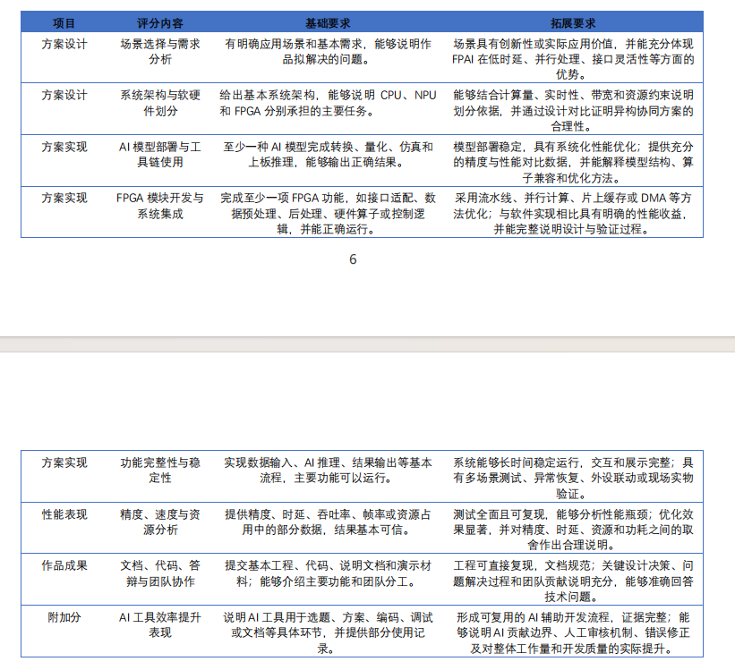

# 面向比赛评分的整体架构与PS PL任务划分分析报告

日期：2026年10月19日。依据：用户提供的比赛评分截图、本板资源、已有实测及当前技术方案。性质：实施前分析；本报告不恢复暂停的开发、构建或板测。

## 1 结论

**整体架构方向合理，姿态预处理继续放在PS是当前证据最充分的选择；CSI心率信号处理下沉PL是值得验证的候选，但目前不能认定一定优于PS。**

推荐架构是：PS负责采集管理、精确姿态预处理和调度，NPU执行既定网络计算，PL负责已有HDMI输出及经过验证的心率信号处理核，PS保留心率最终质量判定，PC承担独立3D展示。

这项结论不是“已经达到全部评分拓展要求”。当前还缺真实采集域的姿态精度、心率实测、整机时延和功耗对照，且D45启动可靠性未解决。评分优势最终来自**真实闭环、可复现数据和有依据的取舍**，不能由模块数量或某项计算被移到FPGA自动获得。

| 判断 | 结论强度 | 主要原因 |
|---|---|---|
| PS＋NPU感知、PL HDMI、PC独立3D | 支持保留 | 职责符合计算特点；已有部分实际闭环，便于独立验证 |
| 姿态预处理留PS | 当前优先推荐 | 有300份真实输入基线，历史约5.78ms；迁PL会增加数值、搬运和布局成本 |
| 心率全部算法都放PL | 不建议 | 时间管理、参数选择和有效性判断需要保留在PS，且原始信号尚未验收 |
| 心率相位／滤波／相关核放PL | 条件性推荐 | 规则运算和片上缓存适合定制硬件，但必须证明相对优化PS实现的收益 |
| 为比赛强行增加PL功能 | 不支持 | 可能损害精度、稳定性、时序和资源，反而弱化评分证据 |

对上一份[具体技术方案](CSI-PREPROCESS-VITALS-PROPOSAL-20261018.md)的补充判断是：**暂不把全量姿态预处理迁PL列为近期必做；心率先建立真实数据及PS参考，再决定PL核规模。**

## 2 如何理解图片中的评分标准

截图列出了基础和拓展要求，没有给出各项分值或权重，因此本报告不虚构“可以得到多少分”。

| 评分内容 | 对本项目的实际要求 | 架构应提供的证据 |
|---|---|---|
| 场景选择与需求分析 | 说明无线感知解决什么问题，以及适用环境 | 活动时姿态感知、静止时生命体征估计；明确各自边界，避免宣称运动中可靠测心率 |
| 系统架构与软硬件划分 | 明确CPU、NPU、FPGA任务，并结合计算量、实时性、带宽和资源解释取舍 | PS／PL两种实现的对照，完整数据流和共享资源说明 |
| AI模型部署与工具链使用 | 完成转换、量化、仿真和上板；拓展要求包括精度与性能对比及算子解释 | 保留原模型、量化及部署数值证据；说明Host算子与NPU分工 |
| FPGA模块开发与系统集成 | 有实际可运行的接口、处理或控制模块；拓展要求有相对软件的明确收益 | HDMI已有真实逻辑和闭环；心率核若新增，应给出含搬运的软件／硬件对照 |
| 功能完整性与稳定性 | 输入、推理、输出形成闭环，长期运行和异常处理完整 | 新鲜数据、首次启动、连续运行、STOP／释放、故障和恢复分别验证 |
| 精度、速度与资源分析 | 数据可信、瓶颈清楚，能够解释精度、时延、资源和功耗的取舍 | 统一计时口径、准确度与有效率、实现资源、整板测功耗 |
| 文档、代码和答辩 | 可复现、边界清楚，能回答技术问题 | 工程、数据来源、原始失败、接口、测量方法及贡献说明 |
| AI工具效率提升 | 可说明AI工具用于哪些环节及如何人工核验 | 保留关键设计建议、人工决策和真实工具结果，不把生成文本当实测 |

评分中的流水线、并行计算、片上缓存和DMA是可采用的优化方法，不意味着必须全部使用。**不使用新增DMA并不使架构不合格；没有测出收益，却把数据搬运或新增RTL称作加速，才缺乏说服力。**

已有PL HDMI属于实际FPGA接口、缓存、扫描和控制工作，能够支撑FPGA开发部分的基础论证。能否满足其余验收项或获得拓展分，仍取决于完整展示、验证和性能证据。

## 3 当前证据与本板资源

### 3.1 可用于判断的实际数据

| 项目 | 已有结果 | 正确使用范围 |
|---|---|---|
| PS预处理 | 300真实窗口与原参考逐位一致；median=5.781265ms、P95=5.8595ms、max=5.89993ms | 该批纯数学预处理，不包括网络、推理及显示；人工±π边界诊断限制保留 |
| 共享图串行推理 | 三冻结来源、30分钟62945次；process均值23.27822ms、P99约24.495ms | 独立串行历史实验，不代表当前HDMI并发整机性能 |
| 长尾 | 11次超过1秒，最大process约4158.131ms | D41未解决，不能删去尖峰后声称严格实时 |
| 部署数值 | 当前共享图按ADR_48 v2检查输入／分数和受检候选位置偏差 | 3mm是部署输出对参考的偏差门，**不是对真实人体的姿态估计误差** |
| 新推理到HDMI | r13三窗数值、渲染、采纳、STOP与现场画面确认通过 | 有界闭环，不代替长期可靠性或实时RF输入 |
| 启动稳定性 | 截至并行工作区r21记录，D45本次未复现、根因仍未定位 | 健康样本不证明故障已修复；当前任务仍暂停 |
| 实时CSI | RT-AC86U样机已到货，尚未完成无线芯片／驱动门检和真实RF采集 | 尚无本采集设备的姿态精度及心率数据 |
| 功耗 | 有工具生成的功耗估计，暂无可用于本方案取舍的整板A/B测量 | 不能宣称PL心率已节能，或整个系统已经低功耗 |

**不能把5.78ms和23.28ms直接相加后当作当前整机时延。** 前者来自另一批纯预处理测试，后者的process本身包含预处理等阶段。正式对照必须从同一进程、同一数据和同一配置重新分段测量。

最新工作区记录也已纠正早期按键映射：F8为PL_KEY1／SW6，r21观察到CSR清零。此修正不构成D45已解决，更不构成本报告恢复实验的授权；旧报告的按键描述不能继续作为操作依据。

### 3.2 板上资源约束

物理板为悟净Lite／JFMQL30TAI676H，四核应用处理器，PS DDR 1GB／32bit、PL DDR 2GB／64bit；手册列PL 125K逻辑单元、9.3Mb块RAM、400个18×25 MAC DSP。125K逻辑单元不等于125K LUT。

以下是r9实际适配工程的Fully Placed报告口径，不是新心率模块实现结果：

| 资源 | 已用／总数 | 占用 | 影响 |
|---|---:|---:|---|
| Slice LUT | 42476／78600 | 54.04% | 算术计数有余量，但不表示能放入任意新增逻辑 |
| Slice寄存器 | 62634／157200 | 39.84% | 控制集合、时钟和位置分布仍影响布局 |
| Slice | 17988／19650 | **91.54%** | 仅1662个算术余量，布局是主要风险 |
| Block RAM Tile | 97.5／265 | 36.79% | 适合小型历史缓存，但需核对端口和实际映射 |
| DSP | 8／400 | 2.00% | 可供小型MAC核使用；NPU专用算力不能按这392个DSP余量推算 |

r9已报告setup约+0.030ns、hold约+0.023ns，原AI两处限定Min Period例外仍保留，raw_timing_pass为false。不能将其描述为无例外的完整时序签核。

新增心率核应沿用现有100MHz GP域，不增加外部引脚或PLL。现有GP／HP、DDR及SDK路径均按实际连接处理，不能假设某个HP口因名字存在就可自由使用。

## 4 整体架构是否正确

### 4.1 精度

PS保留训练一致的输入处理，NPU保留既定计算图，显示端接收实际拥有结果，这种分工有利于隔离数值错误来源。PC做3D材质、相机和交互，不改变板端原始坐标及候选分数；HDMI与PC两路应追溯到同一帧与调用号。

但精度必须分三层报告：

1. **处理及部署一致性。** PS预处理对训练参考、部署输出对冻结参考，这是已有主要证据。
2. **任务准确度。** 姿态对同步3D真值的误差，心率对同步参考的误差，这是用户实际关心的感知能力。
3. **真实采集域适用性。** RT-AC86U与原训练采集硬件的幅度、相位、子载波、几何和时间差异，需要新数据验证。

架构可以保护第一层，却不能替代第二、三层。特别是一台三天线路由器不等于模型的三个空间接收节点；把数据填成相同形状并不能证明模型精度保持。

**判断：架构有利于保持精度，已有部署一致性证据；尚不能据此宣布实际应用精度全部达标。**

### 4.2 时延

PS处理协议、控制和错误，NPU执行既定网络，PL独立扫描HDMI，PC独立渲染，避免把不同更新节奏强行串成一条大流水线。这是合理的异构分工。

须分别统计CSI采样与组窗、排队、预处理、推理、结果发布、HDMI采纳及PC接收／显示。1080p60是扫描刷新条件，不等于每秒产生60份新姿态；PC渲染60FPS也不能提高原始推理更新率。

若单人PIWPOSE1记录为256B，5次/秒时姿态有效载荷仅1280B/s，支持PC独立渲染在传输量上的合理性。它不证明实际网络尾延迟或断线恢复已通过。

当前更需要解决的是D41秒级长尾和D45启动偶发故障。把约5.78ms预处理搬到PL无法消除已经观测到的4秒级forward长尾。

**判断：分工有利于低延迟和展示解耦，但目前未证明整机严格实时。**

### 4.3 资源

NPU承担网络计算，PL承担规则接口／控制及候选信号处理，PC承担高质量3D，可以降低在PL中堆叠大规模图形或浮点运算的必要性。PS保留灵活控制和精确数学，有利于适应尚未稳定的采集输入。

这里的收益应表述为“避免新增某类负载”，不能声称已释放相应硬件。比如停用VPU运行负载，不会自动删除当前位流中保留的SDI／互联逻辑；PC渲染也没有取消PS本地HDMI绘图。

**判断：资源分工合理，但现有布局紧张，应优先保证稳定闭环，再评估小型PL核。**

### 4.4 功耗

停用VPU／RTSP可能减少编码、拷贝及网络负载，NPU专用执行也有能效潜力；但目前没有相同任务下的板端能量对照，不能直接写成已节能。

HDMI仍有持续扫描负载。在1920×1080、RGB565、60Hz设计条件下，理想有效像素读取量为：

`1920 × 1080 × 2 × 60 = 248832000B/s ≈ 248.832MB/s`

这是设计数据量，不是实际DDR性能测量；它说明显示存储访问不会因为姿态只更新2Hz或5Hz而自然消失。做功耗比较时必须保持相同显示条件。

PC与路由器的功耗也不能从应用能耗中隐去。报告应分别给出**板卡输入功率**和**包含采集设备／PC的完整系统边界**；若PC只是已有展示终端，可说明该部署条件，但不能将“板卡省电”直接等同“全系统省电”。

**判断：架构存在降低板端部分负载的理由，是否降低总功耗和每次有效感知的能量，仍待实测。**

## 5 为什么姿态预处理留在PS更合理

| 维度 | 保留PS的主要理由 | 仍需关注的问题 |
|---|---|---|
| 精度 | 已有300份真实输入一致性基线，保留FP64中间值、复数运算顺序及相位分支 | 不等于任意输入已证明；真实路由器输入域仍需验证 |
| 时延 | 历史纯数学约5.78ms，迁移收益上限有限，且会增加传输和驱动开销 | 更高更新率下应重新测瓶颈，不能永久假定开销可忽略 |
| 资源 | 不再增加一套FP64／超越函数及其控制缓存，保护紧张的Slice与布线 | PS也不是免费资源，需看同机CPU时间与推理争用 |
| 功耗 | 避免新增硬件的时钟、活动和搬运；短任务可能不值得硬件卸载 | 没有A/B能量数据，不能认定PS必然更省电 |

### 5.1 精确性成本高于表面上的算子数量

预处理不是只有abs和atan2，还包括相邻天线复数相位差、沿子载波unwrap、最小二乘相位校正、复指数重建和模型输入重排。signed-zero、±π及FP64中间舍入都可能影响最终FP32输入。

定点CORDIC通常提供近似结果，不能自动满足当前输入逐位门。若引入新的误差容限，属于新的数学／数值契约，需要单独评估模型准确度，不能把部署输出3mm门限当作预处理放宽许可。

在现有精度优先的阶段，留在PS具有明确的风险收益优势。

### 5.2 预处理不是当前已证实的最大时延问题

以5Hz、200ms服务周期作**预算示例**，5.781265ms约占2.89%。这是阶段墙钟占周期的比例，不是CPU利用率，也不是严格5Hz已经通过。

若未来目标为40Hz、25ms周期，它约占23.13%，届时重新研究加速就更有意义。两个示例不能替代实际并发计时。

完整PL替换每窗至少输入86400B、输出43200B，共129600B。即便PL数学计算免费，仅为低于历史5.781265ms，往返有效速率就需要超过约22.42MB/s；计入1ms计算／驱动等开销后，需要约27.11MB/s。MMIO理论位宽和时钟频率不能证明实际达到该值。

因此，**“PL核算得快”不足以证明“预处理整体变快”**。更不能认为这项迁移能修复SDK等待或启动故障。

### 5.3 与评分要求的关系

保留PS并不表示异构分工不足。评分明确要求解释资源和性能取舍，能够用数值契约、约5.78ms基线及搬运阈值说明没有盲目迁移，正是可答辩的架构设计。

只有在同配置测得预处理成为主要瓶颈，且全程精度、资源、时序、能耗对照支持迁移时，才应改变该分工。现阶段不需要为展示“更多FPGA计算”而承担这项风险。

## 6 CSI心率信号处理放PL是否正确

### 6.1 应放的是规则计算核

合理的边界是：

| 保留在PS | 可评估下沉PL |
|---|---|
| 包身份与时间质量、必要重采样、子载波／天线对选择 | 选定天线对的复数乘共轭、相位求解 |
| 参数与系数配置、运动状态及信号质量判断 | 独立的时间unwrap、固定滤波／统计 |
| 相关归一化、峰值选择、呼吸谐波排除、置信度 | 片上历史缓存和有界自相关MAC |
| 原值保存、无效状态、结果发布和错误处理 | 实际任务完成、溢出及相关结果输出 |

心率支路在姿态最新窗口覆盖队列之前分流，维护自己的连续数据。两路可以共享原始输入来源，但不共享滤波历史，不直接把姿态校正后的模型特征当心率输入。

### 6.2 精度方面 条件性合理

PL可以让相同固定点算法重复执行得到确定结果，但**确定性不等于检测准确**。主要风险首先是无线信号中是否存在可分辨的心搏成分、时间是否可信、是否混入运动及呼吸谐波；其次才是量化和硬件误差。

PhaseBeat原论文提供了接收天线CSI相位差用于呼吸／心率监测的研究依据，并包含静止状态、校准和子载波选择。它不证明本项目RT-AC86U数据具有同样准确度。[原论文](https://www.eng.auburn.edu/~szm0001/papers/PhaseBeat_ACMHealth20.pdf)

因此需要“浮点算法对真实参考”“固定点对浮点”“RTL对整数模型”三层对照。硬件逐位一致只完成第三层，不能单独成为心率精度通过的证据。

### 6.3 时延方面 有计算卸载潜力但未必有明显收益

前一方案以4通道、50Hz、30秒估计窗口、每秒更新一次作为研究参数。保守相关计算量约264万次MAC／更新；按100MHz、每项2周期估算约52.8ms，尚不包括GP传输、PS准备和最终判定。

264万次MAC／秒并不能自动证明四核PS已形成瓶颈。优化过的C++实现可能足够快；必须实际测量，不能用Python解释器实现与RTL比较后宣称战胜PS。

同时，30秒观测窗口与1Hz更新不是“1秒测出心率”。默认若另需10秒滤波预热，首次结果还需要相应历史。PL缩短的是计算和排队部分，不能把观测信息需求缩短到微秒级。

有价值的PL收益可以是更小的计算尾延迟、较低PS占用、减轻姿态线程争用或更低能量。应至少证明其中一项，并守住其余硬门。

### 6.4 资源方面 适合小核 不能大规模并行

前一方案的合并规划上限为新增LUT 4000、FF 6000、RAMB36等价32、DSP 24。这是预算，不是已综合资源，也不表示心率单核需要全部额度。

片上历史、任务银行、相关输出等有效载荷约104KiB，可用串行复用控制规模。400个DSP中的计数余量支持研究乘加核，但本板DSP为18×25 MAC，32×32乘法和更宽累加必须拆分或时分，不能每项按一个DSP估计。

由于Slice已占91.54%，应从一个迭代相位核和少量共享MAC开始。不适合为了低速生理信号展开数十路浮点流水线，也不应为了该扩展删除原功能或放宽时序。

### 6.5 功耗方面 尚不能判定PL优于PS

低速、长窗口、1Hz更新意味着硬件可能长时间空闲；闲时使能控制有机会降低活动，但时钟树、静态功耗及新增布线成本仍存在。PS为GP传输、准备数据和轮询付出的能量也必须计入。

只有测得“PS节省的计算能量”大于“PL活动、闲置附加成本及PS搬运能量”，才能宣称这项迁移节能。并行度更高、DSP更多或核周期更少，都不是充分证明。

**判断：心率DSP核是合理的PL研究候选，而不是已经证明正确的固定分工。若优化PS实现已满足精度、时限和能耗，且PL无可辨认收益，心率留PS也是符合评分逻辑的结果。**

## 7 现有功耗报告为什么不能直接作为结论

本轮读取r9实际路由后的功耗报告，关键原值如下：

| 字段 | 原值 | 含义 |
|---|---|---|
| Total On-Chip Power | 4.099W | 工具估计，不能称为整板实测 |
| Confidence Level | Low | 活动输入不充分 |
| Simulation Activity File | `---` | 没有仿真活动文件 |
| PS7功耗项 | 0.000W | 当前表没有完整计入真实运行PS负载，不能据此认为PS不耗电 |
| Device | xc7z030ffg676-2 | 当前适配工具模型标识，不能替代复旦微实际器件的测功耗 |

官方UG907说明，无向量分析在缺少指定活动时使用默认活动及传播估计，其准确度不如具有真实激励的布线后活动分析。这只解释该工具的估算限制，不证明其电气模型已适配本板。[官方说明](https://docs.amd.com/r/en-US/ug907-vivado-power-analysis-optimization/Vectorless-Power-Analysis)

因此，4.099W可以作为这份工具输出的原始记录，不能作为本板总功率、NPU功耗或心率PL相对PS节能的依据。整板测试还要包括PS、NPU、DDR、PHY、供电损耗等。

## 8 如何用公平对照证明分工

以下只是后续测量设计，不在本轮执行。需要稳定基线、具体板测包及有效授权；不能复用已经关闭的启动额度。

### 8.1 对照配置

| 配置 | 姿态与显示 | 心率 | 用途 |
|---|---|---|---|
| M0 | 稳定基线，固定输入与显示条件 | 关闭 | 原系统成本 |
| M1 | 同一稳定基线 | 优化PS实现 | 功能增加到PS的真实成本 |
| M2 | 新PL候选，新增核空闲，其余条件相同 | 与M1相同的PS实现 | 新硬件存在但空闲的附加成本 |
| M3 | 与M2完全相同的候选位流 | PL计算核＋必要PS管理判定 | 计算位置改变的收益 |

M3对M2比较同位流下计算卸载；M2对M1观察新增硬件和实现变化成本；M3对M1比较最终部署方案。不同位流的比较须保留完整条件，不能把其它设计变化的收益归给心率核。

所有配置使用相同原始CSI、有效性规则、窗口、采样率和输出频率，不能让PL通过降低精度、少算通道或少输出结果来获得表面优势。CPU基线使用合理优化的C++及明确线程配置。

### 8.2 精度与有效性

| 对象 | 应报告的数据 | 不足以证明准确的替代指标 |
|---|---|---|
| 姿态 | 对真实标签的关节误差及其分布；部署一致性另列 | 单看画面像人，或只报对参考3mm以内 |
| 心率 | 对同步参考的MAE、P95误差、有效覆盖率、无信号误报及运动拒绝 | 只挑有效窗报平均误差，或只展示平滑曲线 |
| 定点／RTL | 全部实际输出与浮点／整数参考的误差 | 仅仿真无断言失败或只比较最终整数BPM |

相同错误率下的覆盖率很重要。若PL版只保留容易的窗口，误差变小但大量拒绝，不能直接宣称精度提高。

### 8.3 时延和资源

同时报告心率计算时间、含GP往返总时间、PS线程CPU时间、数据年龄，以及姿态的P50／P95／P99／最大值和丢弃窗口数。按输入到实际结果交付计时，不用PL内部cycle替代整体时延。

资源报告至少包含新增与整机LUT、FF、Slice、BRAM、DSP、时钟资源、约束覆盖及布线后时序／必要DRC。给出原AI限定例外，不新增豁免。

判定PL值得保留的条件是：精度和稳定性满足既定要求，资源和时序合格，并且端到端时间、PS占用／姿态争用或能量至少一项有超过测量不确定性的改善。没有收益时应收缩核规模或保留PS，不为了保持方案叙述而牺牲数据真实性。

### 8.4 功率与能量

采用本板实际输入端的安全功率测量方法，保持输入电压、外设、显示、工作负载和环境条件一致；不在方案阶段假定某测量电阻／测试点可直接串接。PC和采集设备另列边界。

对相同观测时长，计算：

`E = ∫P(t)dt`

`每个有效结果能量 = E / N_valid`

同时列平均／峰值功率、有效结果数、覆盖率和增量能量。滑动窗口高度重叠时，1Hz更新不是每秒产生一份独立的30秒观察，应保留相同窗口安排进行比较。

若只测到PL核功率，不能将其与PS整板功率比较；若用“减去空载”的增量功率，也要同时提供完整板功率，防止隐藏新硬件空闲成本。

## 9 对比赛展示和答辩的建议

推荐将作品组织为两个有明确边界的模式：活动场景展示板端姿态感知与HDMI／PC两路结果；静止场景展示经过质量检查的心率／呼吸估计，运动或信号不足时明确显示无效。这样更符合当前可验证能力，避免同时承诺行走姿态和可靠心率跟踪。

答辩中应能用数据回答：

1. 为什么预处理留PS：训练一致性、5.78ms基线、往返搬运阈值和资源代价。
2. 为什么NPU做网络：实际算子分配、量化部署和相对参考的精度／性能；没有全CPU性能对照时不虚构倍数。
3. 为什么PL做HDMI：独立扫描、读帧、缓存、跨域、换帧和安全停止的实际工程价值。
4. 为什么选择心率核：实际CPU瓶颈或能量／争用收益，以及有限位宽、片上缓存、串行复用的资源取舍。
5. 为什么PC做高质量3D：展示负载独立、传输姿态而非板端编码视频，同时如实说明PC依赖与系统能耗边界。

当前最影响完整性与稳定性论证的是启动故障、真实采集和整机长期证据缺口，而不是没有把更多算法搬到PL。心率扩展不能挤占解决这些基础问题的主要时间。

## 10 建议的决策与顺序

**建议保留整体架构和PS精确预处理，将PL心率核作为经对照后选择的扩展。**

后续在获得明确恢复指令后，顺序应为：稳定可恢复的基线；真实CSI及时间质量；PS心率参考与真实准确度；确认计算瓶颈和能量成本；最小PL核；完整时序／DRC及实际bit；公平A/B板测；最后再接入两路展示。

离线算法可以用合成数据研究，但合成通过不替代真实心率可行性。若PS基线已足够且PL无收益，则保留PS心率和已有PL HDMI；若PL确实减少计算尾延迟、PS争用或每个有效结果能量，则保留小型PL核。

这比事先断定“心率必须放FPGA”更能体现评分要求中的异构协同、系统优化和工程判断。本轮仅新增分析报告和评分原图副本，没有更改原技术方案、源码、模型、SDK、位流或板端状态。

## 11 依据和来源

1. 用户提供的[比赛评分原图](report-assets/competition-scoring-20261019.png)。报告按截图分析；截图没有分值权重，不据此估算得分。
2. [原技术方案](CSI-PREPROCESS-VITALS-PROPOSAL-20261018.md)，用于接口、搬运量与规划资源预算；其状态和数值不能作为新增实现结果。
3. [300份PS预处理实测](../tools/pose-v1/RESULTS-300.md)、[部署数值契约ADR_48](../ADR/ADR_48.md)、[架构ADR_49](../ADR/ADR_49.md)、[难点D41](../DIFFICULTIES.md)，分别支持数值、职责及长尾限制。
4. [本板r9实际资源报告](D:/FPGACompetitionProject/.local/hdmi-live-20261018-r9/reference/fpai_demo_vivado.runs/impl_read_v3r9/ai7030_edif_top_utilization_placed.rpt)、[实际功耗估计原报告](D:/FPGACompetitionProject/.local/hdmi-live-20261018-r9/reference/fpai_demo_vivado.runs/impl_read_v3r9/ai7030_edif_top_power_routed.rpt)。物理板规格及100MHz通路见原技术方案引用的Lite手册和实际工程。
5. [并行HDMI工作区最新总览](D:/FPGACompetitionProject/PROJECT-PROGRESS.md)、[r21暂停状态及按键映射修正](D:/FPGACompetitionProject/tools/pose-v1/evidence/hdmi-reset-meter-20261019-r21/state.json)、[采集设备到货状态](D:/FPGACompetitionProject/tools/nexmon/README.md)。本轮仅读取本机记录，未重新连接板卡或采集设备。
6. [PhaseBeat原论文](https://www.eng.auburn.edu/~szm0001/papers/PhaseBeat_ACMHealth20.pdf)，仅支持CSI相位差生命体征研究方向，不转用其精度结论。
7. [AMD UG907无向量功耗分析说明](https://docs.amd.com/r/en-US/ug907-vivado-power-analysis-optimization/Vectorless-Power-Analysis)，仅说明该工具的活动估计机制；不作为复旦微器件电气参数或功耗的依据。

## 附录 比赛评分原图

