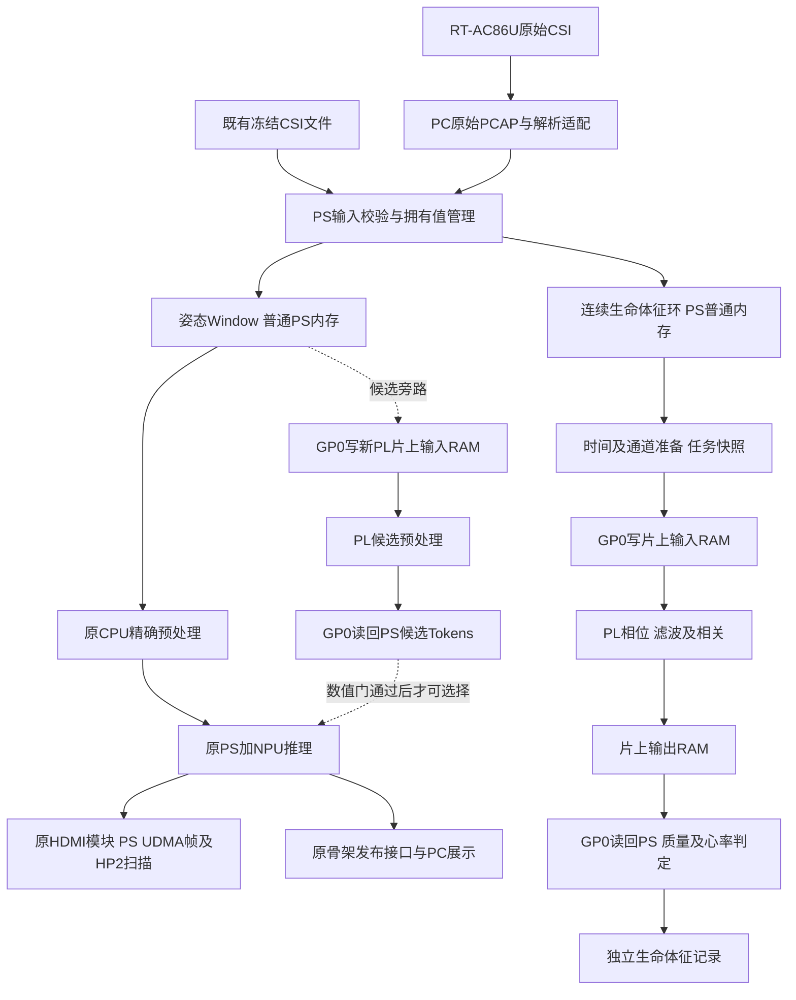

# FPGA输入预处理与心率检测可行性分析及顶层技术方案

**历史阶段说明（2026-10-29）：** 本页方案、暂停状态和待办仅对应记录当时；当前演示已完成交付，后续结果与独立冻结边界见[项目进度](../PROJECT-PROGRESS.md)。不依据本页启动旧诊断或恢复已取消扩展。

日期：2026年10月18日。提交对象：项目负责人。状态：**供实施前审阅的技术方案，尚未开始新增RTL、软件模块、综合实现或板测。**

本方案以悟净Lite实际板卡、当前复旦微适配工程和已验证数值基线为边界，规划独立的CSI预处理与生命体征模块。推荐首期采用**PS接收及管理数据、GP0访问新增模块片上RAM、PL串行复用信号处理运算、PS判定心率和数据质量**的结构。新增模块不成为DDR主机，不分配NPU的PL DDR，也不使用HDMI帧池。

可行性结论分三层：

1. **独立输入适配、数据管理、寄存器与片上RAM接口具备明确实施路径。** 地址空间可通过现有User_Reg分支细分，但必须保留原厂adder寄存器，整机仍需重新实现和签核。
2. **静止单人的CSI心率／呼吸信号处理具有研究依据，资源上适合小规模时分复用。** 本项目尚无真实心搏CSI及同步参考测量，不能提前保证检测成功率或准确度。
3. **现有姿态预处理全量迁PL属于有条件可行，不能直接承诺替换PS。** 当前算法使用FP64复数及超越函数，模型输入要求FP32逐位一致；定点CORDIC不天然符合该契约。应先做旁路数值与资源评估，再决定正式替换范围。

**当前最紧的硬件约束是布局和时序，而非DSP数量。** 已有候选工程Slice占用91.54%，setup裕量约0.030ns。即使新增模块不共享帧地址，也可能通过布线、GP访问、CPU及DDR控制器争用影响原系统。因此本方案给出可检查的隔离条件，不将设计阶段的地址规划写成“整机保证无冲突”。

## 1 现有基线和本次范围

| 对象 | 已核对事实 | 对新模块的约束 |
|---|---|---|
| 主架构 | ADR_49确定PS／NPU感知、PL HDMI、PC独立3D；VPU／RTSP退出未来正式主链 | 不新增视频编码、模型重分配或PC推理 |
| 姿态输入 | 3接收点×3天线×30子载波×20时刻，5400个complex128 | 保留PIWCSI1协议和现有输入语义 |
| 预处理 | PS输出10800个FP32；300份真实窗口有原验收基线 | 正式替换继续受原输入逐位门检约束 |
| 推理 | 固定共享FP16模型有独立串行验证，r13三窗新推理到HDMI通过 | 不修改模型／RAW、SDK、CPU注册、Gather和NPU分配 |
| HDMI最新记录 | r14在应用Device::Open前捕获HP2返回异常，已回原BOOT，包关闭 | 不新增HP2读主机，不把既有启动故障作为本模块实验对象 |
| PC展示 | web-dis已完成60份历史真实姿态回放，实时发布仍待接入 | 不修改其渲染、播放、数据素材或PIWPOSE1 |
| CSI设备 | RT-AC86U离线构建／解析完成，实机尚未验证 | 单台三天线接收设备不能替代模型的三个空间接收点 |
| 独立暂停 | 旧DATA首次坏读调查暂停，FAT不修 | 本方案不恢复这些任务 |

本次范围是顶层方案和实施顺序，不包含采购、刷机、工具安装／升级、BOOT写入、重启或上板负载。原分支中已准备的启动诊断包不因本方案恢复执行。

## 2 实际板上资源及可用性

### 2.1 物理资源与运行时资源分别核算

板卡依据是《悟净开发板Lite轻量版硬件使用手册V1.0》PDF第4、5、7、8、12、13、14、16页，已目视核对第8页资源表。**不使用完整版板卡规格，也不按通用Xilinx板卡推定资源。**

| 资源 | 本板资料／实际工程 | 本方案用法 |
|---|---|---|
| 器件 | JFMQL30TAI676H；当前工程通过030ai／JFM适配，工具报告显示7z030ffg676-2 | 继续同一适配路线，工具器件名不等于可替换为通用Xilinx流程 |
| PS | 四核应用处理器，手册最高1GHz；现有程序为ARM64 | 接收、时间处理、窗口管理、配置和最终质量判定；不假定四核当前均空闲 |
| PS DDR | 板载1GB，32bit接口 | Linux普通内存和SDK的PS侧UDMA均位于这一物理资源内，不相加为额外容量 |
| PL DDR | 板载2GB，64bit接口 | 保持MIG／NPU／SDK管理；首期新增模块不访问 |
| PL逻辑 | 手册125K逻辑单元、9.3Mb块RAM、400个18×25 MAC DSP | 用实际实现报告的LUT／Slice／RAMB口径做预算，125K不等于125K LUT |
| 以太网 | 板上一路千兆PHY接PS端 | 数据先进入PS网络栈，不声称网口直接送入新PL流水线 |
| PS／PL接口 | 手册列2主、2从AXI及4路64bit高速接口 | 现有工程HP0至HP3均有HC连接，不能把标称接口数视为空闲端口数 |
| 新模块时钟 | 既有gp_clk来自ps_ai_wrapper的gp_axi_aclk；当前报告为10ns，即100MHz | 首期全部新增逻辑和RAM位于此域，不新增PLL／MMCM或目标频率 |
| 其它时钟 | 当前MIG UI约200MHz；HDMI像素148.5MHz、串行742.5MHz | 不接入、不重分频、不修改这些时钟和复位 |
| 外部引脚 | 现有HDMI／DDR／以太网等已分配 | 新模块不增加外部IO，不改变BANK／引脚／电平 |

手册的DDR标称速率不能当作可用应用带宽。PS DDR与PL DDR的地址视图、控制器和SDK搬运路线不同，接口理论位宽也不能替代实测吞吐。

### 2.2 当前整机资源基线

取自r9实际候选的`ai7030_edif_top_utilization_placed.rpt`，日期为2026年10月18日、状态Fully Placed。它是当前可获得的实现资源基线，不是未来合并版本或原BOOT运行配置的现场资源读回。

| 工具资源口径 | 已用 | 总数 | 算术余量 | 对可行性的含义 |
|---|---:|---:|---:|---|
| Slice LUT | 42476 | 78600 | 36124 | 尚有逻辑计数余量，但不能代表可用布线空间 |
| Slice寄存器 | 62634 | 157200 | 94566 | 新增状态应减少独立复位／使能控制集合 |
| Slice | 17988 | 19650 | **1662** | 已占91.54%，是首要布局风险 |
| Block RAM Tile | 97.5 | 265 | 167.5 | 计数上足以容纳小型缓存，位置和端口仍需布局验证 |
| DSP | 8 | 400 | 392 | 支持时分复用MAC，不据此展开大规模并行FP64流水线 |
| Bonded IOB | 134 | 250 | 116 | 新模块计划新增0个IO；这些差额不表示任意引脚可用 |

r9报告setup约+0.030ns、hold约+0.023ns，TNS／THS为0；原AI两处Min Period例外仍在，raw_timing_pass为false。新增模块必须通过自身及合并后完整setup／hold、脉宽／最小周期、必要DRC和约束检查，原例外只适用于原对象。

### 2.3 Linux内存快照

r14最终审计记录：MemTotal=1017708KiB、MemAvailable=762384KiB、CmaTotal=262144KiB、CmaFree=130784KiB。这是该次空载快照，不能视为下一次启动、推理常驻或并发时的保证。

首期新增PS工作内存预算不超过16MiB，普通堆页分配；PC录制和结果文件另算磁盘预算。新增模块不要求CMA／设备树预留区调整，不从空闲CMA中手工划地址。

## 3 PS和PL职责

| 环节 | PC／采集适配 | PS | 新PL模块 |
|---|---|---|---|
| 原始采集 | RT-AC86U输出，PC保存PCAP并解析固定版本格式 | 接收已经描述清楚的记录 | 不处理网卡驱动、以太网协议或PCAP |
| 输入身份 | 保存设备、MAC、信道、带宽、core／stream、包序号及时间来源 | 校验完整性，建立本地序号和质量状态 | 校验任务、块序号、长度及配置代次 |
| 姿态支路 | 真实路由器到模型适配须单独评测 | 构造既有Window，保留CPU精确预处理和原Engine | 独立候选预处理，先旁路输出，不直接写NPU内存 |
| 心率支路 | 保留连续原始序列和参考测量 | 时间质量、通道选择、必要重采样、量化配置、峰值及可信度 | 复数相位差、CORDIC、时间解缠绕、选定滤波和自相关MAC |
| 输出 | 原始证据及后续展示 | 拥有结果、保存原值、发布独立生命体征记录 | 仅提交固定任务结果和故障，不直接驱动HDMI或网络 |
| 生命周期 | 有界采集 | 单一设备／模块拥有者，提交、取回、停止、异常保存 | 明确银行所有权、完成代次及本模块停止 |

首期不做TopK、ScatterND、骨架绘图、FFT全硬件化，不新增NPU直连通路。固定点运算公共组件可以复用源码，但姿态和心率不共享可变滤波状态、历史窗口或完成编号。

## 4 顶层数据流与复制边界



**分流位置在姿态LatestSlot之前。** 姿态待处理窗口可以合并到最新值；心率支路先保留连续记录，自己的队列溢出、乱序或缺样会使相应窗口无效，不能悄悄沿用旧值。

新增PL通过PS主动的GP0寄存器读写获得数据。一次典型任务存在PS堆内存→片上RAM、片上RAM→PS堆内存两次显式复制；模型输入仍由原SDK公开接口搬运。首期不承诺零拷贝，也不将Host虚拟地址交给PL。

## 5 各部分数据的存储位置

| 数据对象 | 具体存储资源 | 大小及数量 | 拥有者和释放条件 |
|---|---|---|---|
| 原始CSI PCAP | PC磁盘独立采集目录 | 初始试验建议每次不超过256MiB，按实际速率有界录制 | 采集程序；不覆盖旧证据 |
| 三链64点解码记录 | PC普通内存 | 1536B复数FP32＋64B元数据，4096槽约6.25MiB | 输入适配程序；不足时明确记录溢出 |
| 姿态RawCsi | PS普通堆内存，逻辑`[3,3,30,20]` | 每窗86400B负载；传输记录共86432B；最多当前＋待处理两份 | 姿态编排；消费后释放，不由新PL寻址 |
| 精确／候选Tokens | PS普通堆内存 | 每份43200B；CPU参考与PL候选各一份 | 预处理适配；候选完成并核验后交接 |
| 全部推理结果 | 原PS拥有值Result | 输入43200B、分数400B、姿态16800B，另有身份／选中姿态等 | 原推理线程和保存层；保持先完整保存再比较 |
| NPU权重及张量 | 原SDK默认PL DDR区 | 固定模型与Session实际分配，不把板载2GB都视为SDK可自由分配 | 唯一Engine／SDK；新模块新增分配为0 |
| HDMI双帧 | **PS DDR中的SDK udma区** | 每帧4147200B，共8294400B；实际地址由SDK分配 | 原HDMI模块；原STOP排空证明后才释放 |
| 连续生命体征记录 | PS普通堆内存 | 4个复数天线对共64B＋64B元数据，4096槽共512KiB | 新输入模块；至少覆盖默认40秒任务历史，按序号防覆盖 |
| 心率任务快照 | PS普通堆内存 | 默认2000×64B=128000B；备用快照最多两份 | PS生命体征工作线程；任务完成或明确放弃后释放 |
| 新PL输入／输出银行 | 新模块独占BRAM | 输入2×4KiB，输出2×4KiB，共16KiB有效载荷 | PS和PL按银行状态转移，不能同时写 |
| 新PL滤波历史 | 新模块独占BRAM | 4通道×2频带×2048×4B=64KiB预留 | 生命体征核；单任务独占，下一任务先完成关闭 |
| 新PL自相关结果 | 新模块独占BRAM | 4×(39＋401)×8B=14080B，上限按16KiB预留 | 生命体征核；PS读完并ACK后回收 |
| 系数、状态及小缓存 | 新模块BRAM／少量寄存器 | 有效载荷预算不超过8KiB | 配置锁定到任务结束，变更时递增代次 |
| 心率／呼吸结果 | PS普通内存及独立结果文件 | 小型拥有值记录；不塞入PIWPOSE1保留字段 | 新模块发布层，不访问Web私有对象 |

这里的“PS普通堆内存”只给出资源与对象归属，**不分配固定物理地址**。Linux决定实际页位置；所有新PL访问都止于本模块片上RAM，无需把这些页变成DMA缓冲。

HDMI当前代码检查udma地址在`[0x30100000,0x38100000)`，该128MiB窗口是检查边界，不是新模块可使用的空闲内存。本方案既不在其中硬切分地址，也不另开一个SDK分配器。

## 6 寄存器地址与总线接入

### 6.1 已有资源占用

已读取r9实际生成源码`gp0_manager.sv`、`ps_ai_peripheral.sv`、`ai7030_edif_top.v`及adder寄存器实现。

| 地址／端口 | 现有用途 | 约束 |
|---|---|---|
| SDK URI的npu=0x40000000、dma=0x80000000 | NPU／SDK设备寻址参数 | 不是可直接划分给新模块的两个RAM基址 |
| GP0 `0x40080000–0x400bffff` | 相机及候选HDMI／诊断分支 | 新模块不从这里取地址 |
| `0x400b0000–0x400b00ff` | HDMI控制 | 保持 |
| `0x400b0100–0x400b01ff` | 既有AI观测分支 | 保持 |
| `0x400b0400–0x400b05ff` | r9读路径观测分支 | 保持 |
| GP0 `0x400c0000–0x400fffff` | User_Reg，顶层接原厂adder | **整个窗口已被路由，不能称为全空闲** |
| HP0／1／2／3 | 已有HC；HP2还涉及HDMI与返回互联 | 首期不增主机、不换ID、不改变仲裁／复位 |
| User_Ddr | 原厂adder的DDR接口 | 新模块不连接、不复用其DMA |

adder使用`addr[17:2]`进行寄存器解码，其已定义控制／RFU／完成／复位／调试寄存器位于User_Reg起始约1KiB内。`0x400d0000`映射到其字偏移`0x4000`，与这些定义不同；这支持以下细分方案，但不能证明所有未来软件都未使用该偏移。

### 6.2 新增地址草案

**候选窗口为`0x400d0000–0x400dffff`，只存在于未来新构建，不向当前BOOT探测或写入。** 在顶层User_Reg与原adder之间新增一个完整地址路由器，只截取该64KiB，其它地址继续转发原adder。原`ps_ai_peripheral`与HDMI内部路由不改。

| 相对偏移 | 资源 | 访问规则 |
|---|---|---|
| `0x0000–0x0fff` | ABI、配置、任务／银行控制、统计 | 32bit对齐、显式访问权限 |
| `0x1000–0x1fff` | 输入银行0，4KiB | 仅PS拥有时写 |
| `0x2000–0x2fff` | 输入银行1，4KiB | 同上 |
| `0x3000–0x3fff` | 输出银行0，4KiB | 仅结果已发布时读 |
| `0x4000–0x4fff` | 输出银行1，4KiB | 同上 |
| `0x5000–0x5fff` | 小型配置／诊断窗口 | 非法偏移返回本模块错误，不启动其它设备 |
| `0x6000–0xffff` | 预留 | 不分配DDR，不形成低位地址别名 |

首期直接适配原`mna_gp_ww`组合写接口，**不假定这是带WSTRB的AXI-Lite**。一个字完整写；读地址和返回方向必须锁定到同一接收者。输入银行满、核心忙或输出未读不得阻塞全部GP0寄存器访问：银行RAM访问有界完成，不合法的控制写记录错误并完成总线响应。

地址草案需在实施的G0阶段对合并基线确认；若其它工作已占用该窗口，调整本模块参数并重新验证完整地址译码，不挤占HDMI或SDK寄存器。

### 6.3 MMIO访问与控制字段

PS适配层拟复用项目已有的受限MMIO访问方法，只映射新窗口。实现前核实设备映射属性和内存屏障；普通`memcpy`、C++原子计数或缓存清理不能替代设备写入完成证明。不安装新驱动，不默认存在UIO，不映射任意PS／PL DDR。

| 偏移 | 字段 | 语义 |
|---|---|---|
| `0x000` | ABI | 草案`0x43534901`，按主版本检查 |
| `0x004` | CAPABILITIES | 模式、格式、银行大小、最大样本数 |
| `0x008` | STATUS | idle／active／output_pending／fault |
| `0x00c` | ERROR | 长度、序号、配置、溢出、非法银行等独立错误码 |
| `0x010–0x01c` | JOB_ID、CONFIG_EPOCH | 各u64，空闲时写入后锁存 |
| `0x020–0x02c` | MODE、FORMAT、SAMPLE_COUNT、CHANNEL_COUNT | 与能力位联合检查 |
| `0x030–0x03c` | RATE_NUM、RATE_DEN、WARMUP_COUNT、CONTROL | 有理采样率，独立提交／关闭命令 |
| `0x040–0x05c` | 两组输入银行门铃与块描述 | 字数、块号、银行代次；提交后不可修改 |
| `0x060–0x07c` | 两组输出银行状态及ACK | 有效字数、块号、银行代次；ACK只回收对应银行 |
| `0x080–0x09c` | 已接收／已处理／已输出计数、完成JOB_ID | 保留输出直至PS显式读取和ACK |
| `0x0a0–0x0bc` | cycle_count、overflow_count、停止代次 | 统计及停止证明，不借用原AI完成计数 |

这些是内部接口草案。实现时按位宽逐字段编码，不将C++结构体内存布局或本机端序作为协议。

## 7 软件接口与资源所有权

建议新增以下独立目录；此时仅规划，不创建实现文件：

| 拟新增目录 | 职责 | 不依赖的实现 |
|---|---|---|
| `software/csi_frontend/` | 连续记录、时间质量、姿态／心率分流、适配契约 | Web、HDMI、SDK私有状态 |
| `software/csi_pl/` | MMIO、银行、任务、停止和结果取回；可替换的模拟后端 | 新SDK实例、PL DDR分配 |
| `software/vitals/` | 浮点参考、固定点参考、最终峰值和质量状态 | 姿态模型内部算子、渲染算法 |
| `FPGA/csi_processing/` | 核、寄存器、片上RAM、仿真及独立构建 | HDMI源码内部逻辑和不明第三方IP |
| `tools/csi-processing/` | 本模块数据向量与有界验证入口 | 旧启动包的授权状态或失败Session |

核心软件接口草案：

```cpp
// 类型字段显式定义，以下表示职责，不是现阶段已存在API。
CsiRecord                 // 拥有原始数据、接收节点/链/子载波身份和时间来源
PoseWindow               // 通过已有Window交接，不修改PIWCSI1
VitalsWindow             // 拥有连续样本、缺样标记、配置代次与质量统计
PlTask                    // job_id、mode、format、总长度和银行序列
PosePreprocessCandidate   // 拥有候选FP32 Tokens及差异统计
VitalsFeatures            // 拥有相关序列、有效样本数、缩放和故障状态
VitalsResult              // 窗口身份、HR/RR可选值、有效性、质量和发布时间

CpuExactPreprocessor::process(const PoseWindow&);
PlProcessor::submit(const PlTask&);
PlProcessor::collect(job_id);
PlProcessor::stop();
VitalsEstimator::estimate(const VitalsFeatures&, const WindowQuality&);
```

原Engine继续由原主线程唯一持有。新增MMIO模块由一个工作线程唯一持有，进程内串行化其全部访问；独立验证程序用专用进程，不能同时运行第二个设备负载。跨进程锁只能防止遵守该锁的程序，不能替代实际owner和运行状态核对。

姿态队列保持既有最新值语义。生命体征队列是有界连续环；每个任务只允许一个在途、一个待处理快照，过载时记录跳过的估计时刻及数据质量，不能覆盖正在计算的样本。两路展示接收拥有值，不持有新的银行或SDK内存引用。

首期PL任务不抢占，所谓“优先姿态”只约束下一任务的选择，不能中断已经运行的完整心率任务。联合调度仅在测得的完整心率任务预算能放入姿态服务空档时提交；空档不足则保留原始数据、跳过一次心率更新并标注结果年龄。若最终要求两支在无空档条件下持续运行，须另行设计可暂停的任务上下文或独立小核，并重算RAM、Slice及最坏延迟，不能用当前单任务预算承诺该能力。

## 8 FPGA姿态输入预处理方案

### 8.1 必须保留的算法

当前实现顺序是：有限性校验；幅度和第一天线相位；相邻天线复数乘共轭相位差；沿30子载波unwrap；联合3天线最小二乘校正；复指数重建后再次取相位；按接收点、天线、时间、幅度30点／相位30点组织FP32。

当前db11在20个时间样本下最大分解层数为0，幅度未做额外小波降噪。相位原计算包含FP64中间值、signed-zero和分支规则，不能用定点近似或简化表达式自动替换。

### 8.2 分块接口

一个计算块选定一个接收点r和时刻t，包含3天线×30子载波。精确输入格式为90个complex128，按`antenna→carrier→real/imag`编码，共1440B；输出3×60个FP32，共720B。全窗口60块，输入86400B、输出43200B。

PS汇总时明确写回`((r*3+a)*20+t)*60 + feature`，不把块传输顺序误认为模型连续布局。块头携带job、frame、r、t、格式、字数和配置代次。精确格式与固定点研究格式分配不同格式号，禁止只保留相同数组形状就混用。

### 8.3 三种运行模式

| 模式 | 用途 | 是否进入正式NPU输入 |
|---|---|---|
| CPU_EXACT | 原实现、原顺序、原数值基线 | 是，初始默认 |
| PL_SHADOW | 原CSI独立送PL候选；保存候选和CPU原值，测误差与耗时 | 否 |
| PL_VERIFIED | 已证明满足现行数值门，且总耗时／资源／时序合格的具体候选 | 到该阶段才可集成 |

首期先实现通路／格式无损验证和可复用的定点相位、统计核；用于生命体征和预处理旁路研究。**这不计作全量姿态预处理已经迁PL。**

全量替换有两条研究路线：精确浮点路线需核验复旦微适配下实际可用的FP64／超越运算实现并证明资源和舍入顺序；定点／混合精度路线需评估输入及模型输出误差。后者若不能通过输入逐位门，必须作为新的数学／数值契约决策提交，不能借用ADR_48的3mm例外。若两条路线都不满足预算，保留CPU精确主路，将已经验证的PL算子用于生命体征，不把数据重排包装成预处理加速成果。

### 8.4 性能是否值得迁移

已验收PS预处理历史median约5.78ms。全量PL方案每窗口至少129600B往返，不含控制开销：5窗/秒为648000B/s，20窗/秒为2592000B/s，40窗/秒为5184000B/s。

真正收益条件是`提交＋写入＋PL计算＋读回＋重排 < 同机同配置CPU预处理时间`。即便计算免费，仅为低于5.78ms，往返有效负载速率也需超过约22.42MB/s；若计算和软件共1ms，则需约27.11MB/s。100MHz×32bit的接口理论上限不能证明MMIO达到这个值。G1必须先测通路，未通过时不继续以“消除5.78ms”为目标扩大硬件。

## 9 心率和呼吸模块的具体算法路线

### 9.1 初始能力范围和数据前提

首期限定**一名静止受测者、一组稳定无线链路**，结果是研究性HR／RR估计。不能将姿态100候选槽号当作心率人物身份，也不承诺多人心率分离、行走心率、疾病判断或完整心率频段。

PhaseBeat原论文支持利用接收天线CSI相位差和静止状态检测研究生命体征，其实现包含校准、子载波选择及不同信号分离步骤；这只支持研究方向，不能把其精度移植成本项目承诺。[原论文](https://www.eng.auburn.edu/~szm0001/papers/PhaseBeat_ACMHealth20.pdf)

Nexmon官方实现把CSI按core／stream逐记录输出，BCM4366c0使用专用浮点打包，20MHz为64个复数位置；因此本模块必须保留实际链及子载波身份。[官方源码说明](https://github.com/seemoo-lab/nexmon_csi)

项目现有PCAP解析器明确只记录到达时间，尚不证明无线采样时钟或跨接收点同步。实施前必须验证发射节奏、包序号连续性及到达抖动；未知时间来源时将质量标为不合格，不按“收到50包”等同精确50Hz。

### 9.2 初始研究参数

以下是针对本板资源的**可调整设计上限和首轮参数**，不代表实机已达到：

| 参数 | 初始建议 | 选择原因 |
|---|---|---|
| 射频输入 | 一空间接收节点，至少两条同包接收天线链 | 支持相位差；不足则不能执行该算法 |
| 通道数 | PS从合法子载波／天线对中选择4个特征通道 | 控制RAM与相关计算规模，不把4通道解释为4个人 |
| 处理采样率 | 50Hz，经时钟／时间质量门验证后确定 | 统一滤波和相关参数；原始高采样率下降采样前需抗混叠 |
| 总任务历史 | 2000样本，即40秒；硬件上限2048 | 默认前500样本用于滤波预热，尾1500样本用于估计 |
| 估计窗口 | 30秒，每1秒尝试更新 | 低频呼吸需要足够周期；更新1Hz不等于1秒测量延迟 |
| 心率研究频带 | 0.8–2.0Hz，即48–120次/分 | 窄范围首期；范围外返回不支持或无效 |
| 呼吸研究频带 | 0.1–0.5Hz，即6–30次/分 | 为分离与质量分析提供背景 |
| 缺样／抖动 | 初轮建议缺样≤1%、最大间断≤60ms、50Hz到达间隔偏差P95≤5ms，再用参考时钟验证 | 门限是待实验确认的设计候选，不能掩盖未知采样时钟 |

RuView当前心率模块同样使用有界历史、心率频带及相关峰质量检查，并含呼吸单独输入／噪声误报测试；本方案参考这些失败情形，不直接移植其代码或阈值。[原始实现](https://github.com/ruvnet/RuView/blob/main/v2/crates/wifi-densepose-vitals/src/heartrate.rs)

### 9.3 信号流和各级处理

1. **PS时间准备。** 核对节点、MAC、信道、带宽、包身份和天线对；按真实时间基准形成固定率序列。任何重采样方法先在软件参考中确定并保存原始时间，不能简单把丢失样本补0、重放旧样本或按接收批次填满窗口。
2. **PS选择和缩放。** 选择4个具有可用幅度和稳定性的子载波／天线对，参数锁定一个完整任务；对两个复数采用相同的二进制幂缩放，保存指数和量化误差，不改变姿态支路。
3. **PL相位特征。** 每对计算`z=H_a*conj(H_b)`，CORDIC求主相位，沿时间unwrap；零／过低幅度、溢出和相位突跳分别计数。这里沿时间unwrap，与姿态沿子载波unwrap的状态和数学不同。
4. **PL滤波。** 去直流／趋势，按软件参考冻结的系数形成呼吸和心率两条滤波序列。初期使用小型级联二阶节；所有系数由验证过的软件生成并带版本。滤波预热是否足够由参考误差和有效性规则决定，不因完成500样本就自动Valid。
5. **PL相关。** 保存尾部最多2048样本。对每通道分别计算`R[k]=sum(x[n]*x[n-k])`及归一化所需能量／有效计数；PS完成归一化和峰值判定。Fs=50Hz时心率k=25..63共39点，呼吸k=100..500共401点；边界插值后再检查实际频带。
6. **PS最终判定。** 检查时间、运动、幅度、固定点溢出、相关峰显著性、跨通道一致性；必要时读回滤波波形做频谱复核。对呼吸谐波附近而无独立支持的候选拒绝给出有效HR，不能用强滤波后的单一相关峰冒充可靠信号。
7. **保存和发布。** 保存原始输入身份、处理配置、PL实际输出和判定原因；输出可选HR／RR、质量与窗口时间。不支持／不可靠时输出明确状态，禁止保留上一个数值并伪装当前有效。

PS负责的时间准备、选择和判定也是运行开销，应计入端到端测量。若现有数据只能支持呼吸而不能支持心率，保留准确的阶段结论，不将呼吸峰或合成心跳记为真实心率。

### 9.4 固定点与误差控制

| 运算对象 | 初始格式草案 | 检查 |
|---|---|---|
| 复数I/Q输入 | signed32，数值=`word/2^30`，每分量绝对值≤0.5 | 每对共16B；固定指数写入配置，NaN／Inf／越界由PS拒绝 |
| 复数乘法 | signed64中间值，相加后有明确舍入 | 不能直接截高位隐去溢出 |
| CORDIC角度 | signed32，rad=`word/2^28`；初始24轮候选 | 与高精度参考检查±π、象限、近零幅度 |
| unwrap状态 | signed64，与角度相同尺度 | 避免长窗口累计越过32bit范围 |
| 滤波 | 32bit状态，明确缩放；系数signed32/2^30，64bit乘积、至少72bit累加后舍入 | 多项求和先留保护位；系数量化后验证极点／零输入极限环和最坏输入范围 |
| 相关输入 | signed24，冻结缩放参数后舍入 | 越界使任务无效，不静默饱和后继续给HR |
| 相关累加 | signed64 | 24×24乘积加最多2048项，理论需不超过59bit，留保护位 |

精确的小数位、舍入方式和系数是G2的软件参考产物，不能边写RTL边猜。浮点参考用于算法评估，整数参考用于与RTL逐位比较，两者分别验收。正式姿态输入不使用这些生命体征固定点容差。

## 10 片上RAM和算力预算

### 10.1 RAM物理映射

按32bit数据口的有效存储核算，一个RAMB36在常见组织下只计4096B有效数据，不能把带校验位的4608B全算为用户数据。

| 用途 | 有效字节预算 | 初步RAMB36预算 |
|---|---:|---:|
| 2输入＋2输出银行 | 16384 | 4 |
| 4通道×2频带×2048历史 | 65536 | 16 |
| 相关输出和能量／计数 | 16384 | 4 |
| 系数／滤波状态／角度小缓存 | 8192 | 2 |
| 合计有效载荷 | **106496B，104KiB** | **26** |
| 端口／位宽组织等余量 | 不重复计算可用数据容量 | 最多6 |
| 首期合并模块规划上限 | — | **32 RAMB36等价Tile** |

相关计算需要同周期读两个样本，可以使用经验证的双口RAM并以一通道／一lag顺序访问，不能在资源估算中假定任意多读端口。若推断为分布式RAM或为多端口复制大缓存，必须回到此表重算。

该104KiB是两个模块时分使用一套银行和运算缓存的首期配置，不是姿态与心率同时各有一整套缓存。全量精确姿态核若需要更多浮点缓存，另做资源可行性门检，不从此预算自动扩容。

### 10.2 逻辑和计算预算

初步综合目标：两模块及接口合计新增LUT≤4000、FF≤6000、DSP≤24、RAMB36等价≤32；努力将新增Slice控制在约1000内。以上是设计预算，**不是综合预测或新的验收豁免**。实际放置可能重排原设计，不能把新增Slice与现有1662余量简单线性相减。

采用一个迭代CORDIC和少量共享乘加器，按通道、频带、lag时分复用；避免每通道独立浮点流水、复位大RAM内容和大扇出多套控制。32×32乘法及72bit累加不能各按“一个DSP”估算，应以本器件18×25乘法能力拆分或时分映射，综合后检查实际DSP使用；24个DSP预算包含这种展开。禁止以改原设计频率／放宽时序门来满足预算。

对1500样本、4通道、440个lag，保守上界为2640000次相关乘加。100MHz下若每项耗2周期，计算约52.8ms，加相位／滤波／读写后仍需实测。这是运算量估算，不含Linux调度、MMIO和通道质量判断，不代表实际总延迟。

首轮生命体征任务输入最多2048×64=131072B；读回两频带全波形最多65536B、相关值14080B，合计有效载荷210688B。按1Hz更新并将控制等预算留足，设计通路预算取不超过约0.25MiB/s。若MMIO达不到，则降低估计更新频率并明确结果年龄；不能降低真实采样率后仍用旧滤波／相关参数。

## 11 启停状态和异常行为

任务流程为`IDLE→CONFIGURED→INPUT/COMPUTE→OUTPUT_PENDING→ACK→IDLE`，允许输入银行与输出银行交替工作，但只允许一个job。在每个银行上实施`PS_FREE→PS_FILLED→PL_OWNED→PL_DONE→PS_READ→ACK`的所有权转移。

PS按序写入完整数据、执行已验证的设备写排序／必要读回，再写银行门铃。PL核对代次、长度、块号、总样本数，完成实际RAM写入后才发布对应输出。PS读取锁存的job／块／长度和原始输出，ACK前禁止PL覆盖。

STOP只停止新模块：不再接受新块，完成已接受GP响应、终止有界内部计算、提交停止代次和无在途银行状态。它不能驱动PS、MIG、NPU、HP互联或HDMI复位。由于没有外部DDR主机，不存在新模块在STOP后仍向PS页发起DMA的情况；仍须核对银行和任务关闭，避免使用旧结果。

时间质量不合格、无可用心搏信号属于数据无效，可以记录并等待下一份数据；SDK异常、总线错误、身份变化或硬件计算错误属于本轮执行失败，保存现场并停止受影响负载，不自动清错重试。硬件失败时不在同一窗口偷偷切回CPU并报告成功。

## 12 冲突分析和两个分支的隔离

| 风险 | 是否可能发生 | 结构性处理 | 最终确认方法 |
|---|---|---|---|
| 覆盖HDMI帧 | 新模块方案中不写帧地址 | 新PL无DDR主端口，新增UDMA分配为0 | 顶层连接检查；HDMI实际帧来源与故障检查 |
| 覆盖模型PL DDR | 首期不应发生 | 无User_Ddr／MIG主机，不接SDK张量地址 | 综合后接口及地址权限检查 |
| 普通PS内存重用 | 软件错误仍可能 | 拥有值、边界检查、有界队列，任务中禁止覆盖 | 主机所有权测试和板端有界回归 |
| GP寄存器误译码 | 顶层新增路由存在风险 | 只截取新64KiB；其它请求完整转发adder | 完整地址、读背压、组合写、旧寄存器回归 |
| HP2故障受影响 | 不新增HP2逻辑，但整机变化仍可能影响实现 | 保持HC／HDMI互联和复位，独立构建；板测等待稳定基线 | HDMI分支交付稳定候选后的联合验证 |
| GP0争用 | **会发生共享** | MMIO批次有界，不在推理关键区长时间占用；每批限制256个32bit字后返回调度 | 实测SDK控制访问、推理尾延迟和新模块通路 |
| CPU／PS DDR争用 | **会发生共享** | 一个新工作线程、≤16MiB工作内存；不预设绑核 | 实测四核占用、调度、内存和推理分布 |
| PL布局／时序 | **风险高** | 100MHz既有时钟、串行复用、资源预算；不调整原频率 | 合并整机完整布线与时序／DRC |
| 重置其它模块 | 新模块设计中禁止 | 单独计算复位，只复位本模块状态 | 复位扇出和仿真／实现后检查 |
| 改动Web协议 | 本阶段避免 | 心率结果独立文件／接口，不修改PIWPOSE1 | Web现有测试由该分支维持；未来接线单独确认 |
| 源码合并冲突 | 顶层最终接线不可完全避免 | 新目录独立；只在最终集成修改顶层入口 | 按冻结提交对比、最小接线差异 |
| 板卡／EDA资源同时占用 | 并行分支会竞争 | 只运行一个板端负载／一轮重型EDA；不结束他人进程 | 执行前核对owner、批次及资源预算 |

`hdmi-validate`继续负责HDMI RTL、约束、启动／复位诊断及帧生命周期。本模块不直接编辑其目录或共享失败恢复状态。`web-dis`继续负责Three.js、播放和WebSocket展示；本阶段只保存独立生命体征结果，接入页面由后续明确接口协作完成。

新模块的整机接线建议限制为`ai7030_edif_top`增加User_Reg细分路由及新实例、构建源清单和本模块约束；不在HDMI内部加算法。这个顶层文件仍是共享集成点，必须等对方提供稳定提交／检查点后在独立候选中合并，不能承诺完全没有Git或物理资源冲突。

## 13 验证步骤和通过条件

| 阶段 | 具体验证 | 通过门槛／停止条件 |
|---|---|---|
| G0 资源和接口冻结 | 核对实际目标／工具、当前基线、地址、时钟、端口、Slice和原例外 | 形成一份本模块契约；发现占用则先调整设计；不改旧失败证据 |
| G1 通路可行性 | 模拟后端＋GP RAM旁路，字节与块顺序、银行背压、STOP和代次；计算传输预算 | 无静默损坏／误译码；板上测速只在后续明确授权后进行 |
| G2 算法参考 | 现有300真实姿态输入与CPU参考；生命体征浮点／固定点模型及合成负面样例 | 姿态候选单独记录差异；生命体征先有确定的数学和缩放契约 |
| G3 核RTL | 象限／±π／近零、unwrap、滤波极点与溢出、相关能量、边界lag、最大窗口 | 固定点RTL逐位等于整数参考；候选与浮点差异另报 |
| G4 模块综合和独立实现 | 实际复旦微适配目标、RAM推断、DSP映射、100MHz时序、复位和必要DRC | 超预算先缩小并行度；独立通过不代表整机通过 |
| G5 整机候选 | 在稳定基线接入，仅修改必要顶层／源清单；完整布局布线 | setup／hold、必要时钟检查／DRC满足现行门，原AI例外不外扩；然后才生成bit |
| G6 独立板测 | 新ABI→片上RAM→算子→固定历史任务→STOP，先不启动NPU／HDMI | 实际原值等于参考、无总线错误、停止与释放闭合；需要新具体板测包 |
| G7 联合回归 | 与正式Engine同机；HDMI与PC输出按各自授权接入 | 原模型数值门、帧来源、STOP及资源边界保持；首次启动与常驻分别验收 |
| G8 真实生命体征 | RT-AC86U实机CSI＋同步参考，静止、无受测者、运动及呼吸谐波干扰 | 正确率、有效覆盖率、误报和拒绝原因完整报告；无参考只算信号实验 |

G1的硬件通路由G4／G5先形成可执行候选，表中顺序表示需求与门检依赖，不表示在综合之前就能完成板测。

### 13.1 姿态数值门

保留全部实际原CSI、CPU Tokens、PL候选Tokens及首次不同值。在原验收范围逐位比较10800个FP32；零幅度、signed-zero、相位边界另做诊断。只有输入门通过，才进入固定共享模型：输入／全部分数逐位一致、全候选有限且索引合法，参考score>0.2的候选最大关节三维偏差≤3mm。已有人工±π非阻断历史不等于任意新硬件误差获准。

### 13.2 心率算法和硬件门

合成正样例包括频带中心／边界、不同幅度、相位、呼吸叠加和量化范围；负样例包括恒定输入、纯噪声、仅呼吸及其谐波、运动瞬变、时间乱序、缺包、序号回绕、短历史、近零幅度和溢出。对仅呼吸／噪声的固定负样例，要求没有错误的Valid心率。

拟议数值目标：整数参考与RTL全字节一致；量化相位在有效幅度域的最大误差先以1e-4rad为研究目标；滤波和相关允许误差以浮点／固定点对照后冻结。若达不到，则调整位宽／算法并重算资源，不能只降低输出质量门掩盖实现错误。

真实数据初轮建议采用同一时轴的参考心率设备和独立呼吸参考，至少覆盖3名受测者、2种姿态、2种距离、每段不少于2分钟，并包括无受测者／运动段。拟议研究目标为静止有效窗HR MAE≤5次/分、P95绝对误差≤10次/分、有效窗覆盖率≥70%；RR MAE≤2次/分。**这些是待数据验证和审阅的工程目标，不是本板已具备的精度。** 校准和评估按人／采集会话隔离，不用同一段数据调阈值后再报告泛化性能。

### 13.3 性能和稳定性门

分别测CPU精确预处理、MMIO复制、PL有效周期、PS判定、整体窗口年龄、SDK控制争用、推理P50／P95／P99／最大值、HDMI错误和内存／句柄。新姿态率、屏幕刷新率和心率结果更新率分开。

联合测试建议以同配置基线为对照，先要求推理P95／P99退化≤5%、无新增HDMI故障，再讨论加速收益；该5%是新增模块的性能目标，不替代原系统验收。D41长尾继续单列，不能删尖峰算平均或把已有尖峰当成本模块可随意恶化的余量。

## 14 实施顺序与交付

1. **确认本方案和范围。** 重点确认首期用GP片上RAM、心率采用独立连续支路、姿态先旁路及数值门不变。新增数学／协议／BOOT行为按对应阶段单独落实。
2. **先做不依赖两个分支的参考与契约。** 冻结输入、时间、存储、固定点和任务接口；实现浮点／整数参考、模拟传输后端和向量。原核心、HDMI和Web保持当前实现。
3. **建立最小PL通路及资源门。** 新地址路由、银行和串行公共算子在独立工程中验证，先确认实际资源／100MHz时序，再扩展算法。发现布局预算不容纳时立即收缩范围。
4. **实现心率／呼吸计算核和预处理候选。** 先得到可逐位验证的相位／滤波／相关硬件；全姿态预处理另做精确性与搬运收益门。两者共享一个提交器和有限计算资源，调度优先保证姿态时限。
5. **采集数据条件成熟后冻结生命体征算法。** 一台RT-AC86U可先验证单节点心率研究；完整姿态新采集仍需三个空间接收点及模型域适配，不能阻塞离线RTL验证，也不能冒充已解决。真实CSI若要求改变滤波结构，先更新软件参考和资源预算，再只重验受影响的硬件阶段。
6. **消费HDMI分支稳定基线做整机集成。** 复用有效检查点，只重跑受影响阶段；形成完整时序／必要DRC合格的bit。D45使联合板测条件不满足时继续独立工作，不自行做复位或新重启实验。
7. **另提交具体上板包并执行分阶段板测。** 当前原BOOT运行，旧包额度为0；新的bit／BOOT、候选启动和回退范围必须对应具体产物。先独立模块，再NPU，再HDMI，最后Web接线。
8. **真实数据准确度与联合长期验收。** 基于完整原值、时间基准和参考设备评测；通过后再决定正式切换预处理及展示功能。

交付应包括一套源代码、公开接口、软件参考、必要测试向量、实际原生日志、关键时序／DRC报告、恢复检查点和最终bit对应关系。不开多轮代理审查，不复制整套工程进每个入口；本报告不新增完成条目或已采纳ADR。

## 15 可行性判定和待解决条件

| 事项 | 当前判定 | 必须解决的条件 | 若条件不成立 |
|---|---|---|---|
| GP0＋片上RAM输入通路 | 设计路径明确 | 新窗口与adder回归、设备映射、实际速率及完整实现 | 保留离线模块，不新增DDR DMA作为自动替代 |
| 小型固定点生命体征核 | 计算和存储预算可容纳，布局仍待验证 | 时分复用资源、固定点准确性、整机布线 | 减少并行度／通道数；不删除原功能腾资源 |
| 真实CSI心率 | 条件性研究可行 | 样机、同包多链、可信时间、真实心搏信号及参考测量 | 只报告算法／信号处理验证，不显示有效心率 |
| 姿态预处理PL旁路 | 可以独立研究 | CPU基线和完整差异保存 | 不影响现有推理 |
| 全量姿态预处理正式替换 | **尚不能无条件承诺** | 逐位输入门、实际加速、布局时序全部通过 | 保留CPU主路；数学变更另行决策 |
| 与HDMI共存 | 软件／地址可以分离 | D45稳定基线、GP／CPU争用和整机签核 | 暂缓联合板测，继续本模块离线工作 |
| Web显示生命体征 | 接口可以独立提供 | 后续协商独立生命体征schema和显示含义 | 本阶段保存独立结果，不改Web |

建议首先批准步骤2至4中的**本机参考、模拟接口、独立RTL与资源评估**。不将此项批准扩展为新的启动／BOOT／板测许可，也不批准放宽姿态输入逐位契约。达到资源和数值门后，再用具体结果提交整机集成与板测方案。

## 16 依据和可复核入口

以下区分物理资料、实际实现、原代码和研究依据。实际路径属于当前机器，跨机时需重新定位，不能以目录名字替代身份核验。

1. [项目执行规范](../AGENTS.md)、[架构ADR_49](../ADR/ADR_49.md)、[数值ADR_48](../ADR/ADR_48.md)。
2. [心率与PL分工讨论](../ARCHITECTURE-DISCUSSION-20261015.md)、[旧加速构想](../ADR/ADR_ToBeDiscussed.md)。旧文中的0.1ms／50倍／消除157ms没有实测支持，不作为本方案指标。
3. [Lite硬件手册](<D:/Dowload from Chrome/嵌赛资料/开发板手册/悟净开发板Lite（轻量版）硬件使用手册V1.0.pdf>)，PDF第4、5、7、8、12至14、16页；第8页资源表已目视核对。手册标称值不代表本程序实测速率。
4. [r9实际资源报告](D:/FPGACompetitionProject/.local/hdmi-live-20261018-r9/reference/fpai_demo_vivado.runs/impl_read_v3r9/ai7030_edif_top_utilization_placed.rpt)、[实际时钟报告](D:/FPGACompetitionProject/.local/hdmi-live-20261018-r9/reference/fpai_demo_vivado.runs/impl_read_v3r9/ai7030_edif_top_clock_utilization_routed.rpt)、[r9候选说明](hdmi_candidate/CANDIDATE-BOARD-READ-R9.md)。
5. [r14最新报告](D:/FPGACompetitionProject/tools/pose-v1/evidence/hdmi-startup-20261018-r14/REPORT.md)、[最终审计及内存快照](D:/FPGACompetitionProject/tools/pose-v1/evidence/hdmi-startup-20261018-r14/final-audit.json)。
6. [实际GP0译码](D:/FPGACompetitionProject/.local/hdmi-live-20261018-r9/reference/rtl/gp/gp0_manager.sv)、[User_Reg和HP连接](D:/FPGACompetitionProject/.local/hdmi-live-20261018-r9/reference/rtl/ps_ai_peripheral.sv)、[顶层adder连接](D:/FPGACompetitionProject/.local/hdmi-live-20261018-r9/reference/rtl/ai7030_edif_top.v)、[adder寄存器](D:/FPGACompetitionProject/.local/hdmi-live-20261018-r9/reference/rtl/adder_op/reg_ctrl.v)。
7. [PS精确预处理](../software/core/input/preprocess.cpp)、[类型和形状](../software/core/input/preprocess.hpp)、[HDMI实际分配及STOP](../software/core/display/hdmi_output.cpp)、[核心接口](../software/core/INTERFACES.md)。
8. [Nexmon准备与边界](../tools/nexmon/README.md)、[实机方案](../tools/nexmon/DEPLOYMENT-PLAN.md)、[实际解析器和时间来源](../tools/nexmon/host/csi_verify.py)、[采集设备与模型差异](../tools/csi-planning/ROUTER-CSI-FEASIBILITY-20261014.md)。
9. [Web分支最新验证](C:/Users/cenyongdong/.codex/worktrees/ce99/FPGACompetitionProject/software/pc_viewer/VALIDATION-20261018.md)。
10. [Nexmon官方源码](https://github.com/seemoo-lab/nexmon_csi)、[PhaseBeat原论文](https://www.eng.auburn.edu/~szm0001/papers/PhaseBeat_ACMHealth20.pdf)、[RuView心率原始源码](https://github.com/ruvnet/RuView/blob/main/v2/crates/wifi-densepose-vitals/src/heartrate.rs)，2026年10月18日核对；仅用于输入与算法可行性分析，具体参数和本板性能来自本方案的独立预算，尚无新增实测结论。
