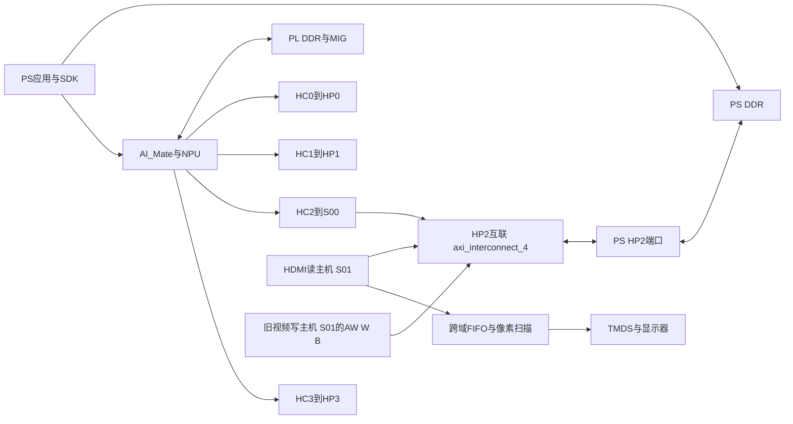

# HDMI启动故障工程排查交接

**收尾说明（2026-10-29）：** 本文保留 D45 的事实、假设与旧 r53 问题；后续演示采用保留消费的合格硬件及 180-query 主链，结果见[项目进度](../../PROJECT-PROGRESS.md)。D45／D47 根因仍未关闭，difficulty 已解决仅表示工程处置完成；旧诊断命令与远端路径不再作为恢复入口。

2026-10-24交接更新：本文以下是r26及此前的历史技术快照。后续已完成隔离反例、真实连续波形、原生协议检查及同启动有限消费；当前阻塞包含r53首次索引读取内容混合、持续实屏与联合长期。最新源码/数据流见[INTEGRATION](INTEGRATION.md)，最后恢复身份及额度见[RESUME](RESUME.md)，原值见[r53](../../tools/pose-v1/evidence/hdmi-pipeline-20261024-r53/RESULTS.md)。文中“PS内部HP FIFO”旧假设以[官方资料判读](diagnostics/PROTOCOL-CHECKER-REVIEW-20261023.md)的修正为准；旧操作方案不恢复授权。

更新日期：2026年10月20日。适用对象：悟净Lite／FMQL30TAI／ZG330，现行Vivado2018.3原厂030ai与JFM适配工程。面向接手PS、PL、AXI互联及启动固件排查的工程师。

**首要问题D45：同一候选BOOT在不同启动中可健康，也可在SDK加载前出现PS HP2读返回持续有效、HDMI入口持续背压。r24已使PL侧HP2互联发生实际复位，r25仍复现，根因未定。** 已完成的r13三窗新推理到HDMI属于一次健康启动下的有界功能通过，不能作为启动故障修复证据。

执行状态更新（2026-10-21）：r26记录器已完成实际bit／BOOT及1次无SDK故障取证，取消第2候选并安全回原BOOT，包关闭、余额0，无后台工作。PS输出初态已高，PL释放后HDMI保留返回而PS随后空闲；仅等待PS高电平不是充分修正。当前缺匹配PS复位资料，用户将咨询官方。[r26实际结果及限制](D:/FPGACompetitionProject/tools/pose-v1/evidence/hdmi-ps-release-20261020-r26/PLAN.md)及[实时状态](D:/FPGACompetitionProject/tools/pose-v1/evidence/hdmi-ps-release-20261020-r26/state.json)优先于本文以下交接时技术快照和过期的“暂停／待实现”表述。[恢复入口](D:/FPGACompetitionProject/FPGA/hdmi_candidate/RESUME.md)。模块不删减，旧DATA独立暂停，FAT不修，HDMI长期验证须单独批准。现行执行规则见[Agents.md](D:/FPGACompetitionProject/Agents.md)。

## 接手时先阅读的结论

1. 先以第4节的r25故障原值为复现判据，再检查第5节的实际复位和PS引脚契约；不要从头重做已通过的静态色条和骨架回放。
2. `RVALID=1 && RREADY=0`持续存在本身符合背压保持规则。疑点在于返回的请求来源、初始化状态和复位经历，不能把持续VALID直接判成协议违规。
3. PS出口RID=`0x20`、HDMI入口RID=`0`与S01来源位加原ID0的路由相容；该数值本身不是ID截断证据。
4. 64B DMA曾成功，但该样本只覆盖HC0，不能替共享HP2证明健康；也不能把问题概括为每次开机整条总线均死锁。
5. 正确按键是PL_KEY1／SW6／F8。PL_KEY2／SW7／E7是SDI GTX复位。旧SW7测试不能判断F8复位是否生效。
6. 观测器清零、PL互联复位、PS HP2内部FIFO复位是三个不同结论。目前前两者有证据，第三者没有直接证明。
7. 原厂适配将对外HP2 RCOUNT／RACOUNT固定为0，原语同名引脚被复用为NPU数据。不能借这些端口读FIFO占用，也不能改回通用Xilinx映射。
8. 还缺PS侧HP2复位输出与PL复位释放的共同时间轴，以及观测开始前活动、旧视频写事务的证据。下一步先补这类被动记录。

## 1 系统范围与实际数据通路

架构按[ADR_49](D:/FPGACompetitionProject/ADR/ADR_49.md)：PS与NPU负责感知，PS绘制本地骨架帧，PL读帧并输出HDMI，PC另负责高质量3D展示。当前HDMI应用不启动VPU／RTSP。NPU计算硬核集成在器件中；`AI_Mate`是PL侧的重要配套，不能整块当作视频冗余删除。



箭头表示逻辑接口关系，读数据按请求的反方向返回。PS DDR中的HDMI帧缓冲与NPU使用的PL DDR是不同对象。SDK的全部参数／权重搬运并非仅走HP2；实际四路HC分别连接四个HP端口，其中HC2与HDMI共享HP2。

### 1.1 HP2接口与ID

实际生成模块实例为`U0_ps_ai_peripheral/ps_ai_wrapper_u0/ps_ai_i/axi_interconnect_4`，类型为`ps_ai_axi_interconnect_3_0`。上游两个从接口S00／S01各为5位原始ID，下游PS接口为6位ID，数据宽64位，AXI3、ARLEN为4位。

| 边界 | 功能 | 需对应核查的信号 |
|---|---|---|
| S00 | AI的HC2 | `S2_AXI_HP_HC_*`，进入BD后为`S_AXI_HP2_0_*` |
| S01读侧 | 新HDMI reader，ARID固定0 | 外围`S_AXI_HP2_AR*`／`S_AXI_HP2_R*`，进入BD后为`S_AXI_HP2_1_*` |
| S01写侧 | 保留的旧相机搬帧 | `frame_to_ps_inst0`的AW／W／B；未被新HDMI接管 |
| M00到PS | 两来源合并后的HP2 | `axi_interconnect_4_M00_AXI_AR*`／`R*`，也是读观测通道5 |

实际xbar配置`C_AXI_ID_WIDTH=6`、`C_S_AXI_BASE_ID=64'h0000002000000000`、两路thread ID width均5。S00基ID为0，S01基ID为32。返回流水线必须同时保持来源位和原ID；S01的PS侧RID32被还原为HDMI侧RID0符合该映射。配置可查[实际xbar综合文件](D:/FPGACompetitionProject/.local/hdmi-boot-witness-20261019-r23/reference/fpai_demo_vivado.srcs/sources_1/bd/ps_ai/ip/ps_ai_xbar_4/synth/ps_ai_xbar_4.v)。

有限64笔连续读、并行读及背压仿真和实际网表连线审查未发现直接错线，但未穷尽启动、单侧复位、缓冲满载及所有事务交错。优化后的常量ID位被裁去不自动构成错误；历史所称“最后25个差异门”是比较结果，不是25处已证错误。

### 1.2 时钟与显示契约

| 时钟或资源 | 现行配置 | 取证限制 |
|---|---|---|
| GP／CSR | 100MHz | 可作新启动时间轴共同基准 |
| HP／source | 200MHz，MIG相关时钟路径 | 按键期间可能中断；没有时钟就没有source采样 |
| PS原语`SAXIHP2ACLK`与`AI_CLK102` | 实际r24 DCP中同为`clk_pll_i` | 不能仅凭两个名字推断额外时钟域 |
| HDMI参考 | AC14，100MHz | 不依赖SDI输入时钟 |
| 像素／串行 | 148.5MHz／742.5MHz | 对应1080p60候选配置 |
| 扫描 | 活动1920×1080，总2200×1125，HS44／VS5正极性 | STOP仍输出有效同步和黑色 |
| 像素格式 | RGB565LE，低16位像素先出 | PS原绘图为1280×720 RGB24，经双线性转换 |
| 双缓冲 | 每帧4,147,200字节，总8,294,400字节 | SDK实际分配、64字节对齐；地址不硬编码 |
| 跨域FIFO | 512×64位，4096字节 | 有效像素带宽248,832,000 B/s；满FIFO约13.79µs消费余量，仅为配置计算 |

板上为FPGA IO直接输出HDMI，原厂原理图对1080p60不作保证。已有静态／动态图案实屏成功，但无完整眼图、电气裕量或长期验收。该限制不能解释SDK前的PS HP2异常，需单独管理。[引脚与电气依据](D:/FPGACompetitionProject/FPGA/hdmi_candidate/PIN-CONTRACT.md)。

## 2 故障定义与已完成能力

| 编号 | 故障或未验项目 | 当前状态 |
|---|---|---|
| D45 | 跨启动偶发HP2返回异常、HDMI返回支路持续背压，可能导致参数上传／4KiB DMA失败 | 首要阻塞；完全无SDK的启动已复现；根因未定 |
| D44 | 首次动态读帧START出现`faults=2`、未采纳首帧／黑屏 | 后续图案与骨架通过；首次失败根因仍未定 |
| D29／D41 | 严格实时及推理长尾 | 独立推理历史有长尾；HDMI联合实时性未验收 |
| HDMI连续长期 | 连续新推理、换帧、内存及视频稳定性 | 未开展；用户要求启动稳定后另行批准 |
| D43 | 启动FAT脏标志及2168个未引用簇，来源不明 | 文件身份一致，未修复；不得并入本次排查顺手处理 |
| D25 | 旧模型DATA首次坏读调查 | 独立暂停，不能与D45直接视为同因 |

`faults=2`表示HDMI故障位1为reader错误，不是精确AXI错误码。该位会汇总读响应错误、RID检查转入的错误、拍数／RLAST或非法请求等条件，不能单凭2定位某一根信号。

已经取得的功能证据：修正后静态八色条稳定；实际SDK双帧全写全读一致；两幅四色图案和三份历史真实骨架回放得到现场确认；r13四档DMA与三次新推理到HDMI通过，含STOP排空和帧释放。上述分别证明相应层级，不构成每次启动均可靠或连续CSI长期验收。

## 3 从初始显示失败到启动排查的关键过程

| 阶段 | 现象或处理 | 可保留的结论 |
|---|---|---|
| 早期参考显示 | 显示器报时序不支持；参考RTL仿真显示200MHz扫描约80.81Hz，并发现仅按RVALID计数及停消费可能卡读 | 原参考源码有风险；不能由此倒推原BOOT每个现场故障的内部因果 |
| 10月15至16日显示修正 | 独立148.5MHz像素时钟；TMDS字符串改为`10'b1111100000`；AXI握手、4KiB拆分、FIFO、换帧及STOP控制独立实现 | 目标模型TMDS时钟占空比20%到50%；r5整机候选实际显示稳定八色条 |
| 10月17日动态显示 | 首次图案START fault2；保存失败并STOP。用户要求重测后，核验原故障安全停止状态、确认错误后清错，再用新进程测试 | 两图案颜色与顺序稳定；三份真实历史骨架回放通过。该处理未修复首次失败根因 |
| 首次新模型接入 | `Session.apply`参数上传阶段SDK DMA异常 | 当时新推理0；不能用历史骨架回放替代新推理 |
| r9与同位流诊断 | reader边界谓词等价缩短并通过实际时序；r9首包64B成功、4KiB SDK内部5000ms超时，exit71 | 不继续64KiB／1MiB及推理，已回退；未证明4KiB阈值或拥塞就是根因 |
| r13 | 同r9位流；Open前纯CSR健康；Open后与64B后分段；四档完整DMA全部一致，再执行新推理 | 三个不同窗口实际前向、数值与三帧采纳通过，现场确认正常；仅该启动通过 |
| r14至r20 | 分离库加载与Open，既有失败程序有的已链接SDK；SW7按键未清零 | Open前可以异常；旧SW7结论后来作废，不能据此认定F8硬件复位缺失 |
| r21 | 纠正SW6／F8后，健康启动按键使CSR从0/2/2回0/0/0，后续一次Open健康 | 证明正确SW6能清观测器；该次按前已健康，不能证明按键治故障 |
| r22 | Open前故障；正确SW6清零CSR，重新纯CSR采样仍持续返回背压 | 排除“按错键／只读旧快照”对该样本的解释；未证明所有域复位正常 |
| r23 | 增加从首个source时钟起保留的启动历史；无SDK即异常；正确SW6清CSR，但未见HP2 PL互联复位 | Open／本轮SDK加载不是必要触发条件；补出实际复位覆盖缺口 |
| r24 | 原复位IP的`dcm_locked`由1改为DDR就绪；启动及SW6后实际PL互联复位均有见证；按后一次Open健康 | 只修改PL就绪门，未触及PS内部FIFO；无DMA／推理／HDMI START |
| r25 | 不重编，复用同r24 BOOT，无按键第1次启动在SDK前故障，取消后续样本并回原BOOT | “PL互联未复位”不是充分解释；r24没有根治跨启动问题 |
| r26离线 | 核对实际DCP和厂商PS封装，发现FIFO假计数及未观测PS复位输出 | 已准备被动PS／PL时间轴方案；尚无新观测RTL、bit、BOOT或实板结果 |

详细结果优先查[r22](D:/FPGACompetitionProject/tools/pose-v1/evidence/hdmi-library-reset-20261019-r22/PLAN.md)、[r23](D:/FPGACompetitionProject/tools/pose-v1/evidence/hdmi-boot-witness-20261019-r23/PLAN.md)、[r24](D:/FPGACompetitionProject/tools/pose-v1/evidence/hdmi-hp2-ready-20261020-r24/PLAN.md)、[r25](D:/FPGACompetitionProject/tools/pose-v1/evidence/hdmi-startup-stability-20261020-r25/PLAN.md)。健康／故障样本的前置顺序不一致，不能合并计算启动可靠性比例。

### 3.1 r13成功运行的实际方法与证据

执行顺序是：候选启动并先恢复原BOOT文件；未Open时检查观测窗；Open后检查；64B完整往返后检查；4KiB、64KiB、1MiB分别完整往返和检查；全部通过后另行运行共享Engine与HDMI。Engine主线程持有同一Device，模型初始化完成后显式交给显示适配，统一管理SDK分配器和双缓冲生命周期。

该包Open后与64B后设置约20ms间隔。ARM／FREEZE只控制诊断计数与快照，不复位功能通路。没有对照证据证明20ms、观测命令或某个软件等待修复了启动故障。

| 新推理输入 | 显示帧ID | process耗时 | 受检最大关节偏差 |
|---|---:|---:|---:|
| S11_01_308 | 1000000 | 33.18888ms | 0.9765625mm |
| S11_01_309 | 1000001 | 23.52012ms | 0.9765625mm |
| S11_01_310 | 1000002 | 23.57173ms | 0.48828125mm |

全部分数逐位一致、输出有限，受检候选符合现行score>0.2、最大关节三维欧氏偏差≤3mm门限。绑定记录为1027原算子、1021 HardOp、6个直接Host算子、5个有效ZG组，运行时最终计数612；这些数值仅属该包，不把旧745／736或612强塞给其它图。每帧保持约5秒供观察，重复扫描不算新姿态；本次三帧并不是连续实时采集吞吐测试。

原始[verification.tar](D:/FPGACompetitionProject/tools/pose-v1/evidence/hdmi-preopen-20261018-r13/verification.tar)内：`run/metadata/full-dma-review.json`、`run/preopen/trace.jsonl`、`run/full-dma/trace.jsonl`、`run/shared/inference/frames.jsonl`、`run/shared/inference/summary.json`、`run/shared/inference/engine/binding-summary.json`及实际输出。最终summary明确fresh_inferences=3、HDMI_frames_adopted=3、STOP／释放完成、Engine销毁，VPU／RTSP未启动，严格实时／长期未验。

## 4 最新故障样本的完整判读基准

r25仅执行候选启动1次和原BOOT回退1次。SDK加载／Open、按键、DMA、推理及HDMI START均0。候选运行ID为`f7e3af86-a439-4beb-895a-fc82f4bd4e46`；其BOOT与r24相同。SSH恢复后先还原并完整读回7,023,552字节原BOOT，再采纯CSR及同一次FREEZE的启动历史。

### 4.1 ARM后窗口

初始`ABI/count/status/request/response = 0x41495201/104/0/0/0`。ARM／FREEZE后有效窗口4,018,538个source周期；按200MHz约20.09269ms。

| 观测项 | 实测原值 | 含义 |
|---|---:|---|
| source_flags | 0x19 | DDR已校准，UI reset=0，hp_clk_rst=0，PL互联ARESETN=1，pl_rst_n=1 |
| 复位观察周期 | 0 | 仅该ARM窗口未见目标复位，不代表启动期间没复位 |
| 六边界ARVALID／AR握手／R握手 | 均0 | 该窗口没有已观测读请求或完成的读拍 |
| PS出口RVALID／R背压周期 | 均4,018,538 | 整窗RVALID=1、RREADY=0 |
| HDMI入口RVALID／R背压周期 | 均4,018,538 | 返回已传播到S01支路，HDMI没有消费 |
| PS当前引脚字 | 0x0102dc06 | 当前RID32、RRESP0；不是已接受事务的记录 |
| HDMI当前引脚字 | 0x0002c006 | 当前RID0、RRESP0 |
| non-OKAY R握手计数 | 各通道0 | 没有握手，不能由此证明所有返回合法 |

其它通道在RVALID=0时的RID／RRESP无有效返回语义；例如读到非0 RRESP不能单独计作传输错误。

### 4.2 从配置后首次source采样起的历史

| 历史项 | 实测值 |
|---|---:|
| source累计周期 | 7,323,136,879 |
| GP累计周期 | 3,661,388,697 |
| PS AR原始握手累计 | 0 |
| PS R原始握手累计 | 6 |
| HDMI AR／R原始握手累计 | 0／0 |
| 首PS RVALID早于任何已观测AR标记 | true |
| 复位期间PS原始RVALID标记 | true |
| 首个ready条件PS RVALID的RID／RRESP | 32／0 |
| 首RVALID周期模2³² | 11,658,424 |
| GP合并复位断言次数 | 0 |
| HP2侧PL互联复位断言次数 | 1 |
| HP2复位低电平GP周期 | 5,657,425，名义约56.57425ms |
| 相关握手／GP计数溢出标志 | 0 |

PS原始6次R握手包含复位期样本，不可称6笔合法读事务。历史无法覆盖source时钟开始之前；“从未观察到AR”不等于已经证明物理上从未发生AR。累计source周期已跨32位回绕，但首事件只有模值，不能把11,658,424直接换算为配置后绝对时刻，更不能拿它与GP复位宽度相减。

104字窗口和source启动历史在同一FREEZE源边沿切面保持，GP统计在CSR确认发布时取样，存在域间切点差异。`source_flags=0x19`是快照末态，不代表之前整个启动期一直如此。

原始归档：[evidence-r25-20261020.tar](D:/FPGACompetitionProject/tools/pose-v1/evidence/hdmi-startup-stability-20261020-r25/evidence-r25-20261020.tar)。关键成员：`run-1/observe-before/trace.jsonl`、`run-1/capture-before/raw.jsonl`及对应stdout／stderr。已解码结果：[cycle-1-decoded.json](D:/FPGACompetitionProject/tools/pose-v1/evidence/hdmi-startup-stability-20261020-r25/cycle-1-decoded.json)。

## 5 复位关系与原厂适配中的关键限制

### 5.1 必须分开观察的复位层

| 信号或对象 | 实际来源与作用 | 已证明与未证明 |
|---|---|---|
| `sys_rst` | PL_KEY1／SW6／F8，按下高、松开低 | 正确按键可清零观测器；不是PS整机复位 |
| `rx_gtx_full_reset` | PL_KEY2／SW7／E7 | 用于SDI GTX；旧r18／r20按它不能检验F8 |
| `FCLK_RESET0_N` | PS侧输出，参与外围复位组合 | 未独立证明其与PS HP2内部复位同义 |
| `gp_clk_rst`／`hp_clk_rst` | `demo_clkrst_wrapper`分别在GP／DDR时钟下两级采样`sys_rst或~FCLK_RESET0_N或soft_rst` | 原封装该段为同步采样；时钟停时不能假设脉冲仍被捕获 |
| `ddr_clk_rst`／MIG路径 | 原封装组合复位及MIG基础PLL相关路径 | 按键可能使HP时钟中断；仿真及r24计数支持该机制 |
| `proc_sys_reset_1.peripheral_aresetn` | HP2侧PL互联复位；r24增加DDR就绪输入 | 实际同时连ARESETN、M00_ARESETN、S00_ARESETN、S01_ARESETN；不等于PS内部FIFO复位 |
| HDMI CSR／mem复位 | 分别为`~gp_clk_rst`／`~hp_clk_rst` | 与互联复位不是同一条命名信号；需比较实际断言／释放关系 |
| 观测器复位 | `sys_rst_n & FCLK_RESET0_N`；内部各域释放链 | 清零证明只覆盖自身；启动历史另按配置初值跨本地复位保持 |
| PS原语`SAXIHP2ARESETN` | PS原语的输出，厂商wrapper有转发 | 生成PS顶层未导出；r24 DCP该输出无网络、无下游；确切PS内部语义待厂商确认 |

生成BD中`proc_sys_reset_1.ext_reset_in`来自`reset_n_1 & soft_rst_n_1`；wrapper将`reset_n`接`sys_rst_n & FCLK_RESET0_N`、`soft_rst_n`接`~soft_rst`。原复位IP极性已有核对，不应只看名称再次猜测反相错误。

### 5.2 r24修正做了什么

```verilog
// 原生成设计
.dcm_locked(1'b1)

// r24实际使用
.dcm_locked(hp2_domain_ready)
// 外围显式传入
.hp2_domain_ready(ddr3_init_done & ~ddr_ui_rst)
```

原IP对照表明：已知初始化后，运行时钟能识别复位；停钟期间完整输入脉冲可能漏采；保持输入到时钟恢复或用DDR就绪门，可让恢复阶段产生复位。r24实板按键后GP与source计时差约2.32686s，与GP复位累计高约2.32696s相符；这是计数支持，非示波器波形或PS FIFO清空证明。

r24启动与SW6后均有HP2互联实际复位，按后一次Open健康。随后r25不按键的SDK前故障说明这项修正并未消除所有启动问题。不要直接把延长相同PL复位或重复按键列为已证修复。

### 5.3 FIFO计数接口不能套用通用PS7解释

实际厂商`PS7_wrapper`把公开`SAXIHP2RCOUNT`输出为`8'h00`、`SAXIHP2RACOUNT`输出为`3'b000`。原语的8＋3根同名引脚复用于NPU `pl_awdata`的部分位。RCOUNT位0到7依次对应376、382、381、378、370、366、373、372；RACOUNT位0到2依次对应385、391、390。

因此计数0不证明FIFO空，原语同名引脚有动态也不能当FIFO占用。当前没有核实到该器件／固件的PS内部FIFO状态／清空寄存器契约。现有A7 BSP的地址定义与本任务AArch64启动环境不能直接混用。FSBL未变及其`ps_init`调用五次`ps_config`只属静态事实，不能证明具体内部复位时序正确。

复核入口：[source-contract.json](D:/FPGACompetitionProject/tools/pose-v1/evidence/hdmi-ps-release-20261020-r26/source-contract.json)、[实际原语连线与时钟结果](D:/FPGACompetitionProject/tools/pose-v1/evidence/hdmi-ps-release-20261020-r26/physical-summary.json)、[FSBL静态调用](D:/FPGACompetitionProject/tools/pose-v1/evidence/hdmi-ps-release-20261020-r26/fsbl-ps-init-calls.json)。

## 6 现有诊断接口及使用边界

### 6.1 CSR地址

以下地址只适用于已核验候选运行，不能因原BOOT文件已恢复就假定运行中也是候选，或向原BOOT盲写这些窗口。原BOOT文件恢复与运行中回退是两个动作。

| 窗口 | ABI与用途 | 命令 |
|---|---|---|
| `0x400b0000–0x400b00ff` | HDMI core ABI `0x48444d01`；板级`+0x40` ABI `0x48445301` | `+0x0c`：0快照、1启动、2提交换帧、3停止、4确认清故障 |
| `0x400b0100`旧事件窗 | ABI `0x41494401`，24字MIG／PL数据通路诊断 | `+0x00`写1请求一次快照；不能替代读路径历史 |
| `0x400b0400–0x400b05ff` | ABI `0x41495201`，104字六边界读快照；r23起附19字启动历史 | `+0x00`写1 ARM、写2 FREEZE，仅改变诊断状态 |

HDMI `+0x04/+0x08`为地址／ID参数，`+0x10/+0x14/+0x18/+0x1c/+0x20`为最近原子响应status／stopped ID／adopted地址／adopted ID／faults，`+0x24/+0x28`为提交／响应代数。命令应答不等于实际翻帧完成。status位0 safe_idle、1运行、2 reader busy、3帧读活动、4待采用地址、5等待burst、6同步lock、7停止中、8已有当前地址、31拒绝；faults位0失锁、1读错误、2帧重叠、3欠载。

### 6.2 六边界读快照

诊断窗口偏移：`+0x00`读busy／sticky command_error，`+0x04`ABI，`+0x08/+0x0c`请求／响应代数，`+0x10`字数104，`+0x40–+0x1dc`为冻结数据。

通道依次为0 HC0、1 HC1、2 HC2、3 HC3、4 HDMI入口、5 HP2互联对PS出口。全局word0 ABI，word1 source窗口周期模32，word2 flags，word3复位观察周期，word4至7保留。通道c的起点为word`8+16*c`。

| 通道内字偏移 | 字段 |
|---|---|
| 0／1／2／3 | AR握手／R握手／RLAST握手／非OKAY R握手次数 |
| 4／5 | ARVALID且非ARREADY周期／RVALID且非RREADY周期 |
| 6／7 | ARVALID周期／RVALID周期 |
| 8／9／10 | 最后AR地址／AR元数据／R元数据 |
| 11 | 最近引脚组合字，属于采样末态，非事务台账 |
| 12／13 | 首次非OKAY R握手元数据／周期模值 |
| 14／15 | 最后AR或R握手周期／累计已接受LEN+1 |

word11解码：bit0 ARVALID、1 ARREADY、2 RVALID、3 RREADY、9:4 ARID、13:10 LEN、16:14 SIZE、18:17 BURST、24:19 RID、26:25 RRESP、27 RLAST。flags bit0 DDR校准、1 UI reset、2 hp_clk_rst、3 PL互联ARESETN、4 pl_rst_n。

只有在ARM确认完成后才开始该窗口负载，FREEZE确认完成后读取全部104字；读取前后校验status与同一代数，先保存完整原值再判读。初始五寄存器不符应先保存再退出，不通过额外ARM、复位或重试把异常现场覆盖掉。硬件可支持后续窗口，具体软件只接受所属包预先规定的代数，不能由现场值推断前序成功。

计数32位，在200MHz下周期计数约21.47s回绕。它没有完整RDATA或逐ID在途队列；AR计数0只能约束已观测范围。元数据和地址单位须遵循各边界实际契约，不能拿不同边界的计数相等或READY为1当DMA完成证明。

完整定义：[六边界观测协议](D:/FPGACompetitionProject/FPGA/hdmi_candidate/diagnostics/ai_read_monitor.README.md)。早期[SDK探针说明](D:/FPGACompetitionProject/FPGA/hdmi_candidate/software/AI-READ-MONITOR.md)描述最初单窗口四档流程，不能覆盖r13后来加入的阶段间ARM／FREEZE；r13实际顺序以归档trace为准。

### 6.3 启动历史

扩展ABI为`0x42545201`。19字中的0至10位于窗口`+0x014–+0x03c`，11至18位于`+0x1e0–+0x1fc`，与104字快照共用同一次FREEZE。字3至6为PS AR／PS R／HDMI AR／HDMI R原始累计，字9至10为路径ready且DDR校准后的首次PS RVALID引脚字／周期模值，字13至17为GP与PL互联复位次数及宽度；完整位定义见[启动历史协议](D:/FPGACompetitionProject/FPGA/hdmi_candidate/diagnostics/README.md#r23启动历史与复位见证)。

`capture_boot_witness.cpp`只读已完成FREEZE，不负责ARM／FREEZE。它要求新输出绝对路径、明确的已完成偶数代数、匹配当前boot_id，并验证扩展已发布位。先由当前合法观测流程完成FREEZE，才能调用该采集器，不能把它当成“只运行一次就开始新观察”的程序。

健康探针的exit0有时仅表示成功保存快照；还要看独立解码的healthy字段。异常退出也不必然是SDK失败，须区分SDK原异常、ABI／代数拒绝和“成功采到故障后按规则停止”。如r22按后纯CSR采集器退出0，保存的总线状态仍为异常。

## 7 实际工程与产物定位

### 7.1 运行环境与身份

| 对象 | 现行值 |
|---|---|
| 工作区 | `D:/FPGACompetitionProject` |
| 板卡 | 悟净Lite，FMQL30TAI／ZG330；Procise器件`JFMQL30TAI676H` |
| 原厂适配前端PART | `xc7z030ffg676-2`，必须与030ai／JFM环境一起理解 |
| Vivado | `D:/vivado18.3/Vivado/2018.3`，Build2405991；既有030ai与IP库补丁保留 |
| Procise | `C:/FudanMicro/Procise`，2025.1.1 temp／SVN32494；既有ICAP／VCCM后处理 |
| SDK与交叉编译 | Icraft／SDK3.39.0，FPAI容器内ARM64 GCC9.4／CMake3.24.2 |
| SDK设备 | `axi://zg330aiu?npu=0x40000000&dma=0x80000000`；device25122301，icore `FMSHZGV3TECH-AID - 24160628` |
| 通信 | SSH `root@192.168.126.49`，内存凭据及固定主机密钥；不在文档存密码 |
| 串口备用 | COM7，CP210x；115200，8N1，无流控，DTR／RTS关闭，使用前重新核对USB身份及占用 |
| 最后核验运行ID | 原BOOT `056656a3-abb3-4b45-888f-18b9658fe3b7`；是历史核验值，接手需重核实际状态 |

不接入Vivado MCP；不升级工具、IP或迁移库来碰运气。工艺／原语的通用Xilinx定义不能直接代替复旦微适配语义。

### 7.2 优先使用r24实际检查点

- [实际r24 Routed DCP](D:/FPGACompetitionProject/.local/hdmi-boot-witness-20261019-r23/reference/fpai_demo_vivado.runs/impl_hp2ready_r24/ai7030_edif_top_routed.dcp)
- [实际工程XPR](D:/FPGACompetitionProject/.local/hdmi-boot-witness-20261019-r23/reference/fpai_demo_vivado.xpr)
- [r24源码覆盖清单](D:/FPGACompetitionProject/tools/pose-v1/evidence/hdmi-hp2-ready-20261020-r24/source-overlay.json)
- [r24物理门检](D:/FPGACompetitionProject/tools/pose-v1/evidence/hdmi-hp2-ready-20261020-r24/qualification.json)、[原始时序](D:/FPGACompetitionProject/tools/pose-v1/evidence/hdmi-hp2-ready-20261020-r24/timing-final.rpt)、[布线状态](D:/FPGACompetitionProject/tools/pose-v1/evidence/hdmi-hp2-ready-20261020-r24/route-status-final.rpt)、[默认DRC](D:/FPGACompetitionProject/tools/pose-v1/evidence/hdmi-hp2-ready-20261020-r24/drc-final.rpt)

实际综合消费的是BD生成的[synth/ps_ai.v](D:/FPGACompetitionProject/.local/hdmi-boot-witness-20261019-r23/reference/fpai_demo_vivado.srcs/sources_1/bd/ps_ai/synth/ps_ai.v)，对应[r24 ps_ai.v覆盖副本](D:/FPGACompetitionProject/.local/hdmi-hp2-ready-20261020-r24/sources/ps_ai.v)，并使用[r24 ps_ai_wrapper.sv](D:/FPGACompetitionProject/.local/hdmi-hp2-ready-20261020-r24/sources/ps_ai_wrapper.sv)及[r24 ps_ai_peripheral.sv](D:/FPGACompetitionProject/.local/hdmi-hp2-ready-20261020-r24/sources/ps_ai_peripheral.sv)。目录中的独立`ps_ai_read_observed.v`不是这次真正综合输入，不能改它后就宣称修正已进DCP。重新生成BD可能覆盖手工生成HDL改动，应按[prepare_hp2_ready_candidate.py](D:/FPGACompetitionProject/FPGA/hdmi_candidate/scripts/prepare_hp2_ready_candidate.py)与覆盖清单重建关系；旧脚本包含已存在运行／目录假设，不直接在基线上反复执行。

r9对reader的等价时序优化在隔离发布来源中完成。仓库通用RTL适合阅读模块语义，若要重建r9相同输入，应以[r9候选发布说明](D:/FPGACompetitionProject/FPGA/hdmi_candidate/CANDIDATE-BOARD-READ-R9.md)及原始包为准，不能假定任意当前同名文件与已验收位流逐字节相同。

### 7.3 关键源码入口

| 排查对象 | 文件 |
|---|---|
| HDMI读握手及背压 | [hdmi_axi_read.v](D:/FPGACompetitionProject/FPGA/hdmi_candidate/rtl/hdmi_axi_read.v)；复位IDLE，ARVALID由ADDRESS状态驱动，RREADY仅DATA状态允许 |
| 请求／停止与帧边界 | [hdmi_scan_control.v](D:/FPGACompetitionProject/FPGA/hdmi_candidate/rtl/hdmi_scan_control.v)、[hdmi_scanout.v](D:/FPGACompetitionProject/FPGA/hdmi_candidate/rtl/hdmi_scanout.v) |
| 命令跨域与保持总线 | [hdmi_command_mailbox.v](D:/FPGACompetitionProject/FPGA/hdmi_candidate/rtl/hdmi_command_mailbox.v) |
| FIFO／扫描 | [hdmi_stream_fifo.v](D:/FPGACompetitionProject/FPGA/hdmi_candidate/rtl/hdmi_stream_fifo.v)、[hdmi_pixel_scan.v](D:/FPGACompetitionProject/FPGA/hdmi_candidate/rtl/hdmi_pixel_scan.v) |
| RID检查／板级接口 | [hdmi_board.sv](D:/FPGACompetitionProject/FPGA/hdmi_candidate/rtl/integration/hdmi_board.sv)；入口RID非0转成reader非OKAY响应 |
| CSR译码 | [hdmi_cam_router.sv](D:/FPGACompetitionProject/FPGA/hdmi_candidate/rtl/integration/hdmi_cam_router.sv)；高地址先译码，保留SDK低地址语义 |
| 时钟／物理发送 | [hdmi_clock_jfm.v](D:/FPGACompetitionProject/FPGA/hdmi_candidate/rtl/integration/hdmi_clock_jfm.v)、[uihdmitx.v](D:/FPGACompetitionProject/FPGA/hdmi_candidate/rtl/display/uihdmitx.v) |
| 六边界及启动记录 | [ai_read_monitor.sv](D:/FPGACompetitionProject/FPGA/hdmi_candidate/diagnostics/ai_read_monitor.sv)、[ai_boot_witness.sv](D:/FPGACompetitionProject/FPGA/hdmi_candidate/diagnostics/ai_boot_witness.sv) |
| SDK外独立CSR映射／状态机 | [r9_observer_mapping.hpp](D:/FPGACompetitionProject/FPGA/hdmi_candidate/software/r9_observer_mapping.hpp)、[r9_startup_observer.hpp](D:/FPGACompetitionProject/FPGA/hdmi_candidate/software/r9_startup_observer.hpp) |
| 启动历史采集／解码 | [capture_boot_witness.cpp](D:/FPGACompetitionProject/FPGA/hdmi_candidate/software/capture_boot_witness.cpp)、[capture_boot_witness.py](D:/FPGACompetitionProject/FPGA/hdmi_candidate/software/capture_boot_witness.py) |
| 库加载及Open隔离 | [library_reset_board.py](D:/FPGACompetitionProject/FPGA/hdmi_candidate/scripts/library_reset_board.py)、[reset_key_board.py](D:/FPGACompetitionProject/FPGA/hdmi_candidate/scripts/reset_key_board.py) |
| 旧视频与同步复位 | [frame_to_ps_largebuf.v](D:/FPGACompetitionProject/.local/hdmi-boot-witness-20261019-r23/reference/rtl/display/frame_to_ps_largebuf.v)、[frame_read_write_largebuf.v](D:/FPGACompetitionProject/.local/hdmi-boot-witness-20261019-r23/reference/rtl/display/frame_read_write_largebuf.v)、[demo_clkrst_wrapper.v](D:/FPGACompetitionProject/.local/hdmi-boot-witness-20261019-r23/reference/rtl/utils/demo_clkrst_wrapper.v) |
| 新推理与帧资源 | [HDMI应用](D:/FPGACompetitionProject/software/hdmi_demo/main.cpp)、[hdmi_output.cpp](D:/FPGACompetitionProject/software/core/display/hdmi_output.cpp)、[hdmi_canvas.cpp](D:/FPGACompetitionProject/software/core/display/hdmi_canvas.cpp) |

### 7.4 BOOT和位流唯一身份

| 对象 | 字节数 | SHA256 |
|---|---:|---|
| 原BOOT | 7,023,552 | `ff350477e624c50d2f8180fb4b9130ec7688fbc7ca553412ed7c3dd2a68b31ef` |
| r9 BOOT，含r13所用配置 | 7,023,552 | `a0fe608bb4890f941238b1557f2202987116d1e25669f220fcb4b84fec11fb00` |
| r24 BOOT，亦为r25所用 | 7,023,552 | `a0ed66d07ba05d80c3d0188d93afda1036a9c7df212ce9badb74b229c61e3e49` |
| r24原始bit | 5,980,025 | `900479d9c6b5c9bbbb9965c37e07eb9d851bed9a0889aa09c7020379e0e76530` |
| r24 Procise后处理bit | 5,980,609 | `66d025f7cfa7866c24b64d8d43c8d57f0ae8a126e94004013ec16ab5b9de953d` |

实际[r24 BOOT](D:/FPGACompetitionProject/.local/hdmi-hp2-ready-20261020-r24/boot-package/BOOT-hp2-ready-r24.bin)仅PL分区改变；偏移186816，分区5,980,464字节，非PL字节全部与原BOOT相同，载荷32位字交换和填充已核验。原始bit与经Procise处理的bit用途不同，不能任意互换。[封装记录及三份PS固件身份](D:/FPGACompetitionProject/tools/pose-v1/evidence/hdmi-hp2-ready-20261020-r24/package-review.json)。

SDK六库／九启动文件的保护身份集中于[r25最终审计](D:/FPGACompetitionProject/tools/pose-v1/evidence/hdmi-startup-stability-20261020-r25/final-audit.json)，不在此复制整份清单。`qualification.json`的board_tested=false以及package-review的deployed=false是离线生成时字段，后续r24／r25确已上板；判读应结合后续实板记录，不回写旧阶段文件来伪装全程状态。

### 7.5 时序和资源的实际限制

r24完整布线WNS +0.030ns、WHS +0.010ns、TNS／THS=0，内部未约束端点0；新DDR就绪路径要求5ns、裕量+0.585ns，启动保持总线10ns与五个GP首级5ns要求有效，bus skew违例0。仍有原AI两处Min Period −0.409／−0.071ns特批例外，`raw_timing_pass=false`。默认DRC原SDI REQP-52／56仍报错；正式bit仅按原批准REQP-44／46／52／56处理，0 Error、58 Warning、32 Advisory。不得新增豁免、改频率或掩盖约束以取得“通过”。

实际r24 Routed资源：Slice18,332／19,650＝93.29%，LUT43,305／78,600＝55.10%，FF64,097／157,200＝40.77%，BRAM36等效97.5／265，DSP8／400；控制集2,052。高Slice占位与LUT百分比不是一回事，STA通过也不能证明协议／CDC／启动时序正确。[完整模块资源](D:/FPGACompetitionProject/FPGA/hdmi_candidate/R24-RESOURCE-AUDIT.md)。

用户明确不删模块。诊断仍有定位价值，旧视频控制还提供soft_rst及寄存器响应。旧读FIFO的计数实际进入读控制器，再影响旧AXI写取数控制，不能按“旧读请求已固定0”直接绑常量。此前目录名r27只代表保守依赖核验，未生成r27候选位流。

## 8 当前假设与能区分它们的证据

下列优先级属于基于现有样本的排查判断，不是根因结论。

| 假设 | 当前支持或限制 | 需要的判别证据 |
|---|---|---|
| PS HP2与PL互联释放不协调 | r24未将真实PS HP2复位输出纳入就绪；互联实际复位仍可故障 | 同一时间基准的PS／PL断言、最后释放、时钟恢复与首AR／RVALID；事件间隔须大于同步分辨率才定先后 |
| PS内部返回状态未初始化／未清除 | 无SDK时PS出口已有RVALID；局部PL复位不能证明PS队列清空 | 原厂确认的内部复位契约、配置前活动或合法可观测状态；不能用假RCOUNT替代 |
| 启动／复位边界发生短暂请求 | source开始前不可观测；旧视频写侧仍保留 | 覆盖更早阶段的时钟见证与AR记录，旧AW／W／B并行记录；写活动不自动解释读返回 |
| 互联ID／状态／寄存片错位 | RID32到HDMI0本身正常；现有有限仿真未发现错线 | 从有效AR建立逐ID台账，定位首次返回与来源标记；单侧复位和满载时是否破坏该关系 |
| VALID／READY与数据更新错误 | 能造成丢拍／错误ID；早期参考源码存在此类问题 | 每拍背压稳定性断言、首／末拍计数、地址握手及复位边界前后原值；检查实际候选而非旧参考 |
| 跨域邮箱／指针初始化不一致 | 异步复位、停钟与释放顺序是结构边界；受检保持路径已约束 | 各域复位相位变化、单侧复位、时钟暂停下toggle与指针行为；不能用静态时序替代功能检查 |
| 新骨架数据写入／翻帧先后错误 | 会影响显示内容或帧复用，但r25在START前已异常 | 若未来故障仅在START后，检查实际地址、写入完成、采纳ID及旧帧引用；当前优先级较低 |
| NPU与HDMI带宽竞争／资源高占用 | 可影响有负载性能；r25无SDK、无HDMI START，尚无因果证据 | 先区分空闲启动异常与有负载拥塞；不通过删模块、挪HP或改频率混合多个变量 |

## 9 握手和更新时序的专项检查

AXI基本判据：在有效时钟沿仅VALID与READY同时为1才完成传输；等待READY期间必须保持VALID及相应payload。R返回要对应已接受的读地址及原ID，拍数和RLAST匹配。`RREADY=0`时持续RVALID可为合法背压，不能主动拉高RREADY丢弃未知返回后宣称修复。[通用协议检查定义](https://docs.amd.com/r/en-US/pg101-axi-protocol-checker/AXI-Protocol-Checks-and-Descriptions)。该资料用于协议规则，不用于推断复旦微PS内部寄存器或复位语义。

离线TB可加入以下示意断言，对实际AR／R边界分别绑定。它们只覆盖稳定性，不能替代事务台账和复位契约：

```systemverilog
assert property (@(posedge aclk) disable iff (!aresetn)
    arvalid && !arready |=>
    arvalid && $stable({araddr, arid, arlen, arsize, arburst}));

assert property (@(posedge aclk) disable iff (!aresetn)
    rvalid && !rready |=>
    rvalid && $stable({rdata, rid, rresp, rlast}));
```

还应逐项检查：

1. VALID不等待READY才产生；背压期间不撤回已发布请求，不提前推进地址、数据索引或ID。
2. burst接收计数仅随`RVALID && RREADY`增加；首拍同状态转移、末拍非阻塞赋值所用旧计数、`LEN+1`和RLAST判断无差一拍。
3. 按每个ID维护有序请求队列和剩余拍数；同ID多笔不能只用一个布尔outstanding。覆盖S00／S01交错、返回背压和多笔在途，保留完整来源位。
4. 在复位有效及有效释放后首周期检查协议规定的VALID状态；对复位期间原始管脚记录单独标注，不当合法事务。单侧复位前的在途请求不能在无解释下从台账删除又继续接收旧返回。
5. HDMI reader在IDLE保持ARVALID=0、RREADY=0符合其一次在途设计；在没有匹配请求时强制RREADY=1不是正确性修复。
6. 对命令邮箱检查payload_hold先被源域保存，并保持到响应返回；toggle及应答跨复位后是否被误认作新命令。不能把多位payload每位各打两拍当作一致传输证明。
7. 对FIFO检查双方复位、Gray指针及满／空标志在停钟和单侧释放时的初态；状态复位和真正异步同步链分别约束。
8. 对旧AXI写侧同时检查AW、W、B独立握手及数据保持。不要仅因未加载SDK就假设旧主机绝对无活动。

已有TB入口：[tb_hp2_idle.sv](D:/FPGACompetitionProject/FPGA/hdmi_candidate/sim/tb_hp2_idle.sv)、[tb_axi_read.sv](D:/FPGACompetitionProject/FPGA/hdmi_candidate/sim/tb_axi_read.sv)、[tb_ai_read_monitor.sv](D:/FPGACompetitionProject/FPGA/hdmi_candidate/sim/tb_ai_read_monitor.sv)、[tb_ai_boot_witness.sv](D:/FPGACompetitionProject/FPGA/hdmi_candidate/sim/tb_ai_boot_witness.sv)、[tb_hp2_reset_clock_stop.sv](D:/FPGACompetitionProject/FPGA/hdmi_candidate/sim/tb_hp2_reset_clock_stop.sv)。PS内部硬核状态并未被这些TB完整建模；模型未复现不能排除实板初始化问题。

## 10 建议下一轮采用的最小诊断方案

本节为待实施方案，当前没有相应新RTL／bit／BOOT。原[r26定向方案](D:/FPGACompetitionProject/tools/pose-v1/evidence/hdmi-ps-release-20261020-r26/PLAN.md)已准备，恢复执行以用户明确唤醒及实际运行身份核验为前提。首轮继续无SDK、无DMA、无推理、无HDMI START，不靠屏幕观察或手动按键。

### 10.1 被动观测的最小增量

保持r24全部功能逻辑、DDR就绪门、互联四个复位连接、原模型／SDK／NPU映射和既有104字／19字协议不变。把真实PS `S_AXI_HP2_ARESETN`经厂商生成PS模块、BD和wrapper显式导出，仅接观测输入；先确认它的实际方向和语义，不驱动该输出，不直接把未知语义信号接入功能复位门。

| 必须记录的信号 | 目的 |
|---|---|
| PS HP2复位输出、PL互联复位、gp_clk_rst、hp_clk_rst | 区分各域断言和最后释放次序 |
| FCLK_RESET0_N、DDR ui_rst、calib_complete | 确认复位释放与DDR就绪是否一致 |
| HP时钟活动见证 | 区分没有事件与根本没有采样时钟 |
| PS出口及HDMI入口ARVALID／ARREADY、RVALID／RREADY | 判断请求／返回的最早来源及传播关系 |
| 首事件的ARADDR、ARID、ARLEN、RID、RRESP、RLAST | 区分合法在途返回、未记录请求和路由问题 |
| 旧视频及PS出口AWVALID／AWREADY、WVALID／WREADY／WLAST、BVALID／BREADY | 消除“无SDK即无全部总线活动”的盲区 |

采用配置后开始、跨本地复位保持的64位GP时间基准，记录初态、首个／最后释放与有界事件；事件表满后置溢出，首异常不可被后续覆盖。GP只记录同步后的电平与时间，不能将独立同步后的ARVALID与ARREADY相与作为原域事务计数；同拍握手、地址和元数据必须在HP源域一致锁存后发布。两个GP事件若相隔不足3周期，报告“顺序未分辨”，不伪造纳秒级先后。

新窗口拟`0x400b0600`，属于尚未实现的方案，必须先核对真实地址译码和别名冲突；不能向现有候选或原BOOT访问该地址。只读历史随既有FREEZE发布，不提供PS复位、RREADY、START或排空控制。首异常保存完整source周期扩展值，修正旧首事件仅有32位模时间的缺口。

### 10.2 离线验证和构建门

定向仿真覆盖PS先释放、PL先释放、两者接近、HP停钟期间复位、恢复后释放、复位期RVALID、无已观测AR的返回、首笔AR与首拍R邻近、有限事件表溢出及本地复位历史保持。逐项区分“模拟的PS响应情形”与“实板硅行为已复现”。

源码静态检查须证明真实PS输出确实到达观测端、假FIFO计数未被使用、旧接口不变。生成PS顶层新增外部输出可能使PS OOC失效，只重跑实际受影响OOC与顶层；复用其余有效IP及r24检查点，不升级IP、不重建无变化模型。新增逻辑应限于必要首事件／少量状态，先评估93.29% Slice下的布局空间和新增扇出。

完成实际目标的完整布局布线，复核setup／hold、内部时钟／未约束端点、Gray偏斜、旧与新保持总线、同步器和复位恢复／移除、路由及DRC，再生成实际bit及Procise后处理产物。沿用原两AI周期例外与限定GT处理，不增加其它例外。BOOT封装核验非PL全部字节、实际载荷及原恢复文件；不因脚本状态字符串差异重跑已完成EDA。

### 10.3 板端执行阶段及停止点

恢复后按以下阶段组织新包，旧r23／r24／r25均关闭、余额0，不重新激活旧记录：

1. 先核对当前boot_id、原BOOT与SDK身份、主机密钥、启动分区、设备占用及串口身份。原BOOT的主机完整备份和板端持久暂存必须可用，不用跨重启可能被清理的`/tmp`保存唯一恢复源。
2. 仅在有效授权范围内安装经离线核验的新候选并发一次启动命令；超时先确认原启动／进程状态，不重复重启。SSH恢复后先恢复原BOOT文件并完整读回，运行中候选身份另行记录。
3. 不加载SDK。先保存ABI／count／status／request／response原值；确认当前候选及合法初态后，完成一个明确代数的ARM／FREEZE，保存104字、19字及新时间轴。任一身份／代数／发布状态异常都保存后停止，不清错重采。
4. 首个样本有判别力的故障或采样无效，即停止后续候选和功能负载。若样本完全健康但仍缺对照，可在预先限定预算内做下一次启动；r26草案自设最多2次候选＋最后或异常时1次原BOOT回退，这是执行预算，不是本文件新授予的操作许可。
5. 结束核对原BOOT运行与启动文件、SDK身份、设备无占用，关闭本包。无进程owner只说明没有软件占用，不能单独当作AXI在途已排空证明。

| 新证据 | 可以支持的判断 | 随后动作 |
|---|---|---|
| 已确认PS复位仍有效，PL已可靠释放 | 两侧释放协调缺口 | 保存完整时间轴；按原厂语义评估把同步PS就绪加入原复位IP的单变量修正 |
| PS早于PL可靠释放，观察范围内没有AR却见PS RVALID | 仅“PL先释放”不足解释 | 转向PS初始化、配置前残留及更早请求；先取得有效PS内部契约 |
| 发现复位／未就绪窗口中的真实AR | 请求产生边界可能参与故障 | 锁定来源、ID及元数据，检查VALID初态／保持／两侧复位，不继续称无请求返回 |
| 合法S00 AR后返回被送S01 | 事务路由／状态错位方向 | 用完整ID与台账复现首个错误，检查流水线、来源位及单侧复位 |
| PS出口没有RVALID而S01出现RVALID | 互联内部或观测边界问题 | 核对同源一致采样，定位寄存片／缓冲初始化；不能据独立同步的异步快照定因 |
| 仅有旧视频写活动 | 证明存在此前未覆盖负载 | 继续核对读返回来源；写事务本身不是读返回异常的因果证明 |
| 事件太近、时钟未知或历史溢出 | 当前观测无判别力 | 修正观测，不追加SDK／DMA作为猜测性试探 |
| 多次健康 | 仅当前样本未复现 | 保留结果，不能把新布局下未复现当作已证根因修复 |

## 11 无需上板即可复核的方法

以下均为本地读取示例。命令中的路径对应现工作区，不启动SDK、构建或板端访问。接手若换机器，先调整实际根目录。

### 11.1 读取r13关键结果

在PowerShell执行：

```powershell
@'
import json, tarfile
from pathlib import Path
root = Path('D:/FPGACompetitionProject')
archive = root / 'tools/pose-v1/evidence/hdmi-preopen-20261018-r13/verification.tar'
with tarfile.open(archive) as t:
    dma = json.load(t.extractfile('run/metadata/full-dma-review.json'))
    print('DMA', dma['passed'], [(x['bytes'], x['full_equal']) for x in dma['files']])
    print(t.extractfile('run/shared/inference/frames.jsonl').read().decode())
    print(t.extractfile('run/shared/inference/summary.json').read().decode())
'@ | & 'C:/Users/cenyongdong/.cache/codex-runtimes/codex-primary-runtime/dependencies/python/python.exe' -
```

该命令不解包覆盖旧目录。检查summary与实际逐窗输出，而非只搜stdout的PASS。

### 11.2 从r25原始归档重新解码

```powershell
@'
import sys, json, tarfile
from pathlib import Path
root = Path('D:/FPGACompetitionProject')
sys.path.insert(0, str(root / 'FPGA/hdmi_candidate/software'))
from capture_boot_witness import decode, prefix_counts
archive = root / 'tools/pose-v1/evidence/hdmi-startup-stability-20261020-r25/evidence-r25-20261020.tar'
with tarfile.open(archive) as t:
    def rows(name):
        return [json.loads(s) for s in t.extractfile(name).read().decode().splitlines() if s.strip()]
    boot = rows('run-1/capture-before/raw.jsonl')
    initial = next(x for x in boot if x.get('event') == 'boot_witness_initial')
    raw = next(x for x in boot if x.get('event') == 'boot_witness_snapshot')
    assert initial['abi'] == 0x41495201 and initial['count'] == 104
    seq = initial['expected_sequence']
    assert initial['status'] == 0 and initial['request'] == initial['response'] == seq
    assert raw['after'] == dict(status=0, request=seq, response=seq)
    assert len(raw['words']) == 19 and raw['words'][0] == 0x42545201 and raw['words'][18] & 128
    epochs = rows('run-1/observe-before/trace.jsonl')
    legacy = next(x for x in epochs if len(x.get('words', [])) == 104 and x.get('sequence', x.get('request')) == seq)
    result = decode(raw['words'])
    result['raw_handshakes_at_or_before_current_ARM'] = prefix_counts(raw['words'], legacy['words'])
    print(json.dumps(result, indent=2))
'@ | & 'C:/Users/cenyongdong/.cache/codex-runtimes/codex-primary-runtime/dependencies/python/python.exe' -
```

已在本文交付时使用这段方法复核原始19字及同代数104字。它不把原始6次R握手重新命名为合法事务，不还原没有高位的首事件绝对时间。

### 11.3 在Vivado内读取既有物理连接

已有结果优先直接读第7节报告。只有需要进一步查询时，才在现行适配Vivado中打开DCP；下例不调用place／route／write_bitstream，不写旧检查点：

```tcl
open_checkpoint {D:/FPGACompetitionProject/.local/hdmi-boot-witness-20261019-r23/reference/fpai_demo_vivado.runs/impl_hp2ready_r24/ai7030_edif_top_routed.dcp}
puts [get_property PART [current_project]]
set ps [get_cells -hier -filter {REF_NAME == PS7}]
if {[llength $ps] != 1} {error {Expected one adapted PS7 primitive}}
foreach tail {SAXIHP2ACLK AI_CLK102 SAXIHP2ARESETN SAXIHP2RVALID} {
    set pin [get_pins -quiet [format {%s/%s} $ps $tail]]
    puts [list $pin [get_property DIRECTION $pin] \
        [get_nets -quiet -segments -of_objects $pin] \
        [get_clocks -quiet -of_objects $pin]]
}
set ready [get_pins -hier -quiet -filter {NAME =~ */proc_sys_reset_1/dcm_locked}]
puts [all_fanin -flat -startpoints_only -to $ready]
close_design
```

上述首组查询来自已执行的[只读DCP检查](D:/FPGACompetitionProject/tools/pose-v1/evidence/hdmi-ps-release-20261020-r26/inspect-physical.tcl)，后组关系已有[r24综合连接结果](D:/FPGACompetitionProject/tools/pose-v1/evidence/hdmi-hp2-ready-20261020-r24/synth-ready-connectivity.txt)。本文整理期间未重复启动Vivado查询。长工具调用超时不代表进程失败；先核对所属PID、创建时间、CPU跨窗口变化及日志／检查点进度，不自动销毁或启动重复负载。

## 12 功能恢复与验收条件

完成有判别力的启动观测后再选单变量功能修正。保留原r24及原BOOT，修正候选另存，不把观测器导致的新布局变化直接当作逻辑修复。

| 验证层 | 需要满足的条件 | 不能替代的结论 |
|---|---|---|
| 逻辑与物理实现 | 实际目标／输入对应，定向TB、完整布局布线、setup／hold、约束覆盖及既有范围DRC检查通过 | 生成bit不等于整机功能通过 |
| 启动稳定性 | 预先约定的热重启与冷上电样本，均在无SDK、无按键、无功能负载时保存启动顺序，无未解释返回；任何异常原值保留 | 单次健康或按键后健康不等于跨启动修复；冷上电需现场及相应授权 |
| SDK分段 | 纯CSR、库加载、Open、空闲、Close分别记录，无新增异常 | Open前故障不能归于Open；库加载前后须真实隔离 |
| DMA | 64B／4KiB／64KiB／1MiB完整source／actual保存后比较，检查对应边界状态；首失败停止 | 64B或DMA状态0不能替其它路径／完整内容正确 |
| 新推理数值 | 固定JSON／RAW／SDK；先完整保存输出，输入与分数逐位、所有候选有限且索引合法；仅score>0.2候选3mm门限 | 不放宽门限、不用晚读取修补首值，不套用于旧DATA |
| HDMI帧与生命周期 | 新推理结果、实际RGB565、帧ID／地址采纳、换帧和STOP安全释放一一对应；现场确认画面 | 回放／反复扫描不能算新推理率；ready和零计数不替代停止完成 |
| 连续长期与实时 | 用户单独批准后，记录新推理率、端到端与尾时延、欠载／fault、CPU／内存／句柄及像素映射 | 历史独立推理30分钟不替代HDMI联合长期；渲染刷新率不等于新姿态率 |

每次功能恢复使用同一Device与明确资源所有者，已发AR不能撤回，STOP要获得新响应、匹配停止ID、safe_idle且在途位清零再释放。SDK内部超时／异常与外层等待超时分别处理；前者保存原错、停止受影响负载，不自动重试，后者先检查原进程是否仍正常推进。

## 13 建议向原厂或资深平台工程师确认的问题

1. 当前030ai／FMQL30TAI适配的`SAXIHP2ARESETN`输出到底反映哪个复位域，能否作为PL互联释放依据，电平是否覆盖内部读缓冲？需要该版本文档而非通用PS7解释。
2. FSBL251210_ddr400_demo在PL配置前后如何初始化／复位HP2，热重启是否保证与冷上电同样清空未完成返回？是否有针对该器件的已知问题或最小初始化顺序？
3. 对该AArch64固件，合法的HP2读／写缓冲状态及复位控制接口是什么？原语计数脚已用于NPU后，是否存在另一个受支持的状态接口？
4. source时钟尚未稳定、PL互联复位有效或PS／PL单侧复位期间，PS出口RVALID／RID允许的行为是什么？如何协调已有事务与局部PL复位？
5. 同一HP时钟连接下，HP2互联和适配PS是否另有隐含初始化／enable条件？原厂是否要求等待某个PS输出，而非仅等待MIG校准？
6. 原厂HC2与新HDMI共享HP2、S01原ID0／PS侧ID32的配置是否有已知复位或寄存片限制？需要逐事务或具体勘误依据，不能仅凭ID32判断错误。
7. 原参考视频关闭时，旧AW／W／B是否保证从复位起完全空闲，SDK是否会访问cam控制／soft_rst？哪些寄存器语义必须保留？
8. FPGA IO直驱HDMI的1080p60实测范围及正式推荐电气方案是什么？该问题与PS HP2启动异常分开确认，不自行降频或更改架构。

## 14 交接资料与当前执行边界

优先交付本文件、r25原始归档与解码、r24 Routed DCP及源码覆盖清单／资格报告、r26厂商源契约与定向方案、r13成功归档、原BOOT恢复副本和既有SDK／启动身份清单。`.local`工程及部分证据未纳入普通Git跟踪，只有Git仓库或本文并不足以重建实际候选；转交工程师时必须同时提供这些已列出的本地产物，不复制整套工具安装或重新生成旧证据来代替。

部分早期独立REPORT.md已不在当前树；早期过程以现存[集成记录](D:/FPGACompetitionProject/FPGA/hdmi_candidate/INTEGRATION.md)、[10月16日工作总结](D:/FPGACompetitionProject/FPGA/FPGA-WORK-SUMMARY-20261016.md)、[阶段成果](D:/FPGACompetitionProject/Done.md)及原始归档为据。旧报告中的当时暂停状态、工具阻塞、按键名称或待测推断不能覆盖第4至5节的新结果；不补造缺失报告。

恢复前不访问CSR、不加载SDK、不执行BOOT／重启、不按键、不恢复被暂停负载、不删模块。用户此前对PS侧诊断BOOT／重启的授权记录保留，但最新暂停仍有效；闭包额度不复活。新增功能范围、模型／SDK／NPU分配、外部接口、时序／DRC例外、FSBL／内核／CMA／FAT均不在本文整理范围。需要用户在场的屏幕／按键／测量另按实际可用条件安排，长期HDMI单独批准。

本次文档交付没有新故障复现、逻辑修正、构建或板端操作。当前D44／D45仍未关闭，r26仅离线准备；最新总览以[PROJECT-PROGRESS.md](D:/FPGACompetitionProject/PROJECT-PROGRESS.md)为准。
