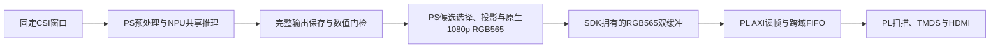

# HDMI结构、接入过程与验证边界

**现行范围（2026-10-29）：** 默认硬件已发布为 `probe-free-drain-filter-v1`，当前 180-query 主链及双输入已有限实板运行；接口与源码以[现行技术说明](../../ADR/TechDetails.md)、[核心目录](../../software/pose180_pipeline/src/README.md)为准。本页保留 r53 及更早诊断链，图中的完整归档／数值门不是现行演示阻塞条件。设备、备份与未验收边界见 [RESUME](RESUME.md)。

历史更新：2026-10-24。r45合格硬件已复用于有限启动消费、r47直接RGB565及r53单SDK线程流水调度。r53健康启动短样本29.521Hz、187次采纳后因首次索引内容混合停止；原BOOT已恢复，联合长期和持续实屏未通过。[r53 当时实测/恢复](../../tools/pose-v1/evidence/hdmi-pipeline-20261024-r53/RESULTS.md)。

本页区分当时诊断候选与早期三窗应用。历史原值不回写，当前授权/次数只见[RESUME](RESUME.md)，源码合并不表示候选已替换正式默认链路。

## 分工与数据流

按[ADR_49](../../ADR/ADR_49.md)，PS＋NPU感知，PL本地HDMI，PC独立3D展示；新HDMI应用未启动VPU／RTSP，旧演示源码保留。

当前候选复用demo_v1的完整归档/数值门后显示；r47已取消旧720p整幅放大/格式转换，PS直接绘制1080p RGB565。PL负责读帧、时序、TMDS与安全换帧/停止。无HDMI实时PC链已完成52,800窗有界验证；HDMI联合长期未通过，见[独立PC链范围](../../demo_v1/RESULTS.md)。

## 源码与最小接口

| 层 | 源码入口 | 职责及所有权 |
|---|---|---|
| 当前流水诊断应用 | [r53 main.cpp](diagnostics/native_rgb565_r53/joint/main.cpp) | 同一SDK线程推理与begin/poll采纳；最多一帧在途、末帧单独排空，未通过长期 |
| PS原生绘图 | [hdmi_renderer.cpp](../../software/pose180_pipeline/src/display/hdmi_renderer.cpp)、[hdmi_renderer.hpp](../../software/pose180_pipeline/src/display/hdmi_renderer.hpp) | 直接1920×1080 RGB565LE；静态准备/动态绘制分离，扩大视口但骨架/标注物理大小保持 |
| 当前SDK显示适配 | [r53 hdmi_output.cpp](diagnostics/native_rgb565_r53/display/hdmi_output.cpp)、[采纳状态](diagnostics/native_rgb565_r53/display/adoption_state.hpp) | 同一Device分配/写帧/CSR；严格ID/地址/pending及200ms门，独立STOP证明后释放 |
| 历史三窗应用与转换 | [software/hdmi_demo/main.cpp](../../software/hdmi_demo/main.cpp)、[skeleton_render.cpp](../../software/core/display/skeleton_render.cpp)、[hdmi_canvas.cpp](../../software/core/display/hdmi_canvas.cpp) | 保留旧720p RGB24→1080p RGB565路径及既有三窗边界，不作为r53最新软件入口 |
| CSR与板级集成 | [hdmi_cam_router.sv](rtl/integration/hdmi_cam_router.sv)、[hdmi_board.sv](rtl/integration/hdmi_board.sv) | 保留原SDK低地址，显式译码HDMI窗口；静态图案、PLL与像素计数辅助观测 |
| 命令与控制 | [hdmi_register_bank.v](rtl/hdmi_register_bank.v)、[hdmi_command_mailbox.v](rtl/hdmi_command_mailbox.v)、[hdmi_scan_control.v](rtl/hdmi_scan_control.v) | CSR／mem域握手、帧边界采纳和停止；命令入队不等于地址已采用 |
| 读帧与扫描 | [hdmi_axi_read.v](rtl/hdmi_axi_read.v)、[hdmi_stream_fifo.v](rtl/hdmi_stream_fifo.v)、[hdmi_pixel_scan.v](rtl/hdmi_pixel_scan.v) | 单笔在途只读、按4KiB边界拆分、64位到16位FIFO、同步扫描；顶层[hdmi_scanout.v](rtl/hdmi_scanout.v) |
| 时钟与TMDS | [hdmi_clock_jfm.v](rtl/integration/hdmi_clock_jfm.v)、[uihdmitx.v](rtl/display/uihdmitx.v) | 100MHz参考经适配PLL生成148.5／742.5MHz，使用原厂适配物理输出路径 |
| 隔离诊断 | [software](software)、[diagnostics](diagnostics)、[sim](sim) | CSR／AXI被动观测、无SDK父进程、SDK加载／Open子进程和定向仿真，不替换正式推理算法 |

原生PS/PL诊断顶层及同启动消费控制见[r45硬件源码](diagnostics/deferred_consume_r45/sources)，消费器见[hp2_startup_drain.sv](diagnostics/deferred_consume_r45/sources/hp2_startup_drain.sv)，TMDS仍为上表uihdmitx.v。

上表给出可维护模块入口；r9对reader边界谓词的时序优化在隔离发布副本中完成。复用实际r9必须核对其原始包和发布来源，不能仅按仓库同名文件重建并宣称逐位相同。工具与产物边界见下节。

## 互联、寄存器与帧契约

r9实际HP2互联为S00接AI的HC2、S01接HDMI，返回PS RID为6位；来源识别与原ID必须一起经过返回流水线。AI桥实际ARID固定0，综合可能合法裁去未使用位，不能用脱离物理边界的网表仿真推断截断。旧相机写通道保留独立所有权，不把两个AR／R驱动直接并接，也不把旧display_en当作新显示START／STOP。静态核对与有限仿真未发现直接错线，但不能证明跨启动运行正确。

- HDMI CSR为`0x400b0000–0x400b00ff`，先验证`0x48444d01`／`0x48445301`双ABI及时钟契约。该地址只适用于已核验候选，不向原BOOT假定寄存器存在。r9被动读观测窗另在`0x400b0400`，ABI为`0x41495201`、快照104字，详见[观测协议](software/AI-READ-MONITOR.md)。
- GP0原cam窗口存在高地址别名，候选用独立router显式译码并保留低地址功能。mna_gp_ww无WSTRB，按对齐完整32位写及write_ready握手处理；AXI-Lite的AW／W不得假定同周期到达。
- 每帧4,147,200字节；双帧共8,294,400字节，由同一SDK设备实际分配、64字节对齐并核对范围。地址不硬编码，不与模型资源重叠，也不跨进程借用分配器。
- 当前`begin_show/poll_show`（历史阻塞`show`兼容）使用新命令响应及匹配帧ID／地址、pending清零的快照确认采纳，预算从START/FLIP应答返回后起200ms；迟到匹配仍拒绝。旧帧需确认不再被当前或待采纳地址引用才可复用。
- `close`预算500ms，必须取得新响应、匹配停止ID、safe_idle且在途位清零后释放。已发布ARVALID不能撤回；读完成仅按RVALID&&RREADY，STOP可丢弃返回数据以排空，像素时钟停止也不能阻止排空。ready、零计数或缓存同步均不能代替该证明。
- mem／pixel域间FIFO为512×64位，即4096字节；1920×1080、2200×1125总时序，正极性HS44／VS5。STOP后保持同步输出黑色。1080p60 RGB565有效像素读带宽为248,832,000字节／秒，满FIFO消费余量约13.79µs；两者都是配置计算，不是DDR最坏服务延迟保证。
- CSR／mem／pixel复位须与AXI子系统协调，异步置位、各域同步释放；局部复位不能伪造读完成。FIFO flush仅在safe_idle后发生；STOP不复位扫描计数器。PLL失锁不能维持有效TMDS，不宣称失锁时画面仍稳定。已证正确SW6清零观测器，但故障下按后返回仍异常；其它域的实际复位覆盖及PS侧状态仍属D45待验证项。
- Gray指针采用两级同步，还须按实际源时钟周期限制到第一级的最大延时及位间偏斜；72位命令／160位响应邮箱依赖稳定保持与toggle握手，数据路径分别以mem／CSR采样窗口约束。不能只设全域false_path就宣称CDC通过；同步链、跨域CE和复位恢复／移除须结合布局后结果核对。
- 静态PLL／像素计数与显示器可见画面，不替代TMDS完整电气合规、连续带宽或长期稳定性验收。

## 开发过程与实际结果

| 阶段 | 开发／处理 | 已取得结果与限制 |
|---|---|---|
| 原显示问题隔离 | 参考RTL仿真发现200MHz扫描、未按RREADY判读完成、停止消费可能卡读；建立独立时钟、AXI读帧、换帧／STOP模块 | 完整1080p地址／像素、背压、跨4KiB及停像素时钟后排空的有限仿真通过；参考源码风险不直接等于原BOOT现场根因 |
| TMDS与原厂工具适配 | 时钟序列器字符串改为显式`10'b1111100000`；核对F8／AC14／差分引脚；从不匹配的通用PCPU7导入转到获准的Vivado2018.3＋030ai／JFM与Procise后处理 | Lite目标模型时钟占空比20%→50%；扩展PS前端、完整系统及原厂位流流程闭合。2019.1或通用Xilinx假设不能直接替代适配流程 |
| 静态与DDR显示 | 静态色条、实际SDK双帧内存对照、两幅四色图案、三份真实历史骨架；建立采纳与STOP／释放证据 | 用户确认可见且切换正常，实际RGB565曾与本机重建逐位一致；首次START fault2仍按D44保留 |
| 时序与r9发布 | reader边界谓词等价缩短，1,048,576组合及有限状态机比较；复用检查点并完成实际实现与复核 | r9 setup／hold余量+0.030／+0.023ns，TNS／THS=0；原AI两个Min Period例外仍在，**raw_timing_pass仍false**，不能称全部原始时序零例外通过 |
| AI路径与新推理联动 | 同r9分段观测、Open前健康门、64B／4KiB／64KiB／1MiB完整DMA门检，随后固定共享模型三窗 | r13四档和3次新推理／3帧采纳、STOP与Engine销毁通过，用户确认FRAME 1000000→1000001→1000002；VPU／RTSP均未启动 |
| 跨启动排查 | r14–r22复用同r9，分离纯CSR、库加载／Open，并纠正SW6后做故障复位对照；核对实际r9网表 | r22在Open前捕获异常；正确SW6清零CSR，按后返回仍异常。需补启动期及实际复位见证，D45未解决，见[当前难点](../../DIFFICULTIES.md) |
| 启动记录补证 | r23增加跨本地复位保持的首事件／累计握手及GP／HP2复位见证；保持旧104字接口，完成仿真、增量实现和实际bit／BOOT | 原有切路径范围已收紧并通过物理检查；实板捕获无SDK故障和SW6未触发HP2互联复位，原BOOT已恢复。实际生成IP的停钟／DDR就绪门对照仿真通过，根因及修正效果仍待实板；[结果](../../tools/pose-v1/evidence/hdmi-boot-witness-20261019-r23/PLAN.md)、[协议](diagnostics/README.md#r23启动历史与复位见证) |
| 复位就绪修正及无按键对照 | r24使HP2原复位IP等待DDR就绪，完成实际时序／位流及SW6／按后Open；r25不重编、同BOOT直接做启动观测 | r25第1次在实际PL互联复位已发生时于SDK前复现，取消后续样本并回原BOOT；重点转向PS端复位／FIFO及两侧释放先后，[完整结果](../../tools/pose-v1/evidence/hdmi-startup-stability-20261020-r25/PLAN.md) |

r27～r53补充：源端隔离后仍故障；双窗口真实采样及原生协议检查捕获AR=0时的早期返回。r45完整布线setup +0.030ns、hold +0.012ns、TNS/THS=0、内部未约束端点0；保留原AI两项Min Period例外，raw_timing_pass=false，没有新增例外。[物理结果](../../tools/pose-v1/evidence/hp2-deferred-consume-20261024-r45/RESULTS.md)。r46/r52同启动消费16拍并保留报警，r52完成90次有限业务；r47/r51/r53的软件收益和失败分别见[当前结果](../../tools/pose-v1/evidence/hdmi-pipeline-20261024-r53/RESULTS.md)。

相关难点、处理是否奏效及剩余假设统一放在[DIFFICULTIES.md](../../DIFFICULTIES.md)，阶段交付放在[Done.md](../../Done.md)。不把故障后来未复现写成根因修复。

r26当时对原厂适配与实际DCP的复核发现FIFO名引脚已复用NPU数据、对外计数为常量，随后增加真实PS／PL释放顺序的被动记录；可入库的源码、约束、构建命令及当时物理对应关系见[r26基线快照](baselines/ps_release_r26/README.md)。

r24实际布线检查点的全局／层级资源、物理共享Slice和冗余候选已完成只读审计，见[资源报告](R24-RESOURCE-AUDIT.md)。只统计、不删模块；后续阶段结果见当前恢复入口。

## 工具、产物与证据位置

执行位置为Windows `D:/FPGACompetitionProject`；当前实际系统构建使用Vivado2018.3＋原厂030ai／JFM适配及Procise2025.1.1 temp/SVN32494后处理，FPAI容器承担ARM64 GCC9.4／CMake3.24.2交叉编译，SDK／Icraft3.39.0。2019.1用于此前辅助仿真，不能据此迁移整机IP。固定模型、RAW、数学、Gather注册、NPU分配和帧协议保持。

- [r9候选与发布规格](CANDIDATE-BOARD-READ-R9.md)保留该包的时序、位流与BOOT身份；其中早期失败结果只代表r9首次执行，不覆盖后续r13通过。实际[离线发布文件](../../tools/pose-v1/evidence/hdmi-live-20261018-r9/controlled-startup-read-v3-execution-r9)仍在位，旧包次数均不恢复。
- [r13 verification.tar](../../tools/pose-v1/evidence/hdmi-preopen-20261018-r13/verification.tar)：`run/metadata/full-dma-review.json`为四档完整比较，`run/shared/inference/frames.jsonl`为每窗门检，`run/shared/inference/summary.json`为3次新推理、3帧采纳与释放；[closure.tar](../../tools/pose-v1/evidence/hdmi-preopen-20261018-r13/closure.tar)保存回退。
- [近期暂停汇报](STARTUP-PAUSE-REPORT-20261018.md)链接r14–r20实际报告、按键原值与最终原BOOT审计。[耗时报告](TIME-REPORT-20261018.md)保留上一轮4小时38分41秒的统计口径。

部分早期独立REPORT.md已不在当前证据目录，不能继续当作可读报告或补造为原文；保留的源码、原始归档及本次整理前文档各自注明范围。[文档修订记录](../../tools/pose-v1/evidence/hdmi-documents-20261018-r1/revision.json)及同目录before.tar保留本次整理前原文。

当前阻塞为D47首读内容混合、D44/持续实屏、D45启动根因及联合长期。r53已安全回原BOOT并关闭，当前没有新的板测额度；本次只整理文档和合并成果，旧DATA独立暂停。以上为 r53 当时结论，原值与判读边界见[r53](../../tools/pose-v1/evidence/hdmi-pipeline-20261024-r53/RESULTS.md)；现行保留事项统一见[后续验证与冻结范围](../../DIFFICULTIES.md#后续验证与冻结范围)。
