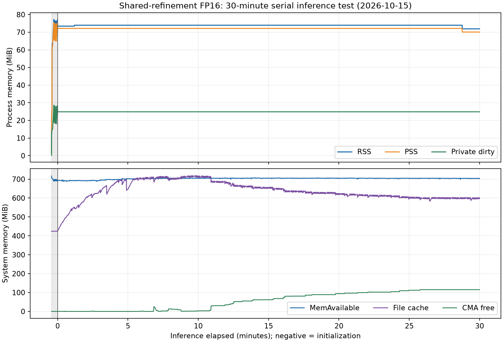
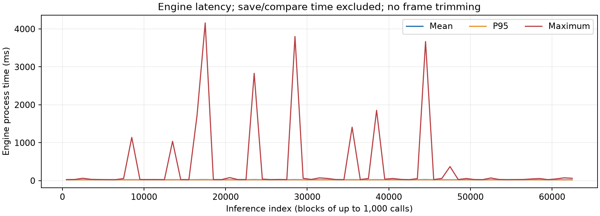

# 共享细化新包板端验证与30分钟压力测试

日期：2026-10-15。**完成原编译包三窗、30秒/1131次及30分钟/62,945次连续推理，数值和内存稳定性观察通过，未观察到崩溃或SDK异常。时延仍有长尾：11次超过1秒，最大4.158秒。** 全部实际输入/输出已回传并按SHA和现行数值规则独立复核；结论限三个冻结来源的串行循环，不称最坏时延或整机长期稳定性通过。

## 范围、预算与前置条件

用户要求推包、检查新代码崩溃／内存泄漏后开展长测，明确选择“30分钟连续满速推理”；r1观测器兼容失败后，又明确允许修复后按原预算继续。原失败不覆盖，授权见[restart-authorization.json](restart-authorization.json)。

执行位置为Windows `D:/FPGACompetitionProject`、已有FPAI/GCC9.4交叉编译容器及Lite `192.168.126.49`。新板端目录 `/tmp/wifi-pose-shared-stability-20261015-r2`。ZG330、SDK3.39.0、原BOOT／内核／模型保持，无重启、主动规整、drop_caches或系统参数修改。SSH固定主机密钥，认证只经内存助手，不在命令／环境变量／日志中保存密码。

| 阶段 | 实际对象 | 推理预算／子进程及观察循环墙钟上限 |
|---|---|---|
| basic | 上轮已编译、SHA不变的`pose_shared_timing`，新Session | 3窗各一次；160秒 |
| short | 复用同一核心的常驻测试入口`pose_shared_resident`，新Session | 连续30秒，最多3000次；140秒 |
| stress | 同一个常驻入口，独立新Session，仅短测审查通过后放行 | 连续1800秒，最多90000次；1940秒 |

每次完整保存10800输入、100分数和4200姿态FP32，再执行门禁；三类数据流共60400字节／调用，最大原始数据5,436,000,000字节。循环仅重复308／309／310三个冻结CSI来源，调用数不能当作独立新姿态／数据集样本数。无人工推理间隔，连续串行提交；不叠加VPU／TCP／RTSP或整机视频负载。

上述墙钟上限约束推理子进程和其活动观察循环；结束后的身份复核、全文件哈希、压缩及回传另行计时，不延长实际推理时长。

数值门禁是ADR_48现行v2：输入／全部分数逐位，所有候选有限，仅score>0.2检查关节三维误差≤3mm。每次实际完成计数必须612、Host／ZG回调各5。SDK／索引／身份／非有限值／数值超限／内核日志变化／超时立即保存停止，不自动重试。资源安全边界为RSS512MiB、暖机后RSS增长64MiB、MemAvailable至少96MiB、磁盘空闲至少2GiB，FD增长16、线程增长8；初始化100秒或推理进度停滞20秒也停止。异常退出的强制清理与优雅Engine销毁分别记录。

## 入口与观测实现

原编译包二进制SHA256：`4c01c92cca92e5d76f427e121fa5c770f61dff3de49a26a75bf3d3fe20351070`，从上一轮原样推送。新增常驻入口只接入该独立包的同一核心与同一门检，不包含其他功能cpp，不修改正式核心。

时间线、复制元数据和tensor identity常规记录限前三帧；每次调用的Host异常原值、存储身份和两轮公开SDK源读取仍保留原路径／字节上限。未人为触发CPU异常，不能称该异常分支通过。固定向量上限不提升、不让正常诊断随调用次数增长；完整实际输入／输出流和逐帧结果直接落盘。

独立控制器每0.5秒采集进程RSS／PSS／Private_Dirty、FD、线程、映射数及系统meminfo／磁盘，每5秒检查内核日志。r1缺失的可选children接口在r2明确记录“不支持”，不替代RSS/PSS；退出清理由已拥有的进程组承担。4项观测器兼容检查通过。压力阶段另每43秒只读轮询进度、资源及标准公开温度／频率接口；当前无thermal节点，温度数据不可用，不据此声称无温升。

完整原值、配置、脚本和编译日志见r1/r2证据目录；原始编译包、常驻编译包和所有模型身份均在[package.json](package.json)。其`status`是生成时快照，不回写以伪造当时状态，最新执行以本报告和实际阶段清单为准。

## 已完成验证

basic三次全部通过，全部实际输入和分数逐位、所有输出有限、受检最大关节差≤0.9765625mm，Engine均值23.55019ms，峰值RSS78,724KiB；正常退出、SDK／BOOT／内核同，无本批遗留进程。它不是独立长期无泄漏证明。详情[basic-analysis.json](basic-analysis.json)。

short实际30.00907秒、**1131次推理**全部通过，正常Engine销毁。暖机10秒后39个采样点：

| 观测项 | 起段中位数 | 末段中位数 | 稳态范围 |
|---|---:|---:|---|
| RSS KiB | 69036 | 69036 | 69036–69036 |
| PSS KiB | 67873 | 67873 | 67873–67873 |
| Private_Dirty KiB | 19532 | 19532 | 19532–19532 |
| FD | 13 | 13 | 13–13 |
| 线程 | 3 | 3 | 3–3 |
| 内存映射 | 86 | 86 | 86–86 |

常规复制诊断只有12条，均属前三帧；1131次完整输入／输出全部独立核验。Engine均值22.97453ms、P95 23.46747ms、最大29.31241ms；这些是处理函数时间，不包括原值落盘／数值比较。短测未观察到内存／句柄持续增长，满足放行长测条件。详情[short-analysis.json](short-analysis.json)、[short-reviewed.json](short-reviewed.json)。

## 30分钟压力测试结果

初始化完成后实际连续运行 **1800.014676秒**，完成并保存 **62,945次**，达到原1800秒时长，未触及90000次上限。含初始化/前后核验的控制器活动耗时1838.161016秒；退出后哈希、归档和回传不计推理时长。没有负载失败重试、延长测试或追加压力阶段。原生进程和控制器均exit0，Engine正常销毁；内核日志前后逐字节相同，SDK/BOOT身份不变、FPGA operating，最终本批进程全部结束。

独立复核了全部 **3,801,878,000字节**实际流：输入2,719,224,000字节、分数25,178,000字节、姿态1,057,476,000字节，逐文件SHA与板端清单一致。每次输入/全部100分数逐位冻结参考，所有候选有限；score>0.2的同槽14关节最大三维偏差 **0.976562500mm**，符合3mm上限。背景全量仍保存，所有槽最大关节差5.524271728mm；累计20,981个背景关节比较超过3mm，按用户授权仅诊断，不改原值。相同共享图重复同一输入时，相对该来源首次输出的姿态字节变化帧数为0，最大单坐标差0.000000000mm。

SDK融合成员独立核实1021个HardOp完整且唯一覆盖五ZG组，最终连续同步层数612；每次实际完成612，Host/ZG回调各5。常规复制元数据12条、tensor identity记录24条、时间线121条，均限初始化和前三帧，未随62945次线性积累；异常Host原值/两次SDK晚源路径保留，但本轮没有触发，不能称异常分支已实测。

### 内存、句柄与退出释放

共3367个资源采样点，暖机30秒后3257点。下表起/末为各5点中位数，范围为全部稳态采样。

| 项目 | 起段 | 末段 | 稳态最小–最大 | 变化 |
|---|---:|---:|---:|---:|
| RSS KiB | 75204 | 73628 | 73628–75736 | -1576 |
| PSS KiB | 73887 | 71779 | 71776–73890 | -2108 |
| Private_Dirty KiB | 25480 | 25480 | 25480–25480 | +0 |
| VmData KiB | 51160 | 51160 | 51160–51160 | +0 |
| VmSize KiB | 467816 | 467816 | 467816–467816 | +0 |
| FD | 13 | 13 | 13–13 | +0 |
| 线程 | 3 | 3 | 3–3 | +0 |
| 映射 | 86 | 86 | 86–86 | +0 |

PSS拟合斜率-17.604584KiB/min，Private_Dirty与VmData无增长，满足预定筛查：RSS/PSS/VmData中位增长≤8MiB、PSS斜率≤64KiB/min、FD末段≤起段+1、线程不增、映射≤起段+2。峰值RSS 79,088KiB，最低MemAvailable 703,732KiB。此负载下**未观察到持续内存泄漏迹象**；不同进程间的绝对RSS差不能用来判断泄漏。

退出前后系统CmaFree为144→117,968KiB，MemAvailable为735,756→745,324KiB。CMA空闲数受可回收文件页影响，不能仅凭该数推断分配所有权；正常Engine销毁、无本批进程、驱动无新增错误一并核验。未清缓存、主动规整、重启或更改系统配置。[释放记录](final-resource-release.json)、[最终清理审查](final-cleanup-review.json)。

### 各阶段耗时

| 每次调用阶段 | 均值ms | 中位ms | P95 ms | 最大ms |
|---|---:|---:|---:|---:|
| Engine完整process | 23.278220 | 22.742500 | 23.451264 | 4158.130990 |
| PS预处理 | 5.628029 | 5.610040 | 5.668314 | 36.036070 |
| Session.forward | 15.545992 | 15.034140 | 15.671390 | 4150.521650 |
| 末端等待 | 0.764550 | 0.782920 | 0.792330 | 8.914110 |
| 最终输出读取 | 1.006434 | 0.988360 | 1.056698 | 5.427940 |

包含完整原值保存、数值比较和循环开销的实际提交速率 **34.969159次/秒**。Engine处理函数时间不包括外部保存/比较；forward包含回调等嵌套区间，各项不能直接相加当总耗时，未调用此前有负值的SDK getLayerTime。此为连续串行、保留证据的压力负载，不能等同无日志理论NPU吞吐或VPU/TCP整机吞吐。

**时延长尾单列为未解决项（D41）**：35次>50ms、12次>100ms、11次>1000ms；P99 24.494967ms，P99.9 30.663709ms，P99.99 1569.181700ms。最大inv17191（0起）process4158.13099ms，其中forward4150.52165ms，而进程CPU时间仅20.177ms，保存0.28621ms、比较0.19545ms；尖峰不在该帧外部保存/比较区间，不能归为NPU纯算术耗时。所有尖峰仍数值通过，未触及20秒进度停滞停止线；原规则的运行完成不等于满足实时最坏时延。

系统累计出现movable分配停顿65次、major fault296次、后台/直接页回收，标准CMA空闲采样0–117968KiB，提示系统内存回收环境有变化；目前只保存了聚合vmstat与稀疏采样，**不能据此认定页回收、文件落盘、SDK调度或NPU为根因**。未追加定位负载或自动延长压力测试。完整前20个尖峰与邻近资源诊断见[latency-tail-analysis.json](latency-tail-analysis.json)。

### 原失败、归档恢复与适用边界

r1首次因可选/proc children接口缺失被观测器中止，未完成帧；原失败、强制清理和日志完整保留在[原报告](../shared-stability-20261015-r1/REPORT.md)。r2仅修复观测器兼容，两个ARM二进制不改，经用户明确“允许按原预算继续”后新目录/新Session执行。

推理结束后，3.80GB原值的xz压缩超过一次SSH助手180秒超时；只读确认原归档进程仍在工作，继续监测同一进程，完成后取回现有文件并安全解压、全量SHA复核。**未重跑推理、未重建或覆盖原归档**。该传输管理超时不计为NPU运行故障，但保留错误和恢复证据：[archive-return-recovery.json](archive-return-recovery.json)、`12-archive-status.txt`及`archive-watch-*.txt`。板端时钟与主机日期不同，归档时间戳不当作实际日期；1800秒预算依据单调时钟。

最终只读审查第一次直接SSH执行dmesg，将原启动日志版权符号UTF-8显示为字面\xc2\xa9，触发字节比较断言。采用与原控制器完全相同的Python subprocess.check_output捕获后，完整字节与结束时日志一致；差异仅该显示转义，未新增内核消息。首次断言及两份原日志均保留，见[final-cleanup-review.json](final-cleanup-review.json)。

本次只有三个冻结输入重复运行，无新增数据集准确率评估、首次冷启动保证、VPU/视频/TCP叠加或热稳定性验收；标准温度/频率节点不可用，温度未知。有限30分钟不能证明任意输入/异常路径/无限期运行绝对无泄漏，也不解除旧DATA调查暂停。正式演示/旧模型未替换，所有本批连接/子进程结束，FPAI已恢复停止。

完整结论以[stress-analysis.json](stress-analysis.json)、[逐帧记录](returned-stress/run-stress/results/frames.jsonl)、[资源采样](returned-stress/run-stress/resources.jsonl)、[控制器退出](returned-stress/run-stress/controller-summary.json)和[板端全文件SHA](returned-stress/run-stress/evidence-files.json)为准。原值位于同目录results的inputs.f32/scores.f32/poses.f32，压缩归档保留stress.tar.xz。源码冻结归档和交叉编译日志保留于r1证据目录；最终交付身份见[completion-review.json](completion-review.json)。
